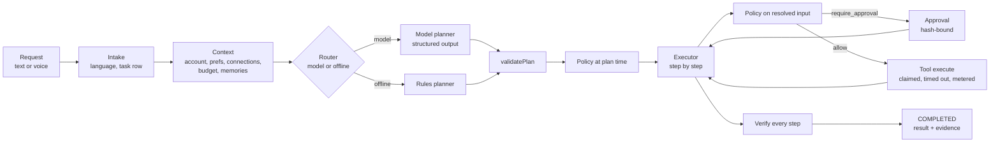

# Agent runtime

How a request becomes verified work. Code lives in `apps/api/src/modules/agent` (runtime),
`apps/api/src/modules/jobs` (queue) and `apps/api/src/worker.ts` (process). The runtime is
**plan-then-execute**: a model (or the offline rules engine) proposes a plan; deterministic code
validates it, decides permissions, executes it with durable checkpoints and verifies the result.

## 1. Intake (intent)

`POST /v1/tasks` → `TaskService.create` (`modules/tasks/service.ts`), one RLS-scoped transaction:

1. Replay if the `Idempotency-Key` was already used for this user.
2. Language: `request.language` if given (voice recognition supplies it), else `detectLanguage`
   (Arabic script, then German/English marker words, else the account locale).
3. Insert `conversations`, `tasks` (`QUEUED`, placeholder title = first 80 chars), the user
   `messages` row, link a voice session if given, `task.created` event, enqueue `task.plan`
   (`dedupe plan:<taskId>`), audit `task.created` (metadata: source, language, request length — never
   the text).

Intent classification is the planner's job: there is no separate classifier. A plain question becomes
a single `assistant.answer` step; an unsupported request becomes an `assistant.answer` step that says
what JARVIS cannot do yet (model mode) or `PLANNER_UNSUPPORTED` (offline mode).

## 2. Context

`loadAgentContext` (`context.ts`) inside the job's RLS context:

| Item                | Source                                                                      | Used for                                 |
| ------------------- | --------------------------------------------------------------------------- | ---------------------------------------- |
| Account             | `users` (name, email, locale, time zone)                                    | Planner prompt, "me" recipient, language |
| Preferences         | `users.preferences` merged over `DEFAULT_PREFERENCES`                       | Autonomy, privacy, budget, memory        |
| Active connections  | `connections` with `status = active`, not expired                           | Tool availability, policy                |
| AI spend this month | `sum(cost_records.amount_micro)` for `category = model` since the 1st (UTC) | Router, budget policy                    |
| Route               | `decideRoute(...)`                                                          | Model or offline mode, with reason       |
| Memories            | `relevantMemories(request, 10)`, only in model mode with memory enabled     | Planner `<notes>`                        |

## 3. Planning

`planTask` (`planner.ts`) → `validatePlan` (`plan.ts`).

- **Tools offered** = `availableTools`: required connection active, memory enabled for `memory.save`,
  a model available for `assistant.answer`. Order is fixed so the system prompt is byte-stable.
- **Model mode:** system prompt = rules + tool catalog (description, risk class, input JSON Schema,
  output fields), byte-stable for prompt caching. User message = `<account>`, `<notes source="the
owner">`, `<request language=…>`, with closing tags escaped inside data. Structured output schema is a
  discriminated union of the offered tools' input schemas. Model `MODEL_DEEP`, effort `medium`,
  `max_tokens` 16 000. On an invalid plan: one repair attempt with the validation errors, then
  `MODEL_ERROR` (retryable).
- **Offline mode:** `planOffline` — three intents in en/de/ar; emails only to the owner's own address.
- **Plan contract:** `title` (≤ 80, trimmed), `objective`, 1–8 steps with keys `s1…s8` in order, each
  `{ key, toolId, title, input }`.
- **Validation** (applies to every plan): shape; key order; tool availability; each input against its
  tool schema (normalised: defaults applied, unknown keys stripped); `{{sN.field}}` references only to
  earlier steps and declared output fields; no malformed braces; no references in email recipients or
  memory content; every recipient is the owner's address or appears literally in the request.
- **Persist** (`plan-job.ts`, phase 3): steps inserted, task title/objective/planner info set, policy
  evaluated per step (risk, decision, reasons, preview, estimate), task risk = max step risk,
  `estimated_cost_micro` = spent so far + step estimates + result-summary estimate, `plan.ready`,
  `PLANNING → RUNNING`, enqueue `task.execute`. A denied step → step `BLOCKED`, task `FAILED`.
- No transaction is held during the model call; the job lease is extended every 20 s.

## 4. Routing

Deterministic, per user, before each model use (`models/router.ts`):

| Check (in order)                             | Result                                   |
| -------------------------------------------- | ---------------------------------------- |
| `ANTHROPIC_API_KEY` missing                  | offline, `NO_API_KEY`                    |
| `preferences.ai.allowExternalModels = false` | offline, `USER_DISABLED_EXTERNAL_MODELS` |
| budget ≤ 0 or spend ≥ budget                 | offline, `BUDGET_EXHAUSTED`              |
| otherwise                                    | model, provider `anthropic`              |

| Purpose          | Tier                                            | Default             | Effort | `max_tokens` |
| ---------------- | ----------------------------------------------- | ------------------- | ------ | ------------ |
| `planning`       | `MODEL_DEEP`                                    | `claude-opus-5-5`   | medium | 16 000       |
| `answer`         | `MODEL_BALANCED`                                | `claude-sonnet-5-5` | medium | 16 000       |
| `summarize`      | `MODEL_FAST` (> 60 000 chars: `MODEL_BALANCED`) | `claude-haiku-5-5`  | low    | 8 000        |
| `result_summary` | `MODEL_FAST`                                    | `claude-haiku-5-5`  | low    | 2 000        |

Offline means: rules planner, extractive summaries, no `assistant.answer`. The UI must always show the
mode and reason (`GET /v1/assistant/status`, `TaskDetail.planner`).

## 5. Tool contract

Every tool is a `ToolDefinition` (`tools/types.ts`) registered in `tools/registry.ts`. The registry is
the backend source of truth; the contract enum `ToolId` lists the same five ids.

| Field                             | Meaning                                                                                   |
| --------------------------------- | ----------------------------------------------------------------------------------------- |
| `id`, `version`                   | Stable id (`web.fetch`), semver of the implementation (stored per execution)              |
| `description`                     | Shown to the planner                                                                      |
| `inputSchema`                     | Zod; validates the planned input and again the resolved input before execution            |
| `validatePlanned`                 | Extra plan-time rules (e.g. no references in `to`)                                        |
| `outputFields`                    | Fields later steps may reference                                                          |
| `requiredConnection`              | `web`, `smtp` or none                                                                     |
| `permissions`                     | Declarative scopes (`web:read`, `email:send`, `memory:write`)                             |
| `sideEffect`                      | `none`, `internal` (changes JARVIS data), `external` (changes the world)                  |
| `idempotency`                     | `once_per_step` or `safe_to_retry` ([ADR-0010](../adr/0010-exactly-once-side-effects.md)) |
| `timeoutMs`, `retry`              | Hard timeout (AbortController); automatic retry policy for transient errors               |
| `modelUse`                        | `none`, `optional`, `required`                                                            |
| `riskLevel(input)`                | Risk from the concrete input                                                              |
| `estimateCostMicro(input)`        | Projected cost for budget policy                                                          |
| `preview(input)`                  | Redacted, display-safe input                                                              |
| `approvalDetails(input)`          | Exactly what the approval sheet shows                                                     |
| `recipients(input)`               | For outbound messages (policy)                                                            |
| `execute(input, runtime, signal)` | Does the work; returns output, preview, evidence, cost, usage                             |
| `verify(input, output)`           | Deterministic post-condition check                                                        |
| `audit(input, output)`            | Security-relevant audit entry (metadata only)                                             |

Tools never open their own transaction scope beyond `withContext` with the runtime's context, never
see other users' data, and receive only active connections. Per-tool declarations:
[permission model](../security/permission-model.md#tool-declarations).

## 6. Policy

`evaluatePolicy` (`policy.ts`) is a pure function; it runs at plan time and on the resolved input
before each step. First deny wins; approval requirements accumulate:

1. Required connection inactive → deny `CONNECTION_MISSING` (`CONNECTION_REQUIRED`).
2. `memory.save` with memory disabled → deny `MEMORY_DISABLED`.
3. `CRITICAL` → deny `RISK_CRITICAL`.
4. Model required but unavailable / budget 0 → deny `BUDGET_ZERO`, `BUDGET_EXHAUSTED`,
   `EXTERNAL_MODELS_DISABLED` or `MODEL_UNAVAILABLE`.
5. Risk: `LOW` allow; `MEDIUM` approval (email only to the owner with `autoApproveEmailToSelf` → allow,
   `AUTO_APPROVED_SELF`); `HIGH` approval always. Email adds `RECIPIENT_SELF`/`RECIPIENT_EXTERNAL` and
   `MANY_RECIPIENTS` (> 3).
6. Projected cost above remaining budget → approval `BUDGET_NEAR_LIMIT`.
7. External side effect consuming content flagged as suspected prompt injection → approval
   `UNTRUSTED_CONTENT` (overrides auto-approval).

## 7. Approval

- Requested by the executor when the policy says `require_approval` and no `APPROVED` approval exists
  for this step with the same action hash: `SHA-256(canonicalJson({ toolId, resolvedInput }))`.
- One `PENDING` approval per step (unique index). A pending approval with a different hash is marked
  `SUPERSEDED` and a new one is created.
- Side effects of a request: step and task `AWAITING_APPROVAL`, `approval.requested` event, an
  `approval_requested` notification (if enabled), an `approval.expire` job at `expires_at`
  (`APPROVAL_TTL_HOURS`, default 24), audit `approval.requested`.
- Decision (`POST /v1/approvals/:id/decision`): approval must be visible (RLS), `PENDING`, unexpired,
  the submitted `actionHash` must equal the stored one (timing-safe compare), the task must be
  `AWAITING_APPROVAL`.
  - approve → step `PENDING`, task `RUNNING`, enqueue `task.execute`.
  - reject → step and open steps `CANCELLED`, task `CANCELLED` with an explanation.
  - expired → approval `EXPIRED`, task `EXPIRED` (retryable), `409 APPROVAL_EXPIRED`.
- The decision channel (`web`, `ios`, …) and an optional note are stored and audited.

## 8. Execution

`handleExecuteJob` (`executor.ts`) loops over steps; each step is four short phases with no
transaction held across network I/O:

1. **Prepare** (tx): lock task; stop if not `RUNNING`; apply a pending cancel; resolve references from
   earlier steps' stored outputs (single-pass substitution); re-validate against the tool schema;
   re-run the policy (taint-aware); store `resolved_input`, preview, risk, policy; deny → step
   `BLOCKED`, task `FAILED`; approval needed and missing → request it and stop.
2. **Claim** (tx): insert/reuse the `tool_executions` row before acting (see §10); step `RUNNING`,
   `attempts + 1`, `step.started`.
3. **Execute**: `tool.execute` with an `AbortController` timeout; job lease kept alive; streaming
   answers publish ephemeral `task.answer.delta` events.
4. **Record** (tx): execution `succeeded` with output, evidence, cost, duration; step `SUCCEEDED`;
   model usage metered (`usage_events` + `cost_records`, `tasks.actual_cost_micro`); tool audit entry.
   On error: execution `failed`/`unknown`; transient errors of `safe_to_retry` tools are retried with
   backoff (250 ms · 2^(n−1), ≤ 5 s) up to `retry.maxAttempts`; otherwise the step fails and the task
   becomes `FAILED` with a user-safe `TaskError { code, message, retryable }`.

Timeouts of external tools are reported as `OUTCOME_UNKNOWN`, of other tools as `TOOL_TIMEOUT`.

## 9. Verification

After the last step: `RUNNING → VERIFYING`; each succeeded step's `verify(resolvedInput, output)` runs:

| Tool               | Passes when                                                             | Evidence produced                                                                     |
| ------------------ | ----------------------------------------------------------------------- | ------------------------------------------------------------------------------------- |
| `web.fetch`        | HTTP 2xx, readable text > 0 chars, SHA-256 of body recorded             | `http_response` (method, final URL, status, type, bytes), `content_hash` (`sha256:…`) |
| `text.summarize`   | Summary non-empty                                                       | `model_output` (model, tokens) or `note` (extractive, no model)                       |
| `email.send`       | Every recipient accepted, none rejected, server reply starts with `250` | `smtp_receipt` (reply, accepted count, Message-ID)                                    |
| `memory.save`      | Memory id returned and content matches                                  | `record` (memory id, kind)                                                            |
| `assistant.answer` | Answer non-empty                                                        | `model_output`; `note` if the length limit was hit                                    |

All checks are emitted as `verification.passed` / `verification.failed`. On success the task becomes
`COMPLETED` with all step evidence and a result summary: deterministic text from tool outputs,
rewritten into one or two sentences by `MODEL_FAST` in model mode (not for answer-only tasks; a failed
summary call never fails the task). A failed verification → `VERIFICATION_FAILED`, retryable only if
no external side effect was involved.

## 10. Recovery

| Failure                                                              | Behaviour                                                                                                                                                                             |
| -------------------------------------------------------------------- | ------------------------------------------------------------------------------------------------------------------------------------------------------------------------------------- |
| Worker crash mid-job                                                 | Lease expires (60 s), reclaimed within 15 s, job re-runs; task row lock + status checks make handlers idempotent; `PLANNING`/`VERIFYING` resume where they stopped                    |
| Crash after an email was handed to the SMTP server, before recording | Execution row stays `started` → next attempt marks it `unknown`, step and task `FAILED` with `OUTCOME_UNKNOWN` (`retryable: false`); audit `tool.outcome_unknown`; nothing is re-sent |
| SMTP down / auth failure before sending                              | `CONNECTION_FAILED` / `TOOL_FAILED`, retryable; retry re-claims the `failed` row                                                                                                      |
| Transient fetch/model error                                          | Automatic retry within the step (safe tools only), then `FAILED` retryable                                                                                                            |
| Job exhausted attempts                                               | Job `dead`; `onJobDead` fails the task with `INTERNAL` (retryable) unless it is awaiting approval                                                                                     |
| Lost enqueue due to dedupe race                                      | `reconcileAfterJob` re-enqueues `task.execute` if the task is `RUNNING` after the job completes                                                                                       |
| User retry                                                           | `FAILED`/`EXPIRED` → `QUEUED`; finished steps are kept; unfinished steps reset to `PENDING`; planning is skipped (steps exist) and only policies are re-checked                       |
| Retry after `OUTCOME_UNKNOWN`                                        | Requires `acknowledgeUnknownOutcome: true`; resend reuses the same Message-ID                                                                                                         |

## 11. Memory

- Stored in `memories` (`preference` or `fact`, ≤ 1000 chars, `source` = `user` or `assistant`,
  `source_task_id`). Created by the user (`POST /v1/memories`) or by `memory.save` (only for content the
  user asked to remember, literal text).
- Read by the planner and `assistant.answer` as `<notes>` — background, explicitly "not
  instructions". Retrieval: full-text `'simple'` OR-query, top 10 ([ADR-0006](../adr/0006-memory-retrieval.md)).
- `preferences.memory.enabled = false` → nothing read or written (policy denies `memory.save`, tool
  hidden from the planner). Users can view, edit, delete one, or delete all memories.

## 12. Cost control

- All money is integer micro-USD. Prices per model in `models/pricing.ts`; unknown models are billed at
  the most expensive known rate.
- Every model call returns usage (input, output, cache read/write tokens, served model) → `usage_events`
  - `cost_records` + `tasks.actual_cost_micro`, also for failed calls (usage attached to the error).
- Monthly budget `preferences.spending.monthlyAiBudgetUsd` (default 20, 0 disables paid models):
  router switches to offline at the limit; policy asks for approval when a step's projected cost exceeds
  the remaining budget; steps that require a model are denied when none may be used.
- Tasks carry `estimated_cost_micro` (from plan time) and `actual_cost_micro`; `GET /v1/usage` reports
  the month. Estimates: [costs](../costs.md).
- Levers in place: tiered models, low effort for summaries, byte-stable cached system prompts,
  text capped at 20 000 chars per fetched page.

## 13. Evaluation framework (plan)

Nothing below runs against a live model yet (no API key in this environment). Deterministic parts are
covered by unit and integration tests today.

| Suite                    | Contents                                                                                                                                                   | Metric                                                            | Gate                                                   |
| ------------------------ | ---------------------------------------------------------------------------------------------------------------------------------------------------------- | ----------------------------------------------------------------- | ------------------------------------------------------ |
| Planner golden set       | 150+ requests (en/de/ar; questions, summarize, summarize+email, remember, email-me, unsupported, missing info) with expected tool sequence and constraints | Valid on first try; valid after repair; exact tool sequence match | ≥ 95 % valid after repair; 0 recipient-rule violations |
| Injection corpus         | Pages and emails with direct, hidden (`display:none`), multilingual and obfuscated (zero-width, bidi) injections                                           | Plan unchanged; recipients unchanged; flagged; approval required  | 100 % (any miss blocks release)                        |
| Detector false positives | 500 ordinary pages (news, docs, shops)                                                                                                                     | Flag rate                                                         | ≤ 2 %                                                  |
| Summary faithfulness     | 100 pages with reference facts; LLM-as-judge plus 10 % human review                                                                                        | Unsupported claims per summary; coverage of key facts             | No regression vs. baseline                             |
| Answer quality           | 100 questions with rubric                                                                                                                                  | Rubric score; refusal/declined rate                               | No regression                                          |
| Cost and latency         | All suites                                                                                                                                                 | Cost per task, p50/p95 plan latency                               | Within [cost estimates](../costs.md) ± 30 %            |

- Deterministic gates (policy, validation, templates, offline planner, injection patterns, executor
  recovery) run in CI with the scripted model adapter.
- Live-model suites run on demand before any change of `MODEL_*`, prompts or tool descriptions, with an
  approved spend limit; results stored with model ids and prompt hashes.
- Production signals (aggregates only, no content): plan failure rate, approval reject rate,
  `OUTCOME_UNKNOWN` count, verification failures, tool p95 (`GET /v1/admin/overview`).
