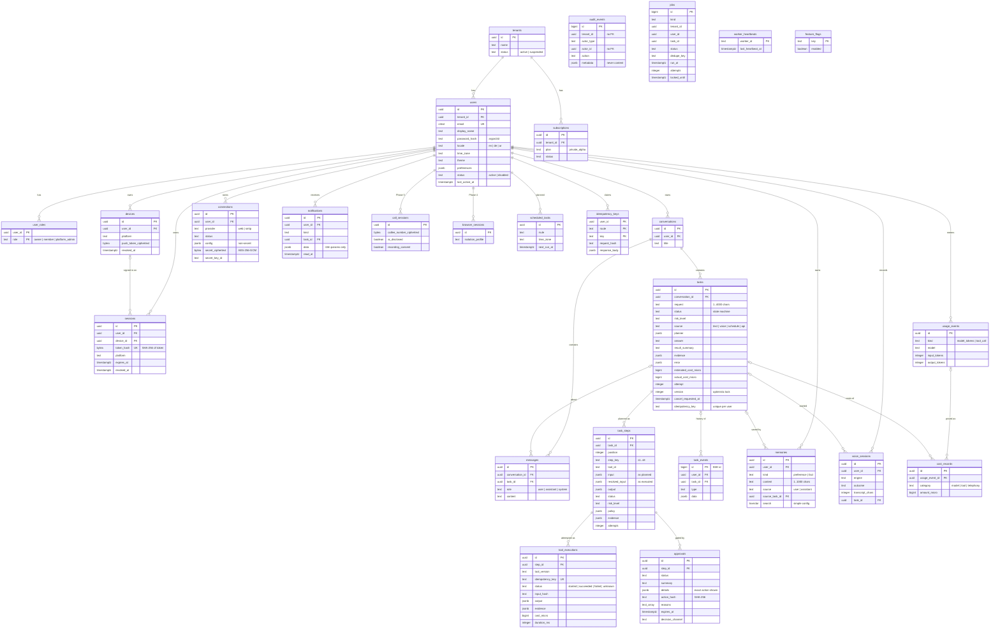
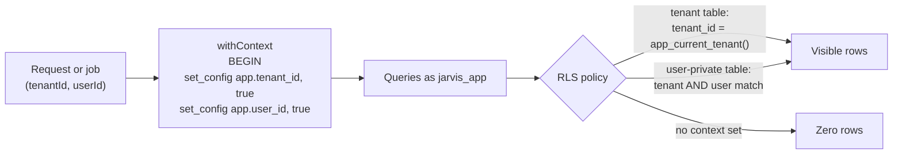

# Data model

Source of truth: `db/migrations/0001_init.sql` (PostgreSQL 16; extensions `citext`, `pgcrypto`,
`pg_trgm`). Kysely row types: `apps/api/src/db/types.ts`. Every timestamp is `timestamptz`; every id is
a `uuid` (`gen_random_uuid()`) except the append-only logs and the job queue (`bigserial`). Money is
integer micro-USD (`bigint`).

## 1. Entity-relationship diagram

Every user-private table also has `tenant_id → tenants.id ON DELETE CASCADE`; those edges are omitted
for readability.



### Tables by purpose

| Group                            | Tables                                                                                                | Notes                                                              |
| -------------------------------- | ----------------------------------------------------------------------------------------------------- | ------------------------------------------------------------------ |
| Identity                         | `tenants`, `users`, `user_roles`, `devices`, `sessions`                                               | Email is `citext`, globally unique. Tokens stored only as SHA-256. |
| Work                             | `conversations`, `messages`, `tasks`, `task_steps`, `tool_executions`, `approvals`, `task_events`     | `task_events` is the append-only history and SSE replay log.       |
| Capabilities                     | `connections`, `memories`, `notifications`, `voice_sessions`                                          | One non-revoked connection per provider per user.                  |
| Reserved (unused in Milestone 1) | `call_sessions` (Phase 5), `browser_sessions` (Phase 4), `scheduled_tasks`                            | Created now so the model is complete.                              |
| Metering                         | `usage_events`, `cost_records`, `subscriptions`                                                       | `subscriptions` row created per tenant by `create-owner`.          |
| Platform                         | `audit_events`, `jobs`, `worker_heartbeats`, `feature_flags`, `idempotency_keys`, `schema_migrations` | `schema_migrations` is created by the migrator.                    |

### Notable constraints and indexes

- `tool_executions.idempotency_key UNIQUE` — the exactly-once guarantee
  ([ADR-0010](../adr/0010-exactly-once-side-effects.md)).
- `approvals_one_pending_per_step` — partial unique index: at most one `PENDING` approval per step.
- `jobs_dedupe_live_idx` — partial unique index on `dedupe_key` for `queued`/`running` jobs.
- `tasks_idempotency_idx` — unique `(user_id, idempotency_key)`.
- `connections_one_per_provider` — unique `(user_id, provider)` where `status <> 'revoked'`.
- `task_steps` unique `(task_id, position)` and `(task_id, step_key)`.
- `memories_search_idx` (GIN on `tsvector`), `memories_trgm_idx` (GIN trigram).
- `updated_at` maintained by triggers on 11 tables.
- `audit_events` has a trigger that raises on `UPDATE`/`DELETE` (append-only for every role).
- Length/enum `CHECK` constraints mirror the contract enums (status, risk, locale, provider, …).

## 2. Row-Level Security model



| Class                   | Tables                                                                                                                                                                                                                                                                                                           | Policy (`USING` and `WITH CHECK`)                                                          |
| ----------------------- | ---------------------------------------------------------------------------------------------------------------------------------------------------------------------------------------------------------------------------------------------------------------------------------------------------------------- | ------------------------------------------------------------------------------------------ |
| Tenant                  | `tenants`                                                                                                                                                                                                                                                                                                        | `id = app_current_tenant()`                                                                |
| Tenant                  | `users`, `subscriptions`                                                                                                                                                                                                                                                                                         | `tenant_id = app_current_tenant()`                                                         |
| User-private            | `user_roles`, `devices`, `sessions`, `conversations`, `tasks`, `messages`, `task_steps`, `tool_executions`, `approvals`, `task_events`, `connections`, `memories`, `notifications`, `voice_sessions`, `call_sessions`, `browser_sessions`, `scheduled_tasks`, `usage_events`, `cost_records`, `idempotency_keys` | `tenant_id = app_current_tenant() AND user_id = app_current_user()`                        |
| No RLS (infrastructure) | `jobs`, `worker_heartbeats`                                                                                                                                                                                                                                                                                      | Full DML for `jarvis_app`; job handlers re-enter `withContext(job.tenant_id, job.user_id)` |
| No RLS, insert-only     | `audit_events`                                                                                                                                                                                                                                                                                                   | `jarvis_app` has `INSERT` only; read via `admin_list_audit`                                |
| No RLS, read-only       | `feature_flags`                                                                                                                                                                                                                                                                                                  | `jarvis_app` has `SELECT` only                                                             |

Roles (created by `scripts/db-setup.sh`):

- `jarvis_owner` — owns the schema; runs migrations. As table owner it is **not** subject to RLS
  (no `FORCE ROW LEVEL SECURITY`); use it only for migrations and break-glass operations.
- `jarvis_app` — `LOGIN NOSUPERUSER NOBYPASSRLS NOCREATEDB NOCREATEROLE`; runtime role of API and
  worker; `CONNECT` on the database, no `CREATE` on `public`.

`SECURITY DEFINER` functions (fixed `search_path = public, pg_temp`, `EXECUTE` revoked from `PUBLIC`,
granted to `jarvis_app`):

| Function                             | Returns                                                                       | Used by                      |
| ------------------------------------ | ----------------------------------------------------------------------------- | ---------------------------- |
| `auth_find_login(email)`             | user id, tenant id, password hash, status                                     | `POST /v1/auth/login`        |
| `auth_resolve_session(token_hash)`   | session, user, tenant, expiry, platform (active, unexpired, user active)      | Auth hook, every request     |
| `auth_user_roles(user_id)`           | roles array                                                                   | `platform_admin` route guard |
| `admin_overview()`                   | counts, tasks by status, queue depth, 30-day cost, tool reliability (p50/p95) | `GET /v1/admin/overview`     |
| `admin_list_users(limit, before)`    | id, email, tenant name, roles, status, dates, task count (≤ 100)              | `GET /v1/admin/users`        |
| `admin_list_audit(limit, before_id)` | audit rows without `metadata` (≤ 200)                                         | `GET /v1/admin/audit`        |

Verified by `apps/api/test/integration/rls.int.test.ts` against a real database.

## 3. Retention policy (proposal)

Not implemented: Milestone 1 has **no automatic purge jobs**. Data stays until the user deletes it or
deletes the account. Proposal for closed beta (to be confirmed with the [privacy](../security/privacy.md)
review):

| Data                                                            | Proposed retention                                                                                                                 | Mechanism                             |
| --------------------------------------------------------------- | ---------------------------------------------------------------------------------------------------------------------------------- | ------------------------------------- |
| Tasks, steps, messages, task events, tool executions, approvals | Until the user deletes them or the account; option "auto-delete after N months" (default off)                                      | User-facing setting + daily purge job |
| Memories                                                        | Until the user deletes them                                                                                                        | Memory screen, `DELETE /v1/memories`  |
| Connections                                                     | Until disconnected; secrets wiped on disconnect                                                                                    | Implemented                           |
| Sessions                                                        | Revoked/expired rows deleted after 30 days                                                                                         | Purge job                             |
| Notifications                                                   | 90 days                                                                                                                            | Purge job                             |
| Voice session metadata                                          | 90 days                                                                                                                            | Purge job                             |
| `idempotency_keys`                                              | 72 hours                                                                                                                           | Purge job                             |
| `jobs`                                                          | `succeeded` after 7 days; `dead` after 30 days (after review)                                                                      | Purge job                             |
| `usage_events`, `cost_records`                                  | 24 months (spend history, abuse investigation); longer only if invoices require it                                                 | Purge job                             |
| `audit_events`                                                  | 13 months, then deleted by an owner-run maintenance task (the append-only trigger must be bypassed deliberately by `jarvis_owner`) | Maintenance runbook                   |
| Backups                                                         | 30 days rolling (deleted accounts disappear from backups within 30 days)                                                           | Backup provider                       |

## 4. Backup and restore

- **Production (proposed):** managed PostgreSQL with point-in-time recovery (PITR, WAL archiving) and
  daily snapshots, 30-day retention, encrypted at rest, in the same jurisdiction as the primary.
  Targets: RPO ≤ 5 minutes, RTO ≤ 4 hours for the alpha.
- **Logical backups** (portable, for restore drills and region moves):

  ```bash
  pg_dump --format=custom --no-owner --no-privileges \
    "$DATABASE_OWNER_URL" > jarvis-$(date -u +%Y%m%dT%H%M%SZ).dump
  ```

- **Restore** into a fresh database:
  1. `scripts/db-setup.sh` on the target server (creates `jarvis_owner`, `jarvis_app`, the database and
     schema ownership; the migration refuses to run if `jarvis_app` is missing).
  2. `pg_restore --no-owner --role=jarvis_owner -d "$TARGET_OWNER_URL" jarvis-….dump` (the dump
     contains `schema_migrations`, so `db:migrate` afterwards reports "up to date").
  3. Re-apply grants (the dump above is taken with `--no-privileges`): run the "Grants for the runtime
     role" section at the end of `0001_init.sql` as `jarvis_owner`, plus the `GRANT` statements of any
     later migration.
  4. Point the API and worker at the restored database with the **same** `SECRET_ENCRYPTION_KEY`
     (without it, connection secrets cannot be decrypted and mailboxes must be reconnected).
  5. Check `GET /readyz`, sign in, open a past task, run `POST /v1/connections/:id/test`.
- **Drill:** restore the latest backup into a scratch database monthly and run read-only smoke checks
  (row counts per table against the source, sign in, open a recent task, test a connection) — planned
  with the first production deployment. Never point the integration test suite at a restored or real
  database: its global setup drops and re-creates the `public` schema.
- Step-by-step operator procedure: [operations runbook](../runbooks/operations.md#backups-and-restore).
