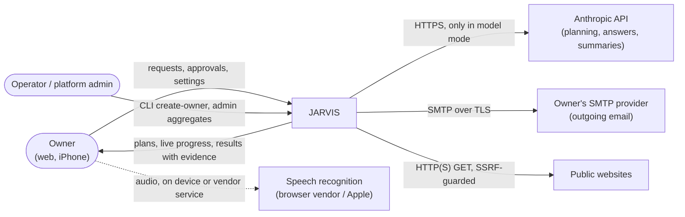
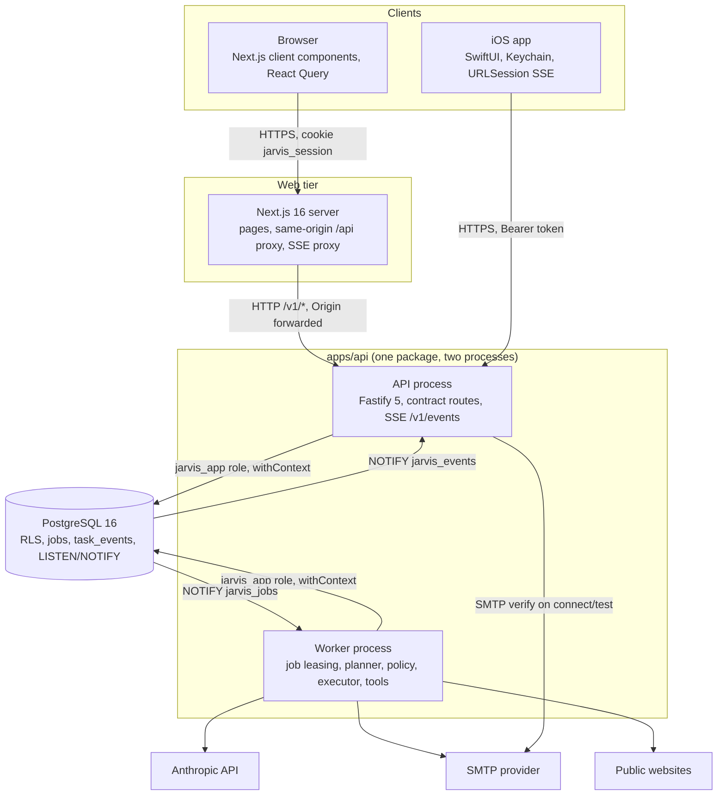
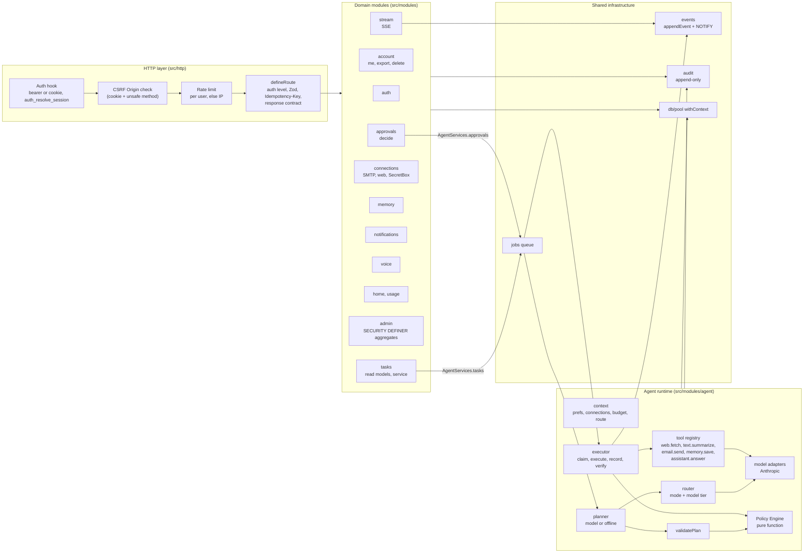
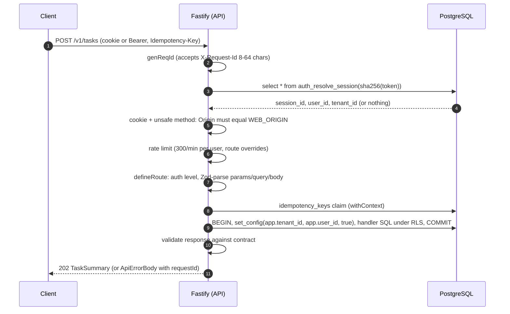
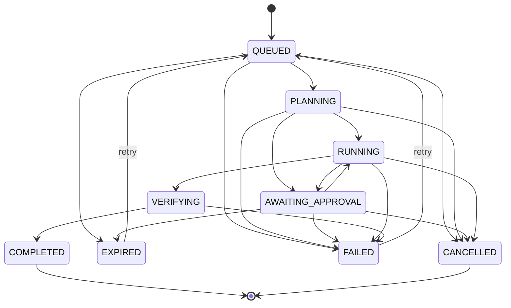
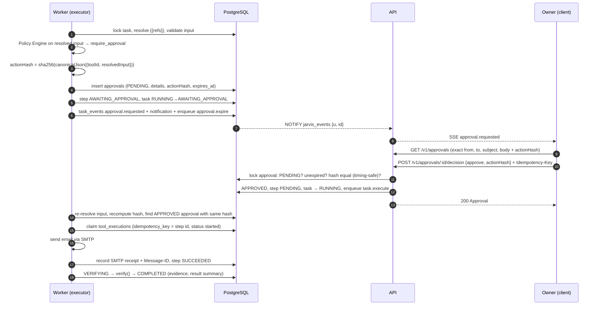
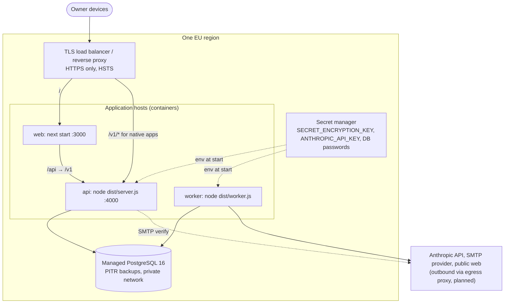

# Architecture overview

JARVIS is a modular monolith: one TypeScript backend package (`apps/api`) running as an **API process**
and a **worker process**, a **Next.js web app**, a **SwiftUI iOS app**, and **PostgreSQL 16** as the
only datastore. Shared Zod contracts (`packages/contracts`) and Meridian tokens (`packages/tokens`)
keep every surface consistent.

Status legend: **Built** = in the foundation or agent runtime as of this document; **Milestone 1
(in progress)** = being implemented in this milestone; **Planned** = later phase.

## 1. System context

External model use is optional: without an API key, when the user disables external models, or when
the monthly AI budget is used up, JARVIS plans with its offline rules engine and nothing is sent to a
model provider ([ADR-0008](../adr/0008-model-layer.md)).

## 2. Containers

| Container    | Code                          | Responsibility                                                                         | Status                    |
| ------------ | ----------------------------- | -------------------------------------------------------------------------------------- | ------------------------- |
| API          | `apps/api/src/server.ts`      | Auth, CSRF, rate limits, 35 contract routes + SSE, read models, task/approval commands | Built                     |
| Worker       | `apps/api/src/worker.ts`      | Leases `task.plan`, `task.execute`, `approval.expire` jobs; runs the agent runtime     | Built                     |
| Operator CLI | `apps/api/src/cli.ts`         | `create-owner` (invitation-only accounts)                                              | Built                     |
| Migrator     | `apps/api/src/db/migrate.ts`  | Checksummed, transactional, advisory-locked SQL migrations                             | Built                     |
| Web          | `apps/web`                    | Next.js App Router UI, `/api` proxy, SSE proxy                                         | Milestone 1 (in progress) |
| iOS          | `apps/ios`                    | SwiftUI app, voice, App Intents                                                        | Milestone 1 (in progress) |
| PostgreSQL   | `db/migrations/0001_init.sql` | All state, RLS, queue, event log, NOTIFY                                               | Built                     |

## 3. Components (backend)

The HTTP layer depends only on the `AgentServices` interface (`src/services.ts`: `tasks.create/cancel/
retry`, `approvals.decide`, `status.get`); the worker calls the job handlers in
`src/modules/agent/jobs.ts`. Details of the runtime: [agent runtime](agent-runtime.md).

## 4. Request lifecycle (HTTP)

- Unauthenticated requests to a `user`/`platform_admin` route → `401 UNAUTHENTICATED`;
  `platform_admin` routes also check `auth_user_roles(userId)`.
- Errors are always `ApiErrorBody` (`{ error: { code, message, requestId, details? } }`); see
  [API conventions](api.md).
- Liveness `GET /healthz`, readiness `GET /readyz` (database ping) are unauthenticated and return no
  data.

## 5. Task lifecycle

The state machine is shared by server and clients (`packages/contracts/src/task-state.ts`). The
server enforces it inside a transaction with optimistic locking (`transitionTask` in
`src/modules/agent/task-state.ts` checks `assertTransition`, bumps `tasks.version` and writes
`task.status_changed`). Clients use it only to decide which controls to show.

Terminal: `COMPLETED`, `FAILED`, `CANCELLED`, `EXPIRED` (`FAILED` and `EXPIRED` can be retried).
`canCancel(s)` = transition to `CANCELLED` allowed; `canRetry(s)` = transition to `QUEUED` allowed.

| Transition                    | Triggered by (current runtime)                                                               |
| ----------------------------- | -------------------------------------------------------------------------------------------- |
| QUEUED → PLANNING             | `task.plan` job claims the task                                                              |
| QUEUED → CANCELLED            | `POST /v1/tasks/:id/cancel` (immediate) or the plan job seeing `cancel_requested_at`         |
| QUEUED → FAILED               | Plan job exhausted its attempts (`onJobDead`, `INTERNAL`, retryable)                         |
| QUEUED → EXPIRED              | Allowed by the contract; not produced by the Milestone 1 runtime                             |
| PLANNING → RUNNING            | Plan validated, policies checked, `plan.ready`, `task.execute` enqueued                      |
| PLANNING → FAILED             | Planner error (`PLANNER_UNSUPPORTED`, `MODEL_ERROR`), a step denied by policy, or a dead job |
| PLANNING → CANCELLED          | Cancel requested; applied at the next checkpoint                                             |
| PLANNING → AWAITING_APPROVAL  | Allowed by the contract; the current runtime requests approvals from `RUNNING`               |
| RUNNING → AWAITING_APPROVAL   | Executor: policy requires approval for the next step's resolved input                        |
| AWAITING_APPROVAL → RUNNING   | Approval approved with the matching action hash                                              |
| AWAITING_APPROVAL → CANCELLED | Approval rejected, or the task cancelled                                                     |
| AWAITING_APPROVAL → EXPIRED   | `approval.expire` job at `expires_at`, or a decision attempted after expiry                  |
| AWAITING_APPROVAL → FAILED    | Allowed by the contract; not produced by the Milestone 1 runtime                             |
| RUNNING → VERIFYING           | All steps `SUCCEEDED`/`SKIPPED`                                                              |
| RUNNING → FAILED              | Step failed or blocked, `OUTCOME_UNKNOWN`, or a dead job                                     |
| RUNNING → CANCELLED           | Cancel requested; applied before the next step starts                                        |
| VERIFYING → COMPLETED         | Every step's `verify()` passed; result summary and evidence stored                           |
| VERIFYING → FAILED            | A verification failed (`VERIFICATION_FAILED`)                                                |
| FAILED/EXPIRED → QUEUED       | `POST /v1/tasks/:id/retry`; resumes from the first unfinished step                           |

Cancellation of `PLANNING`/`RUNNING` tasks is cooperative: the API sets `cancel_requested_at` and
emits `task.cancel_requested`; the worker cancels at the next checkpoint. A step that is already
executing finishes (or times out) first. `VERIFYING` cannot be cancelled.

## 6. Data flow: approvals

If the resolved input differs from what was approved (for example, a referenced output changed after
a retry), the hash differs: the old approval is marked `SUPERSEDED` and a new one is requested.
Mismatched hashes from clients are rejected with `409 APPROVAL_MISMATCH`.

## 7. Deployment topology (private alpha, proposed)

Nothing is deployed by this repository yet; this is the target for the private alpha.

- API and worker run the same build and version; deploy order is migrate → worker + API → web
  ([operations](../runbooks/operations.md)).
- In production the API trusts `X-Forwarded-For` only from loopback, link-local and unique-local
  addresses (`trustProxy`), so the load balancer must sit on a private network.
- `WEB_ORIGIN` must be `https://…` in production (enforced at boot).
- Scale-out: more workers is safe (`SKIP LOCKED`); more API instances is safe, but rate limits and the
  SSE per-user cap are per process ([known limitations](../known-limitations.md)).

## Related documents

- [Agent runtime](agent-runtime.md) · [Data model](data-model.md) · [API conventions](api.md)
- [Threat model](../security/threat-model.md) · [Permission model](../security/permission-model.md)
- ADRs: [index](../README.md#architecture-decision-records)
