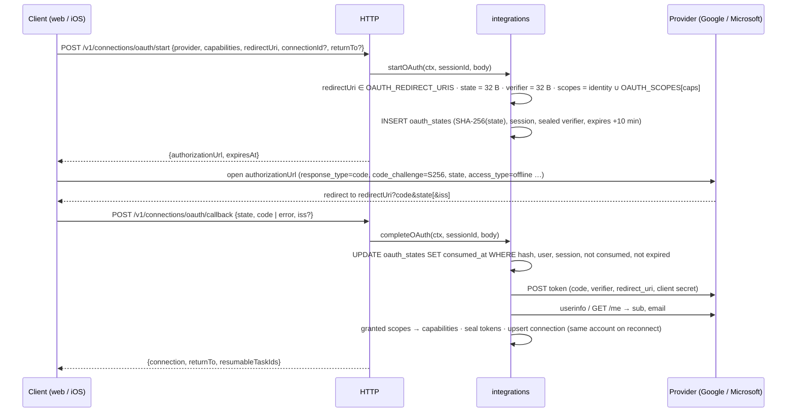
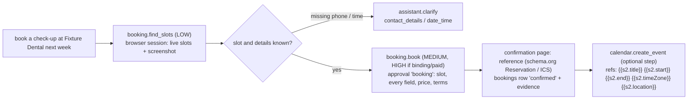
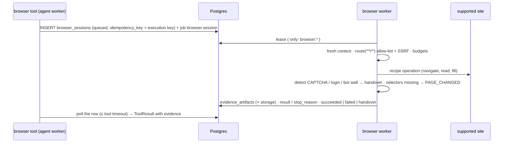

# Phase C — architecture, frozen contracts and ownership

Phase C connects JARVIS to the world: OAuth connections to Google and Microsoft, an email agent,
calendars (with "Upcoming" on Home), booking, an isolated browser agent, and shopping — the master
prompt's scenarios 1 (book an appointment), 3 (compare online products), 7 (reject an unauthorized
purchase), 9 (handle expired OAuth credentials) and 10 (prevent duplicate transactions). This
document is the **stage 1 hand-off**: it freezes the contracts, the schema and the extension points
so four engineers (plus web and iOS) can build in parallel without editing the same files, and says
exactly who writes which file and which functions cross ownership boundaries.

Statuses: **Frozen** = decided and in the tree now (change only through §0); **Owner builds** =
specified here, implemented in stage 2 by the named owner.

Decisions with their own records: [ADR-0016 OAuth connections](../adr/0016-oauth-connections.md),
[ADR-0017 browser agent isolation](../adr/0017-browser-agent-isolation.md),
[ADR-0018 commerce safety](../adr/0018-commerce-safety.md).

Contents: [0 Change control](#0-change-control-and-current-state) · [1 Scope map](#1-scope-map) ·
[2 Ownership](#2-ownership-and-file-layout) · [3 Feature designs](#3-feature-designs) ·
[4 Cross-boundary interfaces](#4-cross-boundary-interfaces-and-extension-points) ·
[5 Security](#5-security-notes) · [6 Contract reference](#6-contract-reference) ·
[7 Schema reference](#7-schema-reference-0005) · [8 Configuration](#8-configuration) ·
[9 Definition of done](#9-definition-of-done-per-owner)

## 0. Change control and current state

**Frozen in stage 1 (in the tree):**

| Artefact                                                                                                                                                                         | What                                                                                                                                                                                           |
| -------------------------------------------------------------------------------------------------------------------------------------------------------------------------------- | ---------------------------------------------------------------------------------------------------------------------------------------------------------------------------------------------- |
| `packages/contracts/src/{enums,limits,schemas,routes,money}.ts`                                                                                                                  | Every Phase C enum, limit, schema and the 13 new routes (74 total); tests `packages/contracts/test/phase-c.test.ts`                                                                            |
| `db/migrations/0005_phase_c.sql`                                                                                                                                                 | Schema, CHECKs, RLS, grants, indexes, triggers, view, SECURITY DEFINER functions (immutable once merged: later changes go in `0006_*.sql`)                                                     |
| `apps/api/src/db/types.ts`                                                                                                                                                       | Kysely types of every new / changed table and the `committed_purchases` view                                                                                                                   |
| `apps/api/src/config.ts`, `.env.example`                                                                                                                                         | Every Phase C environment variable with its production guards (§8); `loadBrowserWorkerConfig`                                                                                                  |
| `apps/api/src/modules/agent/tools/types.ts`                                                                                                                                      | The Phase C `ToolDefinition` hooks (§4.1), `ConnectionRequirement`, `ConnectionState`, `BindContext`, `PurchaseFacts`, `ApprovalContext.{account, accounts, purchases}`                        |
| `apps/api/src/modules/agent/{policy,policy-domain,step-policy,context,plan,planner,plan-job,result-summary,executor}.ts`, `tools/registry.ts`                                    | The Policy Engine's Phase C rules, facts, bind / attendee validation, per-domain tool arrays, result-line hooks (§4)                                                                           |
| `apps/api/src/modules/agent/intents/types.ts`, `models/offline.ts` (the hook)                                                                                                    | The offline-intent extension point (§4.2)                                                                                                                                                      |
| `apps/api/src/modules/jobs/{domain,queue}.ts`, `src/worker.ts`, `modules/agent/jobs.ts`                                                                                          | Per-domain job maps and timers, job-kind lease filters, heartbeat kinds (§4.3)                                                                                                                 |
| `apps/api/src/modules/agent/skills/{registry,service}.ts`, `agent/status.ts`                                                                                                     | Tool ownership per skill, any-of connection options, "built only when registered", Phase C capabilities                                                                                        |
| `apps/api/src/modules/agent/i18n.ts` (MESSAGES block), `modules/notifications/create.ts`, `tools/assistant-clarify.ts` (`QUESTION_KEY`)                                          | en/de/ar templates of the 59 new `ServerMessageKey`s (canonical wording — clients mirror it); notification preference per new kind; questions for the new `MissingInfo` values                 |
| `apps/api/src/http/route.ts`, `src/routes.ts` (`PENDING_ROUTES`)                                                                                                                 | Boot check tolerating the 13 not-yet-registered Phase C routes **outside production only** (§0, "Known gaps")                                                                                  |
| `apps/api/evals/src/{scenario.ts,runners/common.ts}`                                                                                                                             | Suites `connections`, `email`, `calendar`, `booking`, `shopping`; `given.connectionCapabilities`, `given.purchases`, `given.browserAvailable`                                                  |
| Empty extension files                                                                                                                                                            | `agent/tools/{integrations,browser}/index.ts`, `agent/intents/{integrations,browser}/index.ts`, `agent/jobs/integrations/index.ts`, `modules/browser/jobs/index.ts`, `src/browser-worker.ts`   |
| `apps/api/test/integration/rls-phase-c.int.test.ts`, `test/unit/agent/{policy,plan-validation,skills}-phase-c.test.ts`, `test/unit/http/{config-phase-c,routes-pending}.test.ts` | Cross-tenant RLS of every new table + DB invariants; policy, bind/attendee, skill and config rules                                                                                             |
| `docs/api/openapi.json`                                                                                                                                                          | Regenerated (77 operations)                                                                                                                                                                    |
| Web (`apps/web`) — compile-level only                                                                                                                                            | `TOOL_LABEL` / `TOOL_ICON`, catalogs for every new enum value (en/de/ar), `PROVIDER_NAME` / `CAPABILITY_LABEL` params, and new approval kinds shown as **decline-only** until their views land |

**Change control.** Anything marked Frozen changes only with a matching edit of this document, the
contracts tests and (for the schema) a new migration. Owners add internal code freely inside their
files. A new `ServerMessageKey`, `TaskErrorReason`, `ApiErrorReason`, `PolicyReason`, enum value,
route, column, job kind, tool hook or eval-schema field is a contract change: propose it (a
"contract request" with the reason), do not add it silently. Changes to `policy.ts` /
`policy-domain.ts` are changes of the security model and need a review against §5.

**Known gaps at the end of stage 1 (deliberate, no placeholders) — all closed in stage 2, verified in stage 3 (below):**

| Gap                                                                                                              | Why                                                                                                              | Closed by             |
| ---------------------------------------------------------------------------------------------------------------- | ---------------------------------------------------------------------------------------------------------------- | --------------------- |
| The 13 Phase C routes answer **404** in development/test (`PENDING_ROUTES`); a **production boot fails**         | Declared in the contract, handlers are the HTTP engineer's; no "not implemented" handler is registered           | HTTP                  |
| Phase C skills report `status: 'planned'`, capabilities `mail/calendar/browser/booking/shopping/purchases` false | A skill counts as built only once one of its tools is registered (`effectiveStatus`): status never ahead of code | Integrations, Browser |
| `browser-worker.ts` runs, heartbeats, leases `browser.session` — and has no handler (a job would fail)           | The browser domain's handlers are the browser engineer's; nothing enqueues the kind yet                          | Browser               |
| Web shows Phase C approval kinds (and email drafts) as "can't be reviewed here — decline only"                   | Never a blind approval; the full views are web work                                                              | Web                   |
| iOS decodes new enum values as `.unknown` (lenient), has no Phase C screens                                      | iOS work                                                                                                         | iOS                   |

**Verified at the end of stage 1:** contracts `typecheck` + `test` (64); API `typecheck`, `lint`,
unit tests (548), offline evals (109/109, including one policy-level scenario per new suite —
scenario 7 among them); the integration suite on a fresh database migrated through 0005 — every
file green (38 files, 288 tests, including `rls-phase-c.int.test.ts` and the HTTP suites, which
boot with the pending-route exception); web `typecheck`, `lint`, unit tests (263); OpenAPI
`--check` (77 operations); Prettier; the production build (`dist/browser-worker.js` bundles 11
modules — none of the agent, SecretBox or model code); the browser worker started against the test
database, scrubbed the development secrets, heartbeated as `browser` and stopped cleanly on
SIGTERM.

**Stage 3 (integration) — what changed and why.** Every stage-2 contract request was resolved:

| Request (owner)                                                                     | Resolution                                                                                                                                                                                                                                                                                                                           |
| ----------------------------------------------------------------------------------- | ------------------------------------------------------------------------------------------------------------------------------------------------------------------------------------------------------------------------------------------------------------------------------------------------------------------------------------ |
| An acknowledged retry of an unknown order counted its own row against the limit (B) | `stepCommittedSpend` (agent/context.ts): the executor subtracts the step's own committed row from the spend the policy and the approval's limit bar see (eval spec-09 / scenario 10 in pipeline mode proves it)                                                                                                                      |
| Paid bookings never counted against the month (B)                                   | Migration `0006_phase_c_purchases.sql`: `committed_purchases` adds paid bookings (submitting / confirmed / unknown) and the columns `kind`, `step_id`; web Settings › Spending counts them the same way                                                                                                                              |
| Form submissions showed a static host label (B)                                     | `ApprovalContext.siteHost(siteId)`: the host the enabled recipe really loads (form_submission, booking and purchase approvals fall back to it)                                                                                                                                                                                       |
| Booking forms could not use the account's name (B)                                  | `OfflinePlanContext.ownName` / `BindContext.ownName` (display name): "Full name" when the user writes none; phone numbers are still never invented                                                                                                                                                                                   |
| `SLOT_TAKEN` params undocumented (B)                                                | Documented in the contracts comment (`{ alternatives }`)                                                                                                                                                                                                                                                                             |
| "Was steht in meinem Kalender" read as a document question (I)                      | `models/offline.ts`: `WHAT_IS_IN` without a document word but naming a calendar / mailbox goes to the domain intents                                                                                                                                                                                                                 |
| Bare "draft a reply to X" asks `details`, not `email_content` (I)                   | Adopted (§3.2): an `email_content` answer becomes an email to the user themselves                                                                                                                                                                                                                                                    |
| Graph send endpoints and the draft intent's refs (I)                                | §3.2 updated to what is built (Mail.Send-only endpoints; `to` / `subject` refs, `requireMatch`)                                                                                                                                                                                                                                      |
| Pipeline evals inserted every connection as SMTP; no browser in the pipeline (I, B) | `evals/src/runners/pipeline.ts`: OAuth rows as the flow stores them (sealed tokens the mock accepts), the mock providers, the fixture site process and the browser worker's own loop; side effects count orders, reservations and provider mail; `acknowledgedRetry` and `evidenceAtLeast` expectations, `{{weekday+N}}` placeholder |
| `POST /v1/connections/:id/test` could not verify OAuth honestly (H)                 | `integrations.verifyConnection`: the identity endpoint with a valid token (401 → forced refresh → expired `TOKEN_REJECTED`; another account → expired; provider down → 503, nothing changed)                                                                                                                                         |
| `CALENDAR_UNAVAILABLE` named the first (maybe expired) source (H)                   | Names the source that did not answer                                                                                                                                                                                                                                                                                                 |
| Step previews lacked the contract objects (W, X)                                    | `outputPreview` now carries `comparison` + `bestOfferId` (shop.compare), `result` (booking.find_slots, calendar.free_busy), `cart` (shop.prepare_cart), `threads` (email.search)                                                                                                                                                     |
| Site names derived on the client (W)                                                | `BrowserSession.siteName` (optional, additive) from the recipe                                                                                                                                                                                                                                                                       |
| Order / booking failure params, native redirect URI publication (W, X; optional)    | Not done: the clients' parameter-free sentences and the `JARVIS_OAUTH_REDIRECT_URI` build setting stay                                                                                                                                                                                                                               |

Found while integrating and fixed: disconnecting and reconnecting the same Google account before the
revocation drain ran revoked the new grant too (Google revokes per grant) — migration
`0007_oauth_revocation_cancel.sql` records the account on each queued revocation and completing an
OAuth connection cancels the caller's own pending revocations of that account; "email me via Gmail:
…" names the sending account (`via`) in the user's words; the web refetched Home, lists and threads
on every `browser_session.changed` event (a shopping run tripped the API's 300 requests/minute) — now
only the task; a recipe-made delivery range was passed off as page text (`delivery.text` is now null
and clients say "2–4 days" in the viewer's language); and from the real-stack screenshots: Home
claimed "Nothing in your calendar" when no calendar could be read, banners squeezed their text beside
the action on phones, task pages showed the same screenshots three times, a tool's line breaks were
lost in the result, and a skill needing "a Google or a Microsoft account" said "Needs .".

**Verified at the end of stage 3:** `pnpm typecheck`, `lint`, `format:check` (exit 0); `pnpm -r
test` — contracts 64, tokens 62, API unit 638 (50 files), web 306 (18 files); the API integration
suite on a fresh database migrated through 0007 — 49 files, 398 tests; evals `--mode all` — offline
148/148, model 12 + 1 pending (spec-03 phone call, needs a model key), pipeline 41/41 (the pipeline
now runs scenarios 1, 3, 7 (off and over the limit), 9 and 10 for real: fixture site, browser
worker, mock providers), baseline updated; OpenAPI `--check` (77 operations); `pnpm build` and the
bundles booted with `NODE_ENV=production` (server with no pending route, agent worker, browser worker
refusing secrets); on the shared stack (migrated through 0007, mock providers, fixture site, browser
worker): `e2e/real` 23 passed (`phase-c.spec.ts` 11 of them), `e2e/visual` 674 passed / 0 failed.

## 1. Scope map

| #   | Feature                     | Contracts                                                                                                                                                                                                                                                                             | Schema (0005)                                                                                       | Owners                                                |
| --- | --------------------------- | ------------------------------------------------------------------------------------------------------------------------------------------------------------------------------------------------------------------------------------------------------------------------------------- | --------------------------------------------------------------------------------------------------- | ----------------------------------------------------- |
| 1   | OAuth connections           | `ConnectionProvider` +google/microsoft, `OAuthProvider`, `ConnectionCapability`, `ConnectionStatusReason`, `OAUTH_SCOPES`, `OAUTH_LIMITS`, `OAuthStart*`, `OAuthCallback*`, `ConnectionProviderInfo`, `Connection.{capabilities,scopes,statusReason}`, 3 routes, `connection_expired` | `connections` +columns, `oauth_states`, `oauth_revocations` + trigger + functions                   | Integrations, HTTP, Web, iOS                          |
| 2   | Email agent                 | ToolIds `email.search/read_thread/draft_reply/track_replies`, `email.send` + `via`, `Email*` schemas, `EMAIL_LIMITS`, `email_reply_received`, 2 routes, `ApprovalDetails.email.{mode,via,cc,inReplyTo}`                                                                               | `email_watches` + `email_watches_due()`                                                             | Integrations, HTTP, Web, iOS                          |
| 3   | Calendars + Home Upcoming   | ToolIds `calendar.*`, `CalendarEvent*`, `UpcomingEvents`, `FreeBusyResult`, `CALENDAR_LIMITS`, `HomeSnapshot.upcoming`, 2 routes, `ApprovalDetails.calendar_event`                                                                                                                    | none (live from the provider, §3.3)                                                                 | Integrations, HTTP, Web, iOS                          |
| 4   | Booking (scenario 1)        | ToolIds `booking.*`, `BookingSlots`, `BookingConfirmation`, `Booking`, 2 routes, `ApprovalDetails.booking`                                                                                                                                                                            | `bookings`                                                                                          | Browser (+ Integrations for meetings), HTTP, Web, iOS |
| 5   | Browser agent               | ToolIds `browser.read/fill`, `BrowserSession`, `BrowserSessionStatus`, `BrowserStopReason`, `EvidenceArtifact`, `BROWSER_LIMITS`, 2 evidence routes, `ApprovalDetails.form_submission`                                                                                                | `browser_sessions` (made usable), `evidence_artifacts`, job kind `browser.session`, heartbeat kinds | Browser, HTTP, Web, iOS                               |
| 6   | Shopping (3, 7, 10)         | ToolIds `shop.*`, `Money`, `ProductOffer`, `ShoppingComparison`, `PreparedCart`, `Order`, `COMMERCE_LIMITS`, `spending.monthlyPurchaseLimitUsd`, 2 routes, `ApprovalDetails.purchase`                                                                                                 | `orders`, `committed_purchases` view                                                                | Browser, HTTP, Web, iOS                               |
| 7   | Fixtures and mock providers | none (dev/test only)                                                                                                                                                                                                                                                                  | none                                                                                                | Integrations (mocks), Browser (fixture site)          |

## 2. Ownership and file layout

Six owners: **I** Integrations · **B** Browser + commerce · **H** HTTP · **W** Web · **X** iOS (and
the architect for frozen files). A file has exactly one owner; another owner who needs a change asks
the owner or follows §4. Tests live next to their owner's code (`test/unit/<area>/`,
`test/integration/<area>/` — new files only).

### I — Integrations (OAuth, Google, Microsoft, email, calendar)

```text
apps/api/src/modules/integrations/**         oauth.ts (start, callback, PKCE, state), tokens.ts (seal/open, refresh single-flight,
                                             expiry detection), google/{oauth,gmail,calendar}.ts, microsoft/{oauth,graph-mail,graph-calendar}.ts,
                                             mail.ts / calendar.ts (provider-neutral facades), upcoming.ts (Home, in-process cache),
                                             watches.ts, revocation.ts, index.ts (`integrations: IntegrationsApi`, §4.5)
apps/api/src/modules/agent/tools/integrations/**   email-search.ts, email-read-thread.ts, email-draft-reply.ts, email-track-replies.ts,
                                             calendar-*.ts; index.ts exports `integrationTools`
apps/api/src/modules/agent/tools/email-send.ts     extended in place: `via: 'smtp' | 'google' | 'microsoft'`, bind, requires (§3.2)
apps/api/src/modules/agent/intents/integrations/** offline intents (en/de/ar), index.ts exports `integrationIntents`
apps/api/src/modules/agent/jobs/integrations/**    email.watch_poll handler; timers: watch tick, revocation drain, OAuth state purge
tools/mock-providers/**                       mock Google (accounts, oauth2, openidconnect, gmail, calendar) and Microsoft
                                             (login.microsoftonline.com, graph) servers — dev/test only (§3.7)
apps/api/test/{unit,integration}/integrations/**, apps/api/evals/scenarios/{connections,email,calendar}/**
docs/skills/{email-management,calendar-management}.md
```

### B — Browser + commerce (browser agent, booking sites, shopping)

```text
apps/api/src/browser-worker.ts                the browser worker process (exists: lease/dispatch/heartbeat; B extends it)
apps/api/src/modules/browser/**               runner.ts (Playwright launch, fresh context, routing/SSRF, budgets), detect.ts (CAPTCHA /
                                             login / bot protection / error pages), evidence.ts (screenshots, extracts, ICS → storage),
                                             sites/{fixture-shop,fixture-booking,schema-org}.ts (recipes), sites/index.ts (registry),
                                             client.ts (`runBrowserSession`, used by tools in the agent worker), jobs/index.ts (`browserJobs`)
apps/api/src/modules/commerce/**              orders.ts / bookings.ts (exactly-once rows, reconciliation, spend), mappers used by H (§4.5)
apps/api/src/modules/agent/tools/browser/**   browser-read.ts, browser-fill.ts, booking-*.ts, shop-*.ts; index.ts exports `browserTools`
apps/api/src/modules/agent/intents/browser/** offline intents (en/de/ar), index.ts exports `browserIntents`
scripts/fixture-site.mjs                      + fixture shop, fixture booking site, CAPTCHA and login-wall pages (§3.7)
apps/api/test/{unit,integration}/{browser,commerce}/**, apps/api/evals/scenarios/{booking,shopping}/**
docs/skills/{appointment-booking,shopping-assistant,web-research}.md
```

### H — HTTP

```text
apps/api/src/modules/connections/routes.ts    listConnectionProviders, startOAuthConnection, completeOAuthConnection; toConnection with
                                             capabilities/scopes/statusReason; deleteConnection unchanged (the trigger queues revocation)
apps/api/src/modules/calendar/routes.ts       listUpcomingEvents, listCalendarEvents (thin over `integrations`)
apps/api/src/modules/email/routes.ts          listEmailWatches, deleteEmailWatch (status 'stopped')
apps/api/src/modules/{orders,bookings}/routes.ts   read-only lists (keyset (created_at DESC, id DESC)) and details
apps/api/src/modules/evidence/routes.ts       getEvidence, downloadEvidence (as downloadAttachment: owner-only, nosniff, sandbox CSP, no-store)
apps/api/src/modules/home/routes.ts           HomeSnapshot.upcoming (null without calendar.read; CALENDAR_LIMITS.homeTimeoutMs)
apps/api/src/modules/account/**               preferences: monthlyPurchaseLimitUsd; export v4 (connections without secrets, capabilities,
                                             email watches, orders, bookings, browser sessions, evidence metadata + bytes within budget);
                                             delete: unchanged (cascades; the trigger queues Google revocations)
apps/api/src/modules/tasks/mappers.ts         TaskDetail.browserSessions
apps/api/src/routes.ts                        register the new modules; remove each name from PENDING_ROUTES as it lands (empty at the end)
apps/api/scripts/openapi.ts, docs/api/openapi.json, test/integration/http/** (new files), test/unit/http/**
docs/architecture/{api,data-model}.md, docs/security/{threat-model,privacy}.md
```

### W — Web (`apps/web/**`) · X — iOS (`apps/ios/**`)

Screens and copy per feature in §3.9; both consume only the contracts. Web replaces the stage-1
compile-level stubs (decline-only approval kinds, `invalidation.ts` cases returning `[]`).

### Shared files

| File                                                                                                                                                              | Rule                                                                                                                                    |
| ----------------------------------------------------------------------------------------------------------------------------------------------------------------- | --------------------------------------------------------------------------------------------------------------------------------------- |
| `packages/contracts/**`, `db/migrations/0005_phase_c.sql`, `apps/api/src/db/types.ts`, `config.ts`, `.env.example`, the files of §0's Frozen table, this document | Frozen (§0)                                                                                                                             |
| `apps/api/src/lib/**`                                                                                                                                             | H (I and B import; `lib/net.ts isPrivateAddress` is the browser's SSRF classifier)                                                      |
| `apps/api/package.json`, `pnpm-lock.yaml`                                                                                                                         | Architect: all needed dependencies are installed (`playwright-core` 1.63.0); scripts `dev:browser-worker`, `start:browser-worker` exist |
| `apps/api/evals/src/**`                                                                                                                                           | Architect (contract requests); scenario JSON files belong to the suite's owner                                                          |
| `docs/README.md`, `docs/security/permission-model.md`                                                                                                             | Architect                                                                                                                               |

## 3. Feature designs

### 3.1 OAuth connections (ADR-0016; scenario 9)



**Start (I via H).** Refuse: provider without client (`503 SERVICE_UNAVAILABLE`,
`PROVIDER_NOT_CONFIGURED { provider }`); redirect URI not exactly allowed (`400
REDIRECT_URI_NOT_ALLOWED`); `connectionId` not this user's OAuth connection of the same provider
(`404` / `400 CONNECTION_NOT_OAUTH`); more than `OAUTH_LIMITS.maxPendingStates` unconsumed,
unexpired states (`429 OAUTH_PENDING_LIMIT { max }`). Scopes: `OAUTH_SCOPES[provider].identity` ∪
the requested capabilities' scopes (with `connectionId`: only the new ones; Google
`include_granted_scopes=true`). Google adds `access_type=offline&prompt=consent`; Microsoft
`response_mode=query`. Audit `connection.oauth_started { provider, capabilities }`.

**Callback.** `error=access_denied` → `400 OAUTH_DENIED { provider }` (the state is consumed);
unknown / used / other session → `400 OAUTH_STATE_INVALID`; expired → `400 OAUTH_STATE_EXPIRED`;
`iss` present and ≠ the provider's issuer → `OAUTH_STATE_INVALID`. Token exchange refused →
`422 CONNECTION_FAILED`, `OAUTH_EXCHANGE_FAILED`. Capabilities = those whose scopes were all granted
(Microsoft scope names compared without `https://graph.microsoft.com/`, case-insensitive); none →
`400 OAUTH_SCOPE_NOT_GRANTED { capabilities }`. Reconnect with another account → `409
OAUTH_ACCOUNT_MISMATCH`. Upsert under `SELECT … FOR UPDATE`: new row, or the existing one
(`status 'active'`, `status_reason NULL`, new envelope, union of capabilities). Event
`connection.changed { change: 'created' | 'reconnected' | 'capabilities' }`, audit
`connection.connected` (provider, capabilities; never tokens). `resumableTaskIds`: tasks of this
user `FAILED` with `error.reason = 'CONNECTION_EXPIRED'` and `error.params.provider` = this provider
within `resumableWithinDays`, newest first, at most `resumableTasksMax`.

**Token use (I, `tokens.ts`)** — the only code that opens OAuth envelopes:

```ts
/** A valid access token for this user's connection, refreshed under the row lock when needed. */
export async function accessToken(
  deps: { config: Config; db: Db; secrets: SecretBox },
  ctx: DbContext,
  connectionId: string,
  opts?: { forceRefresh?: boolean; signal?: AbortSignal },
): Promise<{ token: string; connection: ConnectionRow }>;
// throws AgentError CONNECTION_REQUIRED / CONNECTION_EXPIRED { provider } after marking the row
// expired (invalid_grant, 401 after a forced refresh) — with notification connection_expired
// (once per transition), event connection.changed { change: 'expired' } and an audit entry.
```

Provider calls go through one wrapper per provider that maps errors: `401` → one forced refresh and
one retry, then `CONNECTION_EXPIRED`; `403` insufficient scope (Google `insufficientPermissions` /
`ACCESS_TOKEN_SCOPE_INSUFFICIENT`, Graph `ErrorAccessDenied` / `Authorization_RequestDenied`) →
capability removed, `CONNECTION_SCOPE_MISSING { provider, capability }`; `429` → `TOOL_FAILED`,
transient, `PROVIDER_RATE_LIMITED { provider, seconds }` (from `Retry-After`, capped); `5xx` /
timeout (`OAUTH_LIMITS.providerTimeoutMs`) → `PROVIDER_UNAVAILABLE`, transient; other `4xx` →
`PROVIDER_REJECTED { provider, status }`. Three consecutive 5xx-only failures of a connection may
set `status 'error'`, `PROVIDER_ERROR` (cleared by the next success).

**Scenario 9.** An expired Google connection: planning-time policy denies the step
`CONNECTION_EXPIRED` (code `CONNECTION_REQUIRED`) — the task fails at once with "Reconnect"; or
the token dies mid-task: the tool throws `CONNECTION_EXPIRED` (retryable — nothing was done), the
connection flips to `expired`, one `connection_expired` notification. The user reconnects (start
with `connectionId`, `returnTo` = the task), the callback returns the task in `resumableTaskIds`,
Retry re-plans the failed step and runs it. Eval suite `connections` covers both paths.

**Disconnect (H).** `DELETE /v1/connections/:id` deletes the row (as today). The `AFTER DELETE`
trigger queues Google envelopes in `oauth_revocations`; I's drain timer (every 30 s) claims
(`oauth_revocations_claim(100, 300)`), opens each envelope (AAD
`oauth:<user>:<provider>:<connection id>`), `POST {revoke}` with the refresh token (form
`token=…`), and completes (`200`, or `400 invalid_token` = already revoked) or fails it (backoff to
a day; after 12 attempts complete it anyway and audit `connection.revocation_abandoned`). Microsoft:
nothing queued; the UI says where to remove the consent (`revocation: 'local_only'`). Email watches
cascade.

### 3.2 Email agent

| Tool                  | Risk                                | Side effect | Idempotency     | Needs (requires / options)                             | Approval                  | Output fields (referenceable)                                           |
| --------------------- | ----------------------------------- | ----------- | --------------- | ------------------------------------------------------ | ------------------------- | ----------------------------------------------------------------------- |
| `email.search`        | LOW                                 | none        | `safe_to_retry` | `{ provider, mail.read }`                              | —                         | `text` (resultTextField), `threadIds`, `count`                          |
| `email.read_thread`   | LOW                                 | none        | `safe_to_retry` | `{ provider, mail.read }`                              | —                         | `text`, `subject`, `threadId`, `suspectedInjection`, `injectionSignals` |
| `email.draft_reply`   | MEDIUM                              | external    | `once_per_step` | `{ provider, mail.compose }`                           | `email` (`mode: 'draft'`) | `draftId`, `threadId`                                                   |
| `email.track_replies` | LOW                                 | internal    | `once_per_step` | `{ provider, mail.read }`                              | —                         | `watchId`, `expiresAt`                                                  |
| `email.send`          | MEDIUM (≤ 3 recipients), HIGH (> 3) | external    | `once_per_step` | `smtp`, or `{ google / microsoft, mail.send }` (`via`) | `email` (`via`)           | `messageId`, `threadId` (providers), `accepted`                         |

- **Reading.** `email.search { provider?, query?, unreadOnly?, needsReply?, newerThanDays?, limit ≤
EMAIL_LIMITS.searchMaxResults }` → `EmailThreadSummary[]` metadata + a readable `text` list
  (sender, subject, snippet — untrusted). `needsReply` is the deterministic header rule of the
  contract (newest message from someone else, in the inbox, not automated). Gmail:
  `users.threads.list` (`q` built from the fields — never raw user text concatenated into
  operators) + `threads.get format=metadata`; Graph: `/me/mailFolders/inbox/messages` with
  `$filter` / `$search`, grouped by `conversationId`. `email.read_thread { provider?, threadId(s) }`
  reads bodies (Gmail `format=full`, text/plain preferred, HTML via the existing `tools/html.ts`
  extractor; Graph `body` with `Prefer: outlook.body-content-type="text"`), caps at
  `threadMaxMessages` / `threadMaxChars`, and runs the injection detector — flags taint every
  dependent step. Thread ids may reference `email.search` outputs (`allowedRefTools`).
- **Drafts are MEDIUM (decided).** A draft writes into the user's mailbox (an external system),
  is reversible and reaches nobody — exactly the permission model's MEDIUM ("external side effect
  with limited reach and reversible consequences"). It asks first, showing recipients, subject and
  body, because a draft's recipients come from the thread's headers (written by others — a
  `Reply-To` can point anywhere) and its body may be model-written from untrusted mail; the user
  should see both before a draft that looks like theirs exists. `email.draft_reply { provider?,
threadId, body }` answers the newest message (Gmail `drafts.create` with `threadId`,
  `In-Reply-To` / `References`; Graph `POST /me/messages/{id}/createReply` then `PATCH` the body).
  It never sends.
- **Sending through the provider: `email.send` with `via` (decided — not a second tool).** One send
  tool keeps the recipient rules (`RECIPIENT_SELF` / `RECIPIENT_EXTERNAL` / `MANY_RECIPIENTS`), the
  auto-approve-to-self autonomy and every client label in one place. Absent `via` means SMTP (old
  plans and approvals keep their meaning); `bind` fills `via` at planning: `smtp` when an SMTP
  connection is active, else the Google / Microsoft account granting `mail.send` (google before
  microsoft). `requires(input)` = that connection; `connectionOptions` = smtp ∪ both providers with
  `mail.send`. The approval shows `via` and the account as `from`. Optional `inReplyTo { threadId }`
  (provider only) threads the reply. Recipients stay literal from the user's words.
- **Exactly once via the provider.** Gmail: the message carries `Message-ID` derived from the
  idempotency key (`messageIdFor`, as SMTP); on a retry after `OUTCOME_UNKNOWN` (user acknowledged)
  the tool first searches Sent (`rfc822msgid:`) and records the found message instead of sending
  again. Graph (as built, stage 3): only Mail.Send endpoints — `POST /me/sendMail`, or
  `POST /me/messages/{id}/reply` inside a thread — with a `singleValueExtendedProperties` tag = the
  key on the message; a retry looks the tag up in Sent Items first. This keeps `mail.send` at Graph
  `Mail.Send` (least privilege): creating drafts needs `Mail.ReadWrite`, which is `mail.compose`.
  Evidence `MAIL_SENT { provider, messageId, threadId }`, check `providerAccepted`.
- **Tracking replies.** `email.track_replies { provider?, threadId, days ≤ watchMaxDays }` (refs
  from `email.send` / `email.search` / `email.read_thread`) inserts one `email_watches` row per step
  (`UNIQUE (step_id)`; live per thread: `UNIQUE (connection_id, thread_id) WHERE watching`),
  baseline = the newest message now. I's watch tick (`EMAIL_WATCH_TICK_MS`) reads
  `email_watches_due(500)` and enqueues `email.watch_poll { watchId }` (dedupe `email-watch:<id>`);
  the job (owner's RLS context) lists the thread's messages after the baseline: a message from
  someone other than the account → `replied`, `reply_*` set, notification `email_reply_received
{ watchId, provider, subject, fromAddress }` (follows `taskCompleted`), event
  `email_watch.changed { change: 'replied' }`; nothing → `next_check_at += watchPollMinutes`; past
  `expires_at` → `expired`; connection expired / thread gone → `failed`. Watch content: subject and
  sender only.
- **Untrusted mail.** Never instructions: framed `<email trust="untrusted">` for models, flagged by
  the detector, never a source of recipients, URLs, attendees, amounts or memories (memory.save
  only takes `conversation.recall`), never forwarded without an approval of the exact body
  (`email.send` MEDIUM/HIGH; `UNTRUSTED_CONTENT` when flagged).
- **Offline intents (I, en/de/ar).** "summarize my unread emails" / "fasse meine ungelesenen
  E-Mails zusammen" / "لخص رسائلي غير المقروءة" → `email.search { unreadOnly }` →
  `email.read_thread` → `text.summarize` (titles `plan.emailUnread`, `step.searchEmail`,
  `step.readThreads`, `step.summarizeEmail`); "what needs my reply" / "worauf muss ich antworten" /
  "ما الذي يحتاج إلى ردي" → `email.search { needsReply }` (`plan.emailNeedsReply`); "draft a reply
  to <sender> saying …" / "entwirf eine Antwort an … : …" / "اكتب مسودة رد على … : …" →
  `email.search { from: <sender as written>, requireMatch: true }` → `email.draft_reply { threadId:
{{s1.firstThreadId}}, to: ['{{s1.firstReplyTo}}'], subject: '{{s1.firstReplySubject}}', body: <the
user's text> }` (`plan.draftReply { name }`); the approval shows the recipients and subject from
  the input, and at execution every recipient must already be in the thread. Without text:
  `assistant.clarify { missing: ['details'] }` (not `email_content`: an answer to an
  `email_content` question becomes an email to the user themselves in `models/offline.ts`), which
  the draft intent's own answer handler combines with the original request. Several matching
  threads → the newest; none → the search step says so (no draft).

### 3.3 Calendars and Home "Upcoming"

| Tool                    | Risk                         | Side effect | Idempotency     | Needs                          | Approval         | Output fields                                    |
| ----------------------- | ---------------------------- | ----------- | --------------- | ------------------------------ | ---------------- | ------------------------------------------------ |
| `calendar.list`         | LOW                          | none        | `safe_to_retry` | `{ provider, calendar.read }`  | —                | `text`, `events`, `count`                        |
| `calendar.free_busy`    | LOW                          | none        | `safe_to_retry` | `{ provider, calendar.read }`  | —                | `result` (`FreeBusyResult`), `text`, `slotCount` |
| `calendar.create_event` | MEDIUM (HIGH > 10 attendees) | external    | `once_per_step` | `{ provider, calendar.write }` | `calendar_event` | `eventId`, `webLink`, `start`, `end`             |
| `calendar.update_event` | MEDIUM                       | external    | `once_per_step` | `{ provider, calendar.write }` | `calendar_event` | `eventId`                                        |
| `calendar.cancel_event` | MEDIUM                       | external    | `once_per_step` | `{ provider, calendar.write }` | `calendar_event` | `eventId`                                        |

- **No content caching (decided).** Events are read live from the provider for every request:
  calendars change from many places, a cache would be stale exactly when it matters (conflicts,
  "upcoming"), and stored invitations (other people's words, attendee lists) would widen the
  privacy, retention and export surface. The only cache is in memory: Home "Upcoming" per
  connection for `CALENDAR_LIMITS.upcomingCacheSeconds` (60), dropped when the connection changes.
- **Home (H over I).** `HomeSnapshot.upcoming` is `null` unless some connection grants
  `calendar.read` (the section is then not rendered at all — spec §4A). Otherwise
  `upcomingEvents(ctx)` asks every such connection in parallel with `homeTimeoutMs` (2.5 s):
  events of the next `upcomingDays`, at most `upcomingMax`, merged by start; each source reports
  `ok | expired | scope_missing | unavailable` — Home never fails because a calendar is slow.
  `GET /v1/calendar/upcoming` is the same payload; `GET /v1/calendar/events?from&to[&provider]`
  lists a window ≤ `listMaxDays` (`truncated` above `listMaxEvents`; `409
CALENDAR_NOT_CONNECTED` without one; `503 CALENDAR_UNAVAILABLE { provider }` when the only
  source fails).
- **Time zones.** Instants are UTC ISO strings everywhere; each event keeps its own `timeZone`
  (Google `start.timeZone`, Graph `originalStartTimeZone` mapped Windows → IANA with the CLDR
  table); all-day events are dates in the event's zone (`allDay: true`, `start` = local midnight
  instant). New events are written in the account's zone unless the user names one; the approval
  shows the zone. Free/busy and proposals use the account's zone and
  `defaultWorkdayStart/End`; DST days are handled by computing in the zone (Intl), never by adding
  hours to UTC.
- **Free/busy and proposals.** Google `freeBusy.query` (the account + named attendees), Graph
  `POST /me/calendar/getSchedule`. A calendar the provider does not share is `accessible: false` and
  is **not** assumed free; slots are proposed only from the answers (`maxProposedSlots`,
  `slotStepMinutes`).
- **Writes.** Approval kind `calendar_event` shows title, start, end, zone, all-day, location,
  description, every attendee and whether they are notified (`sendUpdates=all` /
  Graph invitations). Attendees are literal from the user's words (validatePlan, `tool.attendees`);
  anyone but the owner adds `RECIPIENT_EXTERNAL` (policy-domain). Right before writing, the tool
  re-checks free/busy for the slot: busy → `CALENDAR_CONFLICT { count }`, nothing written (unless
  the input says `allowConflict: true`, shown in the approval). Update / cancel carry the event's
  `etag` / `changeKey` as read by an earlier `calendar.list` step: changed since → `EVENT_CHANGED`.
  Exactly once: Google events get a deterministic `id` derived from the idempotency key (base32hex,
  allowed by the API), so a retried insert returns `409` and the tool reads the existing event;
  Graph uses `transactionId` = the key. Evidence `CALENDAR_EVENT { provider, eventId, action }`.
- **Offline intents (I).** "what's on my calendar" / "was steht in meinem Kalender" / "ما الذي في
  تقويمي" → `calendar.list` (`plan.calendarUpcoming`); "find a time to meet <address> …" →
  `calendar.free_busy` (`plan.findMeetingTime { who }`), `assistant.clarify { missing:
['date_time'] }` without a window. Creating an event offline needs an explicit date/time the rules
  can parse; otherwise clarify.

### 3.4 Booking (scenario 1)

Two paths, both ending in an approved, verifiable result:

1. **Meetings with people (I).** `calendar.free_busy` proposes mutual free slots (result text lists
   them); the user picks one in a follow-up ("book Tuesday 10:00") → `calendar.create_event` with
   the attendees they wrote, `notifyAttendees: true` → approval `calendar_event` (MEDIUM,
   `RECIPIENT_EXTERNAL`) → the provider sends the invitations.
2. **Booking websites (B)** — only supported sites (recipes):



- `booking.find_slots { siteId, service, from?, to? }` → `BookingSlots` (`result`), with the
  site's required form fields. Availability only from the live page (screenshot evidence
  `SCREENSHOT`, extract `PAGE_EXTRACT`); none → the result says so (`NO_FREE_SLOTS` only when the
  user asked for a specific window).
- **Collecting details.** The planner (offline intent or model) fills name and email from the
  account; anything else the recipe requires (phone, date of birth…) must be in the user's words,
  else `assistant.clarify { missing: ['contact_details'] }`; at execution a still-missing field is
  `BOOKING_DETAILS_MISSING { fields }`, nothing submitted.
- `booking.book { siteId, slotId, service, details: { label: value }, expectedStart }` → once per
  step: insert `bookings` (`submitting`, key `booking:<step id>`), re-read the slot (taken →
  `SLOT_TAKEN`, row `failed`), submit, read the confirmation (reference + ICS) → `confirmed`;
  submitted without a confirmation → `OUTCOME_UNKNOWN` `BOOKING_UNCONFIRMED`, row `unknown`. Risk
  HIGH when the recipe or the page says binding / paid (`binding(input)` → `BINDING_COMMITMENT`;
  a price → `purchase(input)` → the purchase rules of §3.6 apply too). Output fields (frozen —
  `calendar.create_event` references them, `allowedRefTools` includes `booking.book`): `bookingId`,
  `reference`, `title`, `start`, `end`, `timeZone`, `location`.
- **Saving the confirmation.** Evidence (screenshot, ICS) + the `bookings` row; the calendar entry
  is a separate `calendar.create_event` step (its own approval) whose `sourceBookingId` input makes
  I call `recordBookingCalendarEvent` (B, §4.5) after creating it. Without a calendar connection
  the ICS file is the offered download.
- **Offline intents (B).** "book <service> at <site name> [on <day>]" / "buche …" / "احجز …" with a
  site name the recipe registry knows → find_slots → (clarify | book), titles `plan.book`,
  `step.findSlots`, `step.book`, `step.saveToCalendar`; an unknown site → `assistant.clarify {
missing: ['site'] }`.

### 3.5 Browser agent (ADR-0017)



- **Client (B, `modules/browser/client.ts`) for tools in the agent worker:**

```ts
export interface BrowserRequest {
  siteId: string; // a registered, enabled recipe
  operation: string; // one of the recipe's operations
  input: Record<string, unknown>; // validated by the operation's schema before enqueueing
}
export interface BrowserOutcome {
  sessionId: string;
  status: 'succeeded' | 'failed' | 'handover' | 'interrupted';
  stopReason: BrowserStopReason | null;
  result: Record<string, unknown> | null; // the operation's output schema, validated
  handoverUrl: string | null;
  artifacts: EvidenceArtifactRow[];
}
/**
 * Runs one recipe operation in the browser worker for this tool execution: one session per
 * rt.idempotencyKey (an existing session of the key is reused, never duplicated), waits until it
 * ends or `signal` aborts (then sets cancel_requested_at). Throws AgentError BROWSER_UNAVAILABLE
 * at once when no browser worker heartbeats or storage is missing.
 */
export function runBrowserSession(
  rt: ToolRuntime,
  req: BrowserRequest,
  signal: AbortSignal,
): Promise<BrowserOutcome>;
```

- **Recipes (B, `modules/browser/sites/*`)** are declared like tools: `id`, `version`, `name`,
  `origins(config)` (exact origins the session may load), `fixture` (only with
  `BROWSER_FIXTURE_ORIGIN`), and `operations` — each with `input` / `output` Zod schemas,
  `sideEffect: 'none' | 'reversible' | 'binding'`, `risk`, `idempotency`, `budgets`, `run(page,
input, ctx)`, `verify(input, output)`. Enabled = registered ∧ in `BROWSER_SITES` (if set) ∧ its
  origin configured. Phase C recipes: `fixture-shop` (search, product, cart, checkout),
  `fixture-booking` (slots, book), `schema-org` (read: JSON-LD `Product` / `Offer` /
  `Reservation` + ICS on a supported site's page). Real shops/sites only through new reviewed
  recipes.
- **Tools.** `browser.read { siteId, url? | operation, input }` (LOW, `outbound`, `runsInBrowser`;
  output `text`, `data`, `url`, `title`, `evidenceArtifactId`, `suspectedInjection`,
  `injectionSignals`; `resultTextField: 'text'`; `untrustedHost` = the page host).
  `browser.fill { siteId, form, fields }` (MEDIUM, HIGH when the recipe's form is binding;
  approval `form_submission`; once per step). Every URL must be on the recipe's origins (the tool's
  `validatePlanned` checks site ids against the registry; a URL from content can only point inside
  the same supported site).
- **Lifecycle and recovery.** Sessions: `queued → running → succeeded | failed | handover |
interrupted` (CHECKs in 0005). The browser job's lease is the browser worker's; an expired lease
  reclaimed by `reclaimBrowserOnce` re-runs a `none`/`reversible` operation, but a `binding` one
  marks the session `interrupted` and the tool reports `OUTCOME_UNKNOWN`. Events
  `browser_session.changed`. Retention: sessions and their evidence cascade from the task.
- **Detection (B, `detect.ts`).** CAPTCHA: iframes / scripts of reCAPTCHA, hCaptcha, Cloudflare
  Turnstile, challenge pages (HTTP 403/503 + challenge markers) → `CAPTCHA_DETECTED`; a password
  field or the recipe's login marker where the operation expected content → `LOGIN_REQUIRED`;
  bot-protection interstitials → `BOT_PROTECTION`. All three: status `handover`, evidence
  `HANDOVER { host, reason, url }`, task error with `host` (+ the client offers "Open the site").
- **Fixture site (B, `scripts/fixture-site.mjs`)** adds: `/shop` (search with query and sorting),
  `/shop/products/:sku` (schema.org `Product` + `Offer` JSON-LD: price, currency, availability,
  shippingDetails, deliveryTime; rating; return-policy and legal-notice links), `/shop/cart`
  (add/update, totals), `/shop/checkout` (POST with `Idempotency-Key` header: the same key returns the
  same order id; a `?fail=decline|stock|slow` switch for tests; a price-change switch), `/booking`
  (slots that change: a seeded rotation plus `/booking/admin/take/:slot` for tests),
  `/booking/book` (form → confirmation page with `Reservation` JSON-LD and reference,
  `/booking/confirmation/:ref.ics`), `/captcha` (a reCAPTCHA-style challenge), `/login-wall`.
  Dev/test only (`BROWSER_FIXTURE_ORIGIN`, `BROWSER_ALLOW_PRIVATE_HOSTS`).

### 3.6 Shopping (scenarios 3, 7, 10; ADR-0018)

| Tool                | Risk   | Side effect | Idempotency     | Approval                                        | Output fields                                                              |
| ------------------- | ------ | ----------- | --------------- | ----------------------------------------------- | -------------------------------------------------------------------------- |
| `shop.search`       | LOW    | none        | `safe_to_retry` | —                                               | `searchId` (browser session id), `offerCount`, `text`                      |
| `shop.compare`      | LOW    | none        | `safe_to_retry` | —                                               | `comparison` (`ShoppingComparison`), `bestOfferId`, `text`                 |
| `shop.prepare_cart` | MEDIUM | external    | `once_per_step` | `generic` (items, quantities, totals as fields) | `cart` (`PreparedCart`), `cartId`, `totalMicro`, `currency`, `handoverUrl` |
| `shop.checkout`     | HIGH   | external    | `once_per_step` | `purchase`                                      | `orderId`, `merchantOrderId`, `total`                                      |

- **Search and compare (scenario 3).** `shop.search { query, siteIds? }` runs the search
  operation on every enabled shop recipe (or the named ones), reading offers from the pages
  (schema.org first); each site's outcome (`ok | failed | handover`) is reported, never hidden.
  Offers are stored in the session's `result` (validated `ProductOffer[]`); later steps reference
  them by `searchId` / offer ids, so page text never travels through `{{refs}}`.
  `shop.compare { searchIds, preference?: 'total' | 'delivery' }` ranks deterministically by known
  total (price + shipping, same currency), then delivery days; unknown shipping stays `null` and
  ranks after known totals; mixed currencies are not converted (`mixedCurrencies`). Reliability
  signals are page facts. Result text: a table with sources.
- **Cart.** `shop.prepare_cart { siteId, offerId | productUrl (same site), quantity (literal, ≤
maxQuantityPerLine) }` → a cart on the site (reversible), screenshot; recipes without checkout
  support return `handoverUrl` (the merchant's cart link) and `checkoutSupported: false`.
- **Checkout (scenario 7, 10).** `shop.checkout { siteId, cartId, expectedTotalMicro, currency,
lines }` — all from the prepared cart's output via refs (`allowedRefTools: ['shop.prepare_cart']`).
  `purchase(input)` declares the amount → policy: `PURCHASES_DISABLED` (limit 0, the default),
  `PURCHASE_CURRENCY`, `PURCHASE_LIMIT` deny; else approval `PURCHASE` with kind `purchase`
  (everything in ADR-0018, including `limit { monthly, spentThisMonth, remainingAfter }` from
  `ApprovalContext.purchases`). Execute: insert `orders` (`submitting`, key
  `order:<step id>`, `approval_id`, `action_hash`) → re-read the live cart: total or lines differ →
  `PRICE_CHANGED`, out of stock → `OUT_OF_STOCK` (row `failed`) → submit with the key as the
  merchant's idempotency key → confirmation (order id, total = approved total, screenshot) →
  `placed`, evidence `ORDER_CONFIRMATION`, check `totalMatches`, event `order.changed`, audit
  `order.placed { siteId, totalMicro, currency }`. Interrupted after submit started →
  `OUTCOME_UNKNOWN` `ORDER_UNKNOWN`, row `unknown` (counts against the limit). A retry (user
  acknowledged) first looks the key up at the merchant (fixture: `GET /shop/orders?key=`) and in
  `orders`: found → `placed` without submitting again (scenario 10).
- **Offline intents (B).** "compare <product> prices" / "vergleiche Preise für …" / "قارن أسعار …"
  → `shop.search` → `shop.compare` (`plan.compareProducts { query }`); "buy <product> on <shop>" →
  search → compare → prepare_cart (quantity from the words, default 1) → checkout (`plan.buy`) —
  the policy then refuses it while the limit is 0, which is scenario 7.

### 3.7 Mock providers (I, `tools/mock-providers/**`)

Dependency-free Node servers (like `scripts/fixture-site.mjs`), started by tests and the e2e
harness, one origin per provider (`GOOGLE_BASE_URL_OVERRIDE`, `MICROSOFT_BASE_URL_OVERRIDE`),
implementing the documented shapes: Google `GET /o/oauth2/v2/auth` (auto-consent page that
redirects with `code`, `state`, `iss`; switches for denial and partial scope grants), `POST /token`
(`authorization_code` with PKCE verification, `refresh_token`; `invalid_grant`), `POST /revoke`,
`GET /v1/userinfo`, Gmail `users.threads.list/get`, `users.messages.list/get/send`,
`users.drafts.create`, Calendar `events.list/insert/patch/delete`, `freeBusy.query`; Microsoft
`/{tenant}/oauth2/v2.0/authorize|token` (rotating refresh tokens), Graph `/v1.0/me`,
`/me/messages`, `/me/mailFolders/{id}/messages`, `createReply`, `send`, `/me/sendMail`,
`/me/events`, `/me/calendarView`, `/me/calendar/getSchedule`. Error injection per account or per
request header: `401` with `WWW-Authenticate: Bearer error="invalid_token"`, `403`
insufficient scope (Google `insufficientPermissions`, Graph `ErrorAccessDenied`), `429` with
`Retry-After`, `500`/`503`, slow responses. Every request records its `Authorization` scope check, so
tests prove least privilege. Never imported by `src/`.

### 3.8 HTTP surfaces (H)

Routes per §6. `toConnection` adds `capabilities`, `scopes` (granted), `statusReason`; secrets and
`provider_account_id` never leave the server. `listConnectionProviders` builds
`ConnectionProviderInfo` from `config.oauth` and `OAUTH_SCOPES` (`revocation: 'provider'` for Google,
`'local_only'` for Microsoft). OAuth routes: rate limit 10/min/user; not idempotent (a state is
single use; a replayed response would store a connection twice). `PATCH /v1/me` accepts
`spending.monthlyPurchaseLimitUsd` (audit `preferences.updated` already records the group; add
`purchaseLimitChanged: true` metadata, never the amount history elsewhere). Orders / bookings:
read-only, keyset `(created_at DESC, id DESC)`, `status` filter, `toOrder` / `toBooking` attach
evidence by artifact ids (`toEvidenceArtifact` with `downloadPath`). Evidence download: as
attachments (owner-only by RLS; `Content-Type` from the row; `Content-Disposition: attachment`;
`X-Content-Type-Options: nosniff`; `Content-Security-Policy: sandbox; default-src 'none'`;
`Cache-Control: private, no-store`; `503 EVIDENCE_NOT_AVAILABLE` when its storage driver is not
this server's). Export v4 adds `connections[].{capabilities, scopes, statusReason}`, `emailWatches`,
`orders`, `bookings`, `browserSessions` (metadata), `evidence` (metadata, bytes within the existing
`EXPORT_FILE_BYTES` budget). Account deletion needs no new code: cascades + the revocation and
storage triggers; jobs are deleted as today.

### 3.9 Clients (W, X)

- **Connections:** Google and Microsoft cards from `listConnectionProviders` — "Not configured on
  this server" when `configured: false`; capability checkboxes with plain-language copy and the
  exact scopes behind a disclosure; connect / add capability / reconnect (expired:
  `statusReason` copy + "Reconnect") / disconnect (Microsoft: the "remove the app at Microsoft"
  note). A callback page at the redirect URI forwards `code` / `state` / `error` / `iss` to the
  callback route, then shows the result and offers Retry for `resumableTaskIds`, then `returnTo`.
- **Home:** an "Upcoming" section only when `upcoming` is not null (sources expired / unavailable
  shown inline with their fix), events in the viewer's locale and the event's zone.
- **Approvals:** full views for `calendar_event` (times with zone, attendees, notify),
  `booking` (slot, fields with personal ones marked, price, binding + terms, screenshot link),
  `purchase` (items table, totals, delivery, payment method, the limit bar, screenshot link —
  approve label "Approve and buy"), `form_submission`, email `mode: 'draft'` ("Save draft") and
  `via`. Until a view exists the kind stays decline-only (stage 1 behaviour).
- **Task detail:** browser sessions (status, stop reason with handover link, evidence thumbnails
  via `downloadEvidence`), comparison table from `ShoppingComparison`, order / booking cards.
- **Settings:** monthly purchase limit (default 0 = "Purchases off"), watches list (stop),
  orders and bookings history. Copy for every new enum value exists (stage 1) — refine wording,
  keep parameters.
- **iOS:** the same surfaces natively; OAuth via `ASWebAuthenticationSession` with
  `.https(host:path:)` callback (iOS 17.4+) on the shared redirect URI; lenient decoding tests with
  fixtures of every new schema.

## 4. Cross-boundary interfaces and extension points

### 4.1 Tool hooks (`agent/tools/types.ts`, frozen)

Tools declare facts; the planner, plan validation and the Policy Engine decide. All optional.

| Hook                        | Used by                                             | Meaning                                                                                        |
| --------------------------- | --------------------------------------------------- | ---------------------------------------------------------------------------------------------- |
| `connectionOptions`         | `availableTools`, skills                            | Any one of these connections makes the tool offerable (plus `requiredConnection` if set)       |
| `requires(input)`           | policy rule 1                                       | The exact connection + capability of this (bound) input; overrides `requiredConnection`        |
| `bind(input, BindContext)`  | `validatePlan` (planning, both planners)            | Deterministic defaults (which account); re-validated; never content, recipients, URLs, amounts |
| `attendees(input)`          | `validatePlan` (literal), policy-domain             | Invitation recipients: literal from the user's requests; external → `RECIPIENT_EXTERNAL`       |
| `purchase(input)`           | policy-domain                                       | `{ amountMicro, currency }` (null while unresolved) → limit, currency, `PURCHASE`              |
| `binding(input)`            | policy-domain                                       | A binding commitment → `BINDING_COMMITMENT`                                                    |
| `outbound`                  | policy rule 7                                       | Requests leave JARVIS: tainted input → `UNTRUSTED_CONTENT`                                     |
| `runsInBrowser`             | `availableTools`                                    | Hidden while no browser worker heartbeats (or no storage)                                      |
| `resultTextField`           | result line, JARVIS's answer, `conversation.recall` | The output field with the tool's text result                                                   |
| `resultLine(input, output)` | `deterministicSummary`                              | The server sentence of a done side effect (`result.eventCreated` …)                            |
| `resultFact(input, output)` | model-written result line                           | A short fact (no secrets)                                                                      |
| `untrustedHost(output)`     | `untrustedSource` (approvals)                       | Where flagged content came from (page host, sender domain)                                     |

`ApprovalContext` gains `account { email, timeZone }`, `accounts` (address per connected
provider: senders, calendars), `purchases { limitMicro, spentMicro }` and (stage 3)
`siteHost(siteId)` — the host a recipe loads on this server, so a form submission shows the real
host. `AgentContext` gains `connectionStates` (every non-revoked connection, expired ones included)
and `purchases` (limit and `committed_purchases` of the month, micro-USD) — loaded by
`loadAgentContext`. At execution, a purchase step's **own** committed row (an unknown order an
acknowledged retry reconciles) is not counted against it (`stepCommittedSpend`, executor), neither
in the policy nor in the approval's limit bar. `BindContext` and `OfflinePlanContext` gain
`ownName` (the account's display name: a booking form's "Full name" when the user writes none).

Each domain registers its tools in its own array: `agent/tools/integrations/index.ts`
(`integrationTools`), `agent/tools/browser/index.ts` (`browserTools`); the registry appends both,
refuses duplicate ids at load, and every id must be a contracts `ToolId` owned by exactly one skill
(`skills/registry.ts`, already assigned for all 17 new ids).

### 4.2 Offline intents (`agent/intents/types.ts`, frozen)

```ts
export interface OfflineIntent {
  id: string;
  plan(request: string, ctx: OfflinePlanContext): OfflinePlanResult | null; // null = not mine
}
// helpers: titled, stepTitled, objective, clarify(lang, missing), hasCapability(ctx, capability)
```

`planOffline` asks `integrationIntents` then `browserIntents` after the Phase B intents that look
at the conversation (answers, follow-ups, schedules, documents) and before the Milestone 1 intents
(which would read any request with a link as "summarize this page"). `OfflinePlanContext` gains
`connections` (no secrets) and `browserAvailable`. Rules in the file header: deterministic, en/de/ar,
literal recipients/attendees/URLs/amounts/quantities, ask instead of guessing, ServerMessage titles,
only registered tools.

### 4.3 Jobs and timers (`modules/jobs/domain.ts`, frozen)

```ts
export interface JobHandler<D> {
  run(deps: D, job: JobRow): Promise<'done' | 'awaiting_approval'>;
  onDead?(deps: D, job: JobRow): Promise<void>;
}
export interface WorkerTimer<D> {
  name: string;
  everyMs(deps: D): number;
  run(deps: D): Promise<number>;
}
export interface DomainJobs<D> {
  handlers: Partial<Record<JobKind, JobHandler<D>>>;
  timers: readonly WorkerTimer<D>[];
}
```

| Domain       | Map                                                  | Process (dispatch + timers)                           | Deps                                      | Kinds              |
| ------------ | ---------------------------------------------------- | ----------------------------------------------------- | ----------------------------------------- | ------------------ |
| Integrations | `agent/jobs/integrations/index.ts` `integrationJobs` | `src/worker.ts` (`jobs.ts` default case, `onJobDead`) | `RuntimeDeps`                             | `email.watch_poll` |
| Browser      | `modules/browser/jobs/index.ts` `browserJobs`        | `src/browser-worker.ts`                               | `BrowserJobDeps` (no SecretBox, no model) | `browser.session`  |

`lease(db, id, ms, n, { except: BROWSER_JOB_KINDS })` (agent worker) / `{ only: … }` (browser
worker); `reclaimExpired` takes the same filter, so each process dead-letters only its own kinds.
`heartbeat(…, 'browser')` and `workerHealth(db, 'browser')` separate the two (index
`jobs_ready_kind_idx`). Payloads: `email.watch_poll { watchId }` (dedupe `email-watch:<id>`),
`browser.session { sessionId }` (dedupe `browser:<sessionId>`, `max_attempts` 2).

### 4.4 Policy facts (`policy.ts`, `policy-domain.ts`, `step-policy.ts`, frozen)

`PolicyInput` gains `requirement`, `connectionStates`, `purchase` (with `limitMicro`,
`spentMicro`), `attendees`, `binding`; `PolicyResult.denyParams` carries the facts of a deny into
the `TaskError` params. `assessStep` computes them from the tool hooks on the exact input and the
`AgentContext`; a hook that throws yields the restrictive fact (unreadable attendees count as
external, an unreadable purchase as "amount unknown", an unreadable binding as binding). Rules in §5.

### 4.5 Function signatures between owners (binding for their implementers)

| Interface                                                                                                                                                         | Where (owner)                        | Called by                                          |
| ----------------------------------------------------------------------------------------------------------------------------------------------------------------- | ------------------------------------ | -------------------------------------------------- |
| `integrations.providers(config): ConnectionProviderInfo[]`                                                                                                        | `modules/integrations/index.ts` (I)  | H                                                  |
| `integrations.startOAuth(deps, ctx: RequestContext, body: OAuthStartRequest): Promise<OAuthStartResponse>`                                                        | I                                    | H (session id from `ctx.sessionId`)                |
| `integrations.completeOAuth(deps, ctx: RequestContext, body: OAuthCallbackRequest): Promise<OAuthCallbackResult>`                                                 | I                                    | H                                                  |
| `integrations.upcomingEvents(deps, ctx, opts?: { timeoutMs?: number; now?: Date }): Promise<UpcomingEvents \| null>`                                              | I                                    | H (home, calendar routes)                          |
| `integrations.listEvents(deps, ctx, q: CalendarEventListQuery): Promise<CalendarEventList>` (throws `AppError` `CALENDAR_NOT_CONNECTED` / `CALENDAR_UNAVAILABLE`) | I                                    | H                                                  |
| `integrations.stopWatch(trx, ctx, watchId): Promise<EmailWatchRow \| null>` (status `stopped`, event)                                                             | I                                    | H (`deleteEmailWatch`)                             |
| `accessToken(deps, ctx, connectionId, opts?)`                                                                                                                     | `modules/integrations/tokens.ts` (I) | I's tools only                                     |
| `runBrowserSession(rt, req, signal): Promise<BrowserOutcome>`                                                                                                     | `modules/browser/client.ts` (B)      | B's tools                                          |
| `recordBookingCalendarEvent(trx, ctx, bookingId, calendarEventId): Promise<void>`                                                                                 | `modules/commerce/bookings.ts` (B)   | I (`calendar.create_event` with `sourceBookingId`) |
| `toOrder(row, artifacts)`, `toBooking(row, artifacts)`, `toEvidenceArtifact(row)`, `toBrowserSession(row, artifacts)`, `toEmailWatch(row)`                        | H's route modules (read models)      | H, and B/I for events if needed                    |
| `skillEnv(deps)`, `effectiveStatus(def, registered?)`, `satisfies(req, states, active)`                                                                           | agent core (frozen)                  | all                                                |

`deps` = `{ config, db, secrets }` (`AppDeps` has them). **Land-first order:** I lands
`modules/integrations/index.ts` with the full `IntegrationsApi` signatures first (bodies may follow
on I's branch, never in the integrated tree); B lands `modules/browser/client.ts` and
`modules/commerce/bookings.ts` signatures first; H registers routes as the functions land and
shrinks `PENDING_ROUTES`. No stub survives into the integrated tree (§9).

## 5. Security notes

**OAuth (ADR-0016).** _CSRF / login CSRF:_ state = 32 random bytes, stored only as SHA-256, bound to
the user **and session** (FK, cascade), single use, 10-minute expiry, ≤ 5 pending; the callback is
an authenticated POST from the same session. _Code injection / interception:_ PKCE S256 (verifier
sealed at rest), exact redirect-URI match (allow-list, https in production), the code exchanged
server-side with the client secret, `iss` checked (RFC 9207) against the configured issuer per
provider (mix-up). _Open redirect:_ `returnTo` is a relative path (contract regex + DB CHECK).
_Token leakage:_ one SecretBox envelope per connection (AAD user + provider + connection id), access
tokens only in memory and only in `Authorization` headers to the provider's fixed hosts, never in
logs (`http/app.ts` redacts `*.accessToken`, `*.refreshToken`, `*.access_token`,
`*.refresh_token`, `*.code_verifier`, `*.client_secret` and the `Authorization` header; workers log ids only), job payloads, events, notifications, exports or responses;
base-URL overrides refused in production. _Scope creep:_ `OAUTH_SCOPES` frozen and unit-tested
against broad scopes; granted scopes recorded; a capability only with all its scopes; incremental
consent per capability; the UI shows the exact scopes. _Refresh races:_ row lock + in-process single
flight; rotation persisted in the same transaction; a refused refresh expires the connection
instead of retrying blindly. _Account swap:_ `provider_account_id` must match on reconnect.
_Revocation:_ every deletion path queues Google tokens (trigger → definer-only outbox, no table
grants); Microsoft honestly local-only.

**Untrusted content (mail, invitations, pages, tool outputs).** Never instructions: framed as
untrusted for models, injection-scanned, flags taint dependents (`UNTRUSTED_CONTENT` approvals on
external or outbound steps). Never a source of recipients or attendees (plan validation: literal
from the user's requests), URLs (browser: only recipe origins; `web.fetch`: user-written sites),
amounts or quantities (approved totals bound by the action hash and re-checked live; quantities
literal), new steps (plans are made before anything is read; the offline planner never reads
content) or memories (memory.save only from `conversation.recall`, approved verbatim).

**Browser isolation (ADR-0017).** Separate process and container without secrets (refused in
production, scrubbed in dev, Chromium gets a minimal env); fresh ephemeral context per session; no
downloads, service workers, WebSocket/WebRTC; every request routed through the allow-list + SSRF
check (`lib/net.ts`), private ranges only for configured dev fixtures; budgets; CAPTCHA / login /
bot walls handed over, never bypassed; evidence for every claim; deterministic recipes (no model
drives the page). Residual risk: the process uses `jarvis_app` (RLS still scopes rows); a dedicated
role is planned.

**Payments (ADR-0018).** Purchases off by default (limit 0); deny over the monthly limit or in
another currency; every purchase approved with the exact items and total; live re-check before
submit (`PRICE_CHANGED`); exactly once (unique key in the database and at the merchant,
`OUTCOME_UNKNOWN` + reconciliation instead of retries); transfers CRITICAL and denied; real-merchant
checkout gated on step-up authentication.

**Policy rules added** (evaluation order of `policy.ts`):

| #   | Rule                                                                                     | Decision                                    | Reason code                                    | Task error code / reason                           |
| --- | ---------------------------------------------------------------------------------------- | ------------------------------------------- | ---------------------------------------------- | -------------------------------------------------- |
| 1   | The exact connection (requires / requiredConnection) has no active row                   | deny                                        | `CONNECTION_MISSING`                           | `CONNECTION_REQUIRED` { provider, capability? }    |
| 1   | … and an OAuth row of that provider is `expired`                                         | deny                                        | `CONNECTION_EXPIRED`                           | `CONNECTION_REQUIRED` / `CONNECTION_EXPIRED`       |
| 1   | Active, but the capability is not granted                                                | deny                                        | `CONNECTION_SCOPE_MISSING`                     | `CONNECTION_REQUIRED` / `CONNECTION_SCOPE_MISSING` |
| 1   | No exact requirement bound (`requires` → null) and none of `connectionOptions` satisfied | deny (the most specific of the three above) | as above                                       | as above                                           |
| 3b  | Purchase with a monthly limit of 0                                                       | deny                                        | `PURCHASES_DISABLED`                           | `POLICY_DENIED`                                    |
| 3b  | Purchase not in USD                                                                      | deny                                        | `PURCHASE_CURRENCY`                            | `POLICY_DENIED` { currency }                       |
| 3b  | Committed this month + amount > limit                                                    | deny                                        | `PURCHASE_LIMIT`                               | `POLICY_DENIED` { limit, spent, amount }           |
| 5b  | Any purchase within the limit                                                            | approval (never auto)                       | `PURCHASE`                                     | —                                                  |
| 5b  | Binding commitment on a site                                                             | approval                                    | `BINDING_COMMITMENT`                           | —                                                  |
| 5b  | Invitation to anyone but the owner                                                       | approval                                    | `RECIPIENT_EXTERNAL` (+ `MANY_RECIPIENTS` > 3) | —                                                  |

Domain rules can only deny or add approval reasons (`DomainVerdict` has no allow); unit-tested
(`policy-phase-c.test.ts`), like the Phase B skill rules.

## 6. Contract reference

**Routes (13 new; 74 total)** — all `auth: user`, none idempotent:

| Method | Path                             | Name                      | Success | Notes                                                          |
| ------ | -------------------------------- | ------------------------- | ------- | -------------------------------------------------------------- |
| GET    | `/v1/connections/providers`      | `listConnectionProviders` | 200     | configured or not, capability → scopes, revocation             |
| POST   | `/v1/connections/oauth/start`    | `startOAuthConnection`    | 200     | → `OAuthStartResponse`; 400/404/429/503 (§3.1)                 |
| POST   | `/v1/connections/oauth/callback` | `completeOAuthConnection` | 200     | → `OAuthCallbackResult`; same session; 400/409/422             |
| GET    | `/v1/calendar/upcoming`          | `listUpcomingEvents`      | 200     | `{ upcoming: UpcomingEvents \| null }`                         |
| GET    | `/v1/calendar/events`            | `listCalendarEvents`      | 200     | `from`, `to`, `provider?`; 409/503                             |
| GET    | `/v1/email/watches`              | `listEmailWatches`        | 200     |                                                                |
| DELETE | `/v1/email/watches/:id`          | `deleteEmailWatch`        | 204     | stops watching (row kept as `stopped`)                         |
| GET    | `/v1/orders`                     | `listOrders`              | 200     | cursor, `status?`                                              |
| GET    | `/v1/orders/:id`                 | `getOrder`                | 200     |                                                                |
| GET    | `/v1/bookings`                   | `listBookings`            | 200     | cursor, `status?`                                              |
| GET    | `/v1/bookings/:id`               | `getBooking`              | 200     |                                                                |
| GET    | `/v1/evidence/:id`               | `getEvidence`             | 200     |                                                                |
| GET    | `/v1/evidence/:id/content`       | `downloadEvidence`        | 200     | bytes (`download`: image/png, application/json, text/calendar) |

**Additive changes to existing schemas** (older payloads still decode — tested):
`Preferences.spending.monthlyPurchaseLimitUsd` (default 0; `UpdateMeRequest` spells the group out
without defaults so a PATCH never resets the other field), `Connection.{capabilities, scopes,
statusReason}`, `HomeSnapshot.upcoming`, `AssistantStatus.capabilities.{mail, calendar, browser,
booking, shopping, purchases}`, `Skill.connectionOptions`, `TaskDetail.browserSessions`,
`ApprovalDetails.email.{mode, via, cc, inReplyTo}`, `ApprovalDetails` kinds `calendar_event`,
`booking`, `purchase`, `form_submission`, `Evidence.kind` `provider_response` / `browser_capture`.

**New enum values:** `ToolId` +17; `ConnectionProvider` +2; `NotificationKind` +2
(`connection_expired` always notifies; `email_reply_received` follows `taskCompleted`);
`ApiErrorReason` +13; `TaskErrorReason` +33; `ServerMessageKey` +59 (params in the
`ServerMessageKey` doc comment; money params "USD 129.99" via contracts `moneyParam`);
`MissingInfo` +4 (`date_time`, `contact_details`, `product`, `site`); `SkillUnavailableReason` +2;
`PolicyReason` +7; `EvidenceCode` +14; `VerificationCheckKey` +14; `AccountEventType` +4. New
enums: `OAuthProvider`, `ConnectionCapability`, `ConnectionStatusReason`, `EmailWatchStatus`,
`BrowserSessionStatus`, `BrowserStopReason`, `EvidenceArtifactKind`, `EvidenceMediaType`,
`OrderStatus`, `BookingStatus`, `ReliabilitySignalCode`, `AttendeeResponse`. No new `ErrorCode`.
Clients localise every one (en/de/ar; German "du" with impersonal labels; Arabic MSA) and tolerate
unknown values. **New schemas:** `Money`, `CurrencyCode`, `EvidenceArtifact`, `BrowserSession`,
`ConnectionProviderInfo`, `OAuthStartRequest/Response`, `OAuthCallbackRequest/Result`,
`CalendarAttendee`, `CalendarEvent`, `CalendarEventSummary`, `CalendarSource`, `UpcomingEvents`,
`CalendarEventListQuery`, `CalendarEventList`, `BusyInterval`, `FreeBusyResult`, `EmailAddress`,
`EmailMessageSummary`, `EmailThreadSummary`, `EmailWatch`, `ReliabilitySignal`, `ProductOffer`,
`ShoppingComparison`, `CartLine`, `PreparedCart`, `Order`, `BookingSlot`, `BookingSlots`,
`BookingConfirmation`, `Booking`, `OrderListQuery`, `BookingListQuery`.

**Limits** (`limits.ts`): `OAUTH_SCOPES`, `OAUTH_LIMITS`, `EMAIL_LIMITS`, `CALENDAR_LIMITS`,
`BROWSER_LIMITS`, `EVIDENCE_MEDIA_TYPE`, `COMMERCE_LIMITS`.

## 7. Schema reference (0005)

| Table / change                      | Key columns and constraints                                                                                                                                                                                                                                   | RLS            |
| ----------------------------------- | ------------------------------------------------------------------------------------------------------------------------------------------------------------------------------------------------------------------------------------------------------------- | -------------- |
| `connections` +                     | provider +google/microsoft; `capabilities` (⊆ enum), `granted_scopes`, `status_reason` (enum; only while not active, or SCOPE_MISSING), `provider_account_id`, `token_expires_at`, `token_refreshed_at`; OAuth-only fields; active OAuth ⇒ envelope + account | existing       |
| `oauth_states`                      | `state_hash` 32 B unique; `session_id` → sessions CASCADE; sealed PKCE verifier; exact `redirect_uri`; `connection_id` CASCADE; `return_to` path; expires ≤ created + 15 min; `consumed_at`                                                                   | owner          |
| `oauth_revocations`                 | outbox of Google envelopes (trigger `connections_queue_revocation` AFTER DELETE); `oauth_revocations_claim/_complete/_failed`; no FKs                                                                                                                         | on, no policy  |
| `email_watches`                     | `connection_id` CASCADE; unique live `(connection_id, thread_id)`; unique `(step_id)`; watching ⇔ `next_check_at`; replied ⇔ `reply_at`; ≤ 31 days; `email_watches_due(limit)`                                                                                | owner          |
| `browser_sessions` (0001, reshaped) | `task_id` NOT NULL CASCADE, `step_id` CASCADE; status enum; `site_id`, `operation`, unique `(user_id, idempotency_key)`, `request`/`result` jsonb; stop reason ⇔ failed/handover; handover ⇔ URL; ended ⇔ not queued/running                                  | existing owner |
| `evidence_artifacts`                | key = `tenants/<t>/users/<u>/evidence/<id>` (CHECK); kind ↔ media type; ≤ 2 MiB; task + session CASCADE; deletion trigger → `storage_deletions`                                                                                                               | owner          |
| `orders`                            | unique `(user_id, idempotency_key)`; status enum; items 1–10; money columns ≥ 0; placed ⇔ merchant order id + placed_at; failure reason ⇔ failed/unknown; approval + action hash; task SET NULL                                                               | owner          |
| `bookings`                          | unique `(user_id, idempotency_key)`; slot, zone, reference (confirmed ⇒), price pair, binding, `calendar_event_id`; approval + action hash; task SET NULL                                                                                                     | owner          |
| `committed_purchases`               | view (security_invoker) of orders submitting / placed / unknown, and (0006) paid bookings submitting / confirmed / unknown; columns `kind` (`order` \| `booking`) and `step_id` (0006)                                                                        | caller's RLS   |
| `notifications.kind`, `jobs.kind`   | CHECKs extended (`connection_expired`, `email_reply_received`; `email.watch_poll`, `browser.session`); `jobs_ready_kind_idx`                                                                                                                                  | —              |
| `worker_heartbeats.kind`            | `agent` \| `browser`                                                                                                                                                                                                                                          | —              |
| functions                           | `email_watches_due(limit)` (ids only), `oauth_states_purge()` (count), the outbox functions                                                                                                                                                                   | definer        |

Every new foreign key has an index on its referencing columns (`schema.int.test.ts`). No calendar
or mail content is stored. Gotchas: generate `evidence_artifacts.id` before inserting (the key CHECK
uses it); consume a state with `UPDATE … WHERE consumed_at IS NULL RETURNING`; insert orders /
bookings / sessions / watches **before** acting and treat a unique violation as "this already
happened — read it"; `committed_purchases` only sums what RLS shows (always query it in the user's
context).

## 8. Configuration

All optional, in `apps/api/src/config.ts` (Frozen) and `.env.example`:

| Variable                                                  | Default                                                   | Notes                                                                   |
| --------------------------------------------------------- | --------------------------------------------------------- | ----------------------------------------------------------------------- |
| `GOOGLE_CLIENT_ID`, `GOOGLE_CLIENT_SECRET`                | —                                                         | both or neither; without them Google is "not configured on this server" |
| `MICROSOFT_CLIENT_ID`, `MICROSOFT_CLIENT_SECRET`          | —                                                         | both or neither                                                         |
| `MICROSOFT_TENANT`                                        | `common`                                                  | `organizations`, `consumers`, a tenant id or domain                     |
| `OAUTH_REDIRECT_URIS`                                     | `<WEB_ORIGIN>/connections/callback`                       | exact strings; https in production; no fragment / credentials           |
| `GOOGLE_BASE_URL_OVERRIDE`, `MICROSOFT_BASE_URL_OVERRIDE` | —                                                         | mock providers; **refused in production**                               |
| `EMAIL_WATCH_TICK_MS`                                     | `60000`                                                   | 1 000–600 000                                                           |
| `BROWSER_EXECUTABLE_PATH`                                 | `/opt/pw-browsers/chromium` (dev/test), none (production) | the browser worker refuses to start without it in production            |
| `BROWSER_WORKER_CONCURRENCY`                              | `2`                                                       | 1–8 sessions per browser worker                                         |
| `BROWSER_ALLOW_PRIVATE_HOSTS`                             | `''`                                                      | host:port of dev fixtures; **refused in production**                    |
| `BROWSER_FIXTURE_ORIGIN`                                  | —                                                         | enables fixture recipes; **refused in production**                      |
| `BROWSER_SITES`                                           | all available                                             | comma-separated recipe ids                                              |

Resolved values: `Config.oauth.{google,microsoft}` (`{ clientId, clientSecret, endpoints }` or null;
`googleEndpoints()` / `microsoftEndpoints()`), `oauthRedirectUris`, `browserExecutablePath`,
`browserAllowPrivateHosts`, `browserSites`. The browser worker uses `loadBrowserWorkerConfig` (no
secrets; forbidden keys refused in production, `scrubBrowserWorkerEnv` in development).

## 9. Definition of done (per owner)

Common: no stub, placeholder handler or fake data in the integrated tree; `PENDING_ROUTES` empty;
every new server sentence a `ServerMessage`; en/de/ar complete; RTL correct; WCAG 2.2 AA; `pnpm
typecheck`, `lint`, `test`, `test:integration`, `openapi --check`, `format:check`, offline evals
green; each owner's eval suite has ≥ 8 offline scenarios and its spec scenario updated (spec-02 →
scenario 3, spec-06-unauthorized-purchase → scenario 7 `PURCHASES_DISABLED`, spec-08 → scenario 9
`CONNECTION_EXPIRED`, spec-09 → scenario 10 order reconciliation).

- **I:** OAuth start/callback (PKCE, state binding, expiry, single use, iss, scope → capability,
  account match) with integration tests against the mock providers including every error case
  (401 `invalid_token`, 403 insufficient scope, 429 `Retry-After`, 5xx, `invalid_grant`, rotation,
  denied consent, partial grant); single-flight refresh test (two workers); revocation drain;
  `email.*` and `calendar.*` tools with full `ToolDefinition`s, exactly-once provider sends
  (reconciliation after `OUTCOME_UNKNOWN`), watch polling + notification; offline intents en/de/ar;
  scenario 9 end to end (expire → fail → reconnect → resumable → retry); mock providers; skill docs.
- **B:** browser worker handlers (fresh context, routing + SSRF tests with private / rebinding /
  redirect cases, budgets, detection of CAPTCHA / login / error pages → handover, evidence in
  storage), recipes for the fixture shop, fixture booking and schema.org reader; `browser.*`,
  `booking.*`, `shop.*` tools; orders / bookings exactly once (crash after submit → unknown →
  acknowledged retry reconciles, one order at the fixture shop); price-change and slot-taken
  paths; offline intents en/de/ar; fixture-site additions; scenarios 1 (site path), 3, 7, 10 end to
  end; skill docs.
- **H:** all 13 routes registered (`PENDING_ROUTES` empty, production boot green); OAuth routes
  (session binding, rate limit), providers, upcoming / events with timeouts, watches, orders /
  bookings read models with cursors, evidence download headers and owner-only tests; Home
  `upcoming`; purchase-limit preference; export v4; OpenAPI current; docs listed in §2.
- **W:** Connections (providers, capabilities, scopes, connect / reconnect / disconnect, callback
  page with resumable retry), Home Upcoming, approval views for the four kinds + drafts, task detail
  browser sessions / comparison / order / booking, Settings purchase limit, watches, orders and
  bookings; mock API fixtures for every new route; catalogs reviewed; visual review (light/dark,
  en/de/ar, mobile/desktop).
- **X:** models + endpoints for every new route; OAuth via `ASWebAuthenticationSession`;
  Connections, Upcoming, the four approval kinds, purchase limit, orders / bookings; lenient
  decoding tests with fixtures of every new schema; en/de/ar strings.
