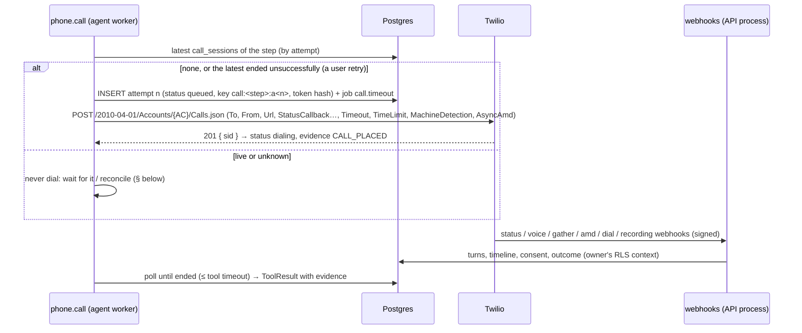

# Phase D — architecture, frozen contracts and ownership

Phase D gives JARVIS a voice and a phone: a continuous **voice conversation** on web and iOS
(listen → answer aloud → listen again, with barge-in, honest states and text fallback) and a
**phone agent** that places authorized outbound calls through a telephony gateway (Twilio),
says first that it is an AI assistant calling on someone's behalf, pursues exactly one approved
goal in German, Arabic or English, and reports a structured outcome with evidence — including the
master prompt's scenario 4 (an unsuccessful phone call). This document is the **stage 1
hand-off**: it freezes the contracts, the schema and the extension points so the telephony, web
and iOS engineers can build in parallel without editing the same files, and says exactly who
writes which file and which functions cross ownership boundaries.

Statuses: **Frozen** = decided and in the tree now (change only through §0); **Owner builds** =
specified here, implemented in stage 2 by the named owner.

Decisions with their own records: [ADR-0019 voice conversation](../adr/0019-voice-conversation.md),
[ADR-0020 telephony gateway](../adr/0020-telephony-gateway.md). Compliance:
[telephony, consent and recording](../security/telephony.md).

Contents: [0 Change control](#0-change-control-and-current-state) · [1 Scope map](#1-scope-map) ·
[2 Ownership](#2-ownership-and-file-layout) · [3 Feature designs](#3-feature-designs) ·
[4 Cross-boundary interfaces](#4-cross-boundary-interfaces-and-extension-points) ·
[5 Security](#5-security-notes) · [6 Contract reference](#6-contract-reference) ·
[7 Schema reference](#7-schema-reference-0008) · [8 Configuration](#8-configuration) ·
[9 Definition of done](#9-definition-of-done-per-owner)

## 0. Change control and current state

**Frozen in stage 1 (in the tree):**

| Artefact                                                                                                                                                                                              | What                                                                                                                                                                                                                                                                                         |
| ----------------------------------------------------------------------------------------------------------------------------------------------------------------------------------------------------- | -------------------------------------------------------------------------------------------------------------------------------------------------------------------------------------------------------------------------------------------------------------------------------------------- |
| `packages/contracts/src/{enums,limits,schemas,routes,telephony-webhooks}.ts`                                                                                                                          | Every Phase D enum, limit and schema, the 6 new user routes (80 total) and the separate telephony webhook route group (8 routes); tests `packages/contracts/test/phase-d.test.ts`                                                                                                            |
| `db/migrations/0008_phase_d.sql`                                                                                                                                                                      | `call_sessions` rebuilt, `call_turns`, `do_not_call`, `phone_verifications`, `users.phone_*`, `voice_sessions` conversation columns, recordings as evidence files (+ consent trigger), job kinds, RLS, grants, the definer look-up (immutable once merged: later changes go in `0009_*.sql`) |
| `apps/api/src/db/types.ts`                                                                                                                                                                            | Kysely types of every new / changed table                                                                                                                                                                                                                                                    |
| `apps/api/src/config.ts`, `.env.example`                                                                                                                                                              | Every Phase D environment variable with its production guards (§8); `Config.telephony`; `TWILIO_AUTH_TOKEN` forbidden in the browser worker                                                                                                                                                  |
| `apps/api/src/lib/{phone,twilio-signature,period}.ts`                                                                                                                                                 | E.164 normalisation and literal extraction, blocked destinations, masking, keyed number hashes; Twilio signature validation (Twilio's test vector); `currentDay`, `localTimeOfDay`                                                                                                           |
| `apps/api/src/modules/agent/tools/types.ts`                                                                                                                                                           | The Phase D `ToolDefinition` hooks (`phoneNumbers`, `call`, `needsTelephony`), `CallFacts`, `BindContext.{modelAvailable, locale}`, `ApprovalContext.telephony` (§4.1)                                                                                                                       |
| `apps/api/src/modules/agent/{policy,policy-domain,policy-telephony,step-policy,context,plan,planner,plan-job,executor,jobs}.ts`, `tools/registry.ts`, `models/offline.ts` (the hook only)             | The call rule and its facts, the telephony context, number literalness (NUMBER_NOT_LITERAL), planner hints, the telephony domain arrays and job dispatch (§4)                                                                                                                                |
| `apps/api/src/modules/agent/skills/{registry,service}.ts`, `agent/status.ts`                                                                                                                          | The phone-calling skill (built only once `phone.call` is registered), `TELEPHONY_NOT_CONFIGURED`, `capabilities.phoneCalls`                                                                                                                                                                  |
| `apps/api/src/modules/agent/i18n.ts` (MESSAGES), `tools/assistant-clarify.ts` (`QUESTION_KEY`)                                                                                                        | en/de/ar templates of the 9 new `ServerMessageKey`s (canonical wording — clients mirror it); questions for `phone_number`, `call_goal`                                                                                                                                                       |
| `apps/api/src/http/webhook-route.ts`, `src/routes.ts` (`PENDING_ROUTES`, `PENDING_WEBHOOK_ROUTES`), `modules/telephony/routes.ts` (the registration seam), `src/services.ts` (`AppDeps.modelAdapter`) | The unauthenticated, signature-validated route group and its boot check (§3.3); the pending lists (outside production only)                                                                                                                                                                  |
| `apps/api/src/modules/{account/me.ts, account/routes.ts (PATCH phone number, nested preference merge), voice/routes.ts, tasks/service.ts (voice-session link)}`                                       | `Me.phoneNumber` / `phoneNumberVerifiedAt` read and written; voice-conversation session metadata persisted                                                                                                                                                                                   |
| Empty extension files                                                                                                                                                                                 | `agent/tools/telephony/index.ts` (`telephonyTools`), `agent/intents/telephony/index.ts` (`telephonyIntents`), `agent/jobs/telephony/index.ts` (`telephonyJobs`)                                                                                                                              |
| `apps/api/evals/src/{scenario.ts,runners/common.ts}`, `evals/scenarios/telephony/*` (4 policy scenarios)                                                                                              | Suite `telephony`; `given.telephony`; `syntheticSteps[].call`                                                                                                                                                                                                                                |
| Tests                                                                                                                                                                                                 | `test/integration/rls-phase-d.int.test.ts` (RLS of every new table + DB invariants + the definer look-up), `test/unit/agent/policy-phase-d.test.ts`, `test/unit/http/phase-d-lib.test.ts`, route boot checks                                                                                 |
| `docs/api/openapi.json`                                                                                                                                                                               | Regenerated (91 operations: 83 user routes and SSE/probes + the 8 webhooks under `telephony-webhooks`)                                                                                                                                                                                       |
| Web (`apps/web`) — compile-level only                                                                                                                                                                 | `TOOL_LABEL` / `TOOL_ICON` for `phone.call`, catalogs (en/de/ar) for every new enum value, `phone_call` approvals decline-only, invalidation of the new stream events, fixtures with the new voice preferences                                                                               |

**Change control.** Anything marked Frozen changes only with a matching edit of this document, the
contracts tests and (for the schema) a new migration. Owners add internal code freely inside their
files. A new `ServerMessageKey`, `TaskErrorReason`, `ApiErrorReason`, `PolicyReason`, enum value,
route, webhook, column, job kind, tool hook or eval-schema field is a contract change: propose it
(a "contract request" with the reason), do not add it silently. Changes to `policy.ts`,
`policy-domain.ts` and `policy-telephony.ts` are changes of the security model and need a review
against §5.

**Stage 3 (integration) — all closed.** Every gap below was closed in stage 2 and integrated in
stage 3: the 7 user routes and the 9 webhooks are registered (`PENDING_ROUTES` and
`PENDING_WEBHOOK_ROUTES` are empty; a production boot of every bundle succeeds), `phone.call` is
built (the phone-calling skill is `implemented`, `capabilities.phoneCalls` is true wherever Twilio
is configured), web and iOS have the conversation mode and every phone view, and the iOS static
checks are green. Contract changes made in stage 3 (all additive; the contracts tests, OpenAPI —
now 93 operations — and the iOS mirrors follow them):

| Change                                                                                                                                                                                                                                 | Why                                                                                                       |
| -------------------------------------------------------------------------------------------------------------------------------------------------------------------------------------------------------------------------------------- | --------------------------------------------------------------------------------------------------------- |
| Route `getPhoneVerification` (`GET /v1/me/phone/verification` → `PhoneVerificationState { verification: PhoneVerification \| null }`: the latest calling / pending / failed one before its expiry, for the number the account has now) | A client that left Settings or reloaded shows the code field again (web `PhoneNumberRow`, iOS `resume`)   |
| Webhook `twilioCallWhisper` (`POST /v1/telephony/twilio/calls/:callId/whisper`, form `TwilioWhisperForm` with `ParentCallSid`, TwiML) — the 9th webhook; `<Dial><Number url=…>`                                                        | The user hears who is calling and why before a transfer is bridged (§3.2); a hang-up there bridges nobody |
| `TaskSummary.language` (`Locale \| null`, the planner's detected request language)                                                                                                                                                     | Voice mode reads answers in the request's language (web controller, iOS `view(of:)`)                      |
| `CallSummary.taskTitle` / `taskTitleMessage`; `DoNotCallEntry.taskId`; `ApprovalDetails.phone_call.callerIdDisplay`                                                                                                                    | Lists without a second query; a do-not-call entry links to its call; the caller id is readable            |
| `ModelPurpose` `call_dialog` (internal: MODEL_BALANCED, effort low, ≤ 1 000 tokens; `models/router.ts`)                                                                                                                                | The dialog's decisions are routed and metered as what they are                                            |
| `ToolCancelledError` (internal, `agent/errors.ts`): a tool that stopped because the task was cancelled while it ran; the executor ends the step and the task CANCELLED (`finishCancellation(…, 'step')`)                               | A first-class outcome instead of `phone.call` changing the task's state itself                            |
| Offline planner: a call request is a schedule only when its own words say so (`callRequestHead` of `intents/telephony/calls.ts`), never because of what JARVIS is to say or ask ("… and ask: do you deliver on Sundays?")              | The schedule intent ran first and turned such calls into a schedule question                              |
| Evals: `given.telephony.callee` / `calleeOnRetry` (pipeline mode runs the mock Twilio and the API's webhook routes); `spec-04-unsuccessful-phone-call` (offline + pipeline) and three planner-order scenarios                          | Master-prompt scenario 4 runs through the whole runtime                                                   |

**Known gaps at the end of stage 1 (deliberate, no placeholders) — all closed in stages 2–3:**

| Gap                                                                                                                                                                                                                                                                                                                              | Why                                                                                                  | Closed by |
| -------------------------------------------------------------------------------------------------------------------------------------------------------------------------------------------------------------------------------------------------------------------------------------------------------------------------------- | ---------------------------------------------------------------------------------------------------- | --------- |
| The 6 Phase D user routes and the 8 telephony webhooks answer **404** in development/test (`PENDING_ROUTES`, `PENDING_WEBHOOK_ROUTES`); a **production boot fails**                                                                                                                                                              | Declared in the contract; handlers are the telephony engineer's; no "not implemented" handler exists | Telephony |
| `phone.call` is not registered: the phone-calling skill reports `status: 'planned'`, `capabilities.phoneCalls` is false; spec-03 still expects "unsupported"                                                                                                                                                                     | A skill counts as built only once one of its tools is registered (`effectiveStatus`)                 | Telephony |
| `call.timeout` / `call.recording_fetch` have no handler (a job would fail)                                                                                                                                                                                                                                                       | Nothing enqueues them yet                                                                            | Telephony |
| Web shows `phone_call` approvals as decline-only; voice mode is still single dictation                                                                                                                                                                                                                                           | Never a blind approval; the views and the conversation mode are web work                             | Web       |
| iOS: `check-contract-copy.ts` reports 19 problems (new enum values in `Enums.swift`, 9 server sentences, reason / evidence copy) and `validate-fixtures.ts` 5 (`me.json` / `login-response.json` without the new voice fields; `unknown-values*.json` used `phone_call` / `phone_number` as "future" values, which are now real) | iOS work (lenient decoding keeps the app working against this server meanwhile)                      | iOS       |

**Verified at the end of stage 1:** `pnpm typecheck`, `lint`, `format:check` (exit 0); `pnpm -r
test` — contracts 89 (4 files), tokens 62, API unit 670 (52 files, including
`policy-phase-d.test.ts` and `phase-d-lib.test.ts`), web 306 (18 files); the API integration
suite on a fresh database migrated through 0008 — 50 files, 414 tests, including
`rls-phase-d.int.test.ts` (16: RLS of every new table, the definer look-up, one call per attempt,
consent / recording invariants, cascades, one live verification); evals offline 152/152 (4 new
`telephony` policy scenarios), model 12 + 1 pending (spec-03, needs a key — unchanged); OpenAPI
`--check` (91 operations); `node scripts/build.mjs` (server, worker, browser worker — no agent,
SecretBox or model code in the browser worker). Not green by design: the iOS static checks (see
the gaps above) and a production boot (pending routes).

## 1. Scope map

| #   | Feature                    | Contracts                                                                                                                                                                                                                       | Schema (0008)                                                                  | Owners                       |
| --- | -------------------------- | ------------------------------------------------------------------------------------------------------------------------------------------------------------------------------------------------------------------------------- | ------------------------------------------------------------------------------ | ---------------------------- |
| 1   | Voice conversation         | `Preferences.voice.{conversationMode, speakingRate, endOfSpeechSilenceMs, voiceNames}`, `VoiceSessionStart.{mode, conversationId}`, `VoiceSessionEnd.{outcome 'ended', turns, bargeIns, reconnects, endReason}`, `VOICE_LIMITS` | `voice_sessions` + mode, conversation, counters                                | Web, iOS                     |
| 2   | Phone agent (`phone.call`) | `ToolId` `phone.call`, `PhoneCallInput`, `CallScript`, `ApprovalDetails` `phone_call`, `CallSession`, `CallSummary`, `CallTurn`, `CallOutcome`, `TaskDetail.calls`, `CALL_LIMITS`, reasons, evidence, checks, stream events     | `call_sessions` (rebuilt), `call_turns`, evidence `recording`                  | Telephony, Web, iOS          |
| 3   | Telephony gateway          | `telephonyWebhookRoutes` (8), `TELEPHONY_WEBHOOK_LIMITS`, Twilio form schemas, `WEBHOOK_SIGNATURE_INVALID`                                                                                                                      | `telephony_webhook_target()`, job kinds `call.timeout`, `call.recording_fetch` | Telephony                    |
| 4   | Account phone number       | `Me.{phoneNumber, phoneNumberVerifiedAt}`, `UpdateMeRequest.phoneNumber`, `PhoneVerification`, `ConfirmPhoneVerificationRequest`, 2 routes                                                                                      | `users.phone_number`, `phone_verified_at`, `phone_verifications`               | Telephony (routes), Web, iOS |
| 5   | Do-not-call list           | `DoNotCallEntry`, `DoNotCallSource`, 2 routes, policy `DO_NOT_CALL`                                                                                                                                                             | `do_not_call` (keyed hash + sealed number + mask)                              | Telephony, Web, iOS          |
| 6   | Mock Twilio + simulator    | none (dev/test only)                                                                                                                                                                                                            | none                                                                           | Telephony                    |
| 7   | Compliance                 | —                                                                                                                                                                                                                               | —                                                                              | Architect (docs)             |

## 2. Ownership and file layout

Owners: **T** Telephony · **W** Web · **X** iOS (and the architect for frozen files). A file has
exactly one owner; another owner who needs a change asks the owner or follows §4. Tests live next
to their owner's code (new files only).

### T — Telephony engineer

```text
apps/api/src/modules/telephony/**             gateway.ts (TelephonyGateway: the provider seam), twilio/{client,errors,twiml}.ts (the
                                             Twilio REST adapter and TwiML builder), calls.ts (call sessions: create attempt, transitions,
                                             timeline, outcome, events), dialog/{engine,script,offline,model,rules,guard}.ts (the dialog
                                             engine, §3.2), webhooks.ts (the 8 handlers), verification.ts (phone verification calls),
                                             do-not-call.ts, recordings.ts, mappers.ts (toCallSession / toCallSummary / toDoNotCallEntry /
                                             toPhoneVerification), routes.ts (exists: registerTelephonyRoutes — user routes + webhooks)
apps/api/src/modules/agent/tools/telephony/** phone-call.ts; index.ts exports `telephonyTools` (exists, empty)
apps/api/src/modules/agent/intents/telephony/** offline intents (en/de/ar); index.ts exports `telephonyIntents` (exists, empty)
apps/api/src/modules/agent/jobs/telephony/**  call.timeout, call.recording_fetch handlers; index.ts exports `telephonyJobs` (exists, empty)
apps/api/src/modules/agent/policy-telephony.ts the call rule (exists, implemented and tested; changes: §0 change control)
apps/api/src/modules/account/export.ts        export v5 additions (calls, turns, do-not-call masked, phone number, verifications)
apps/api/src/modules/tasks/mappers.ts         one addition: TaskDetail.calls (via modules/telephony/mappers.ts)
apps/api/src/routes.ts                        only: remove names from PENDING_ROUTES / PENDING_WEBHOOK_ROUTES as handlers land (empty at the end)
tools/mock-twilio/**                          mock Twilio REST API + call simulator (§3.6) — dev/test only, never imported by src/
apps/api/test/**/telephony*, apps/api/evals/scenarios/telephony/** (≥ 8 offline scenarios; spec-03 updated), docs/skills/phone-calling.md
```

### W — Web (`apps/web/**`) · X — iOS (`apps/ios/**`)

Screens and copy per feature in §3.1 and §3.7; both consume only the contracts. Web replaces the
stage-1 compile-level stubs (decline-only `phone_call`, the new invalidation cases) with full
views; iOS mirrors every new enum, sentence and reason (`check-contract-copy.ts`, fixtures).

### Shared files

| File                                                                                                                                                 | Rule                                                                                               |
| ---------------------------------------------------------------------------------------------------------------------------------------------------- | -------------------------------------------------------------------------------------------------- |
| `packages/contracts/**`, `db/migrations/0008_phase_d.sql`, `apps/api/src/db/types.ts`, `config.ts`, `.env.example`, §0's Frozen table, this document | Frozen (§0)                                                                                        |
| `apps/api/src/lib/**`                                                                                                                                | Architect (T imports `phone.ts`, `twilio-signature.ts`; a change is a contract request)            |
| `apps/api/package.json`, `pnpm-lock.yaml`                                                                                                            | Architect: `libphonenumber-js` 1.13.14 is installed; no Twilio SDK (the adapter speaks REST, §3.3) |
| `apps/api/evals/src/**`                                                                                                                              | Architect (contract requests); scenario JSON files belong to the suite's owner                     |
| `docs/README.md`, `docs/security/{permission-model,telephony,privacy}.md`                                                                            | Architect                                                                                          |

## 3. Feature designs

### 3.1 Voice conversation (ADR-0019; W, X)

```mermaid
stateDiagram-v2
  [*] --> permission
  permission --> listening : granted
  permission --> denied : refused (explain how to enable; offer typing)
  listening --> submitting : final result + silence ≥ endOfSpeechSilenceMs
  listening --> [*] : stop phrase / End / Esc / idle
  submitting --> thinking : task created (or follow-up accepted)
  submitting --> reconnecting : network error (same Idempotency-Key, backoff)
  thinking --> speaking : answer delta / result line / question
  thinking --> awaiting_approval : task AWAITING_APPROVAL
  awaiting_approval --> thinking : approved / declined on screen (tap or click only)
  speaking --> listening : last sentence spoken
  speaking --> listening : barge-in (user speech cancels speaking at once)
  reconnecting --> thinking : stream back (Last-Event-ID) and task refetched
```



- **Turn-taking.** Recognition runs continuously (web `SpeechRecognition` with `continuous` and
  `interimResults`; iOS `SFSpeechRecognizer` with `requiresOnDeviceRecognition` when
  `supportsOnDeviceRecognition`, an `AVAudioEngine` input tap). An utterance ends at a **final**
  result followed by `preferences.voice.endOfSpeechSilenceMs` of silence (default 1 200 ms,
  600–4 000: adjustable — WCAG 2.2.1). The first utterance creates a task (`POST /v1/tasks`,
  `source: 'voice'`, `voiceSessionId`); every later one is a follow-up in the same conversation
  (`POST /v1/conversations/:id/messages`, Phase B). Each utterance gets its own Idempotency-Key,
  kept until the request is acknowledged, so a retry after a network error never creates two
  tasks. `CONVERSATION_BUSY` (the previous task still runs or waits for approval) is said and
  shown; the utterance stays in the text field — never queued silently.
- **Speaking, low latency.** The client subscribes to the task's `task.answer.delta` events (SSE,
  ephemeral), accumulates them and speaks each **complete sentence** as soon as it exists
  (`Intl.Segmenter` granularity `sentence` / `NLTokenizer(.sentence)`; chunks longer than
  `VOICE_LIMITS.maxSpokenChunkChars` split at commas). Without deltas it speaks, in order of
  preference: the answer, the result line (`resultSummaryMessage` rendered in the viewer's
  locale), the clarifying question, or the localized error line. The voice is
  `voiceNames[<language of the reply>]` (fallback: the platform default for that language), at
  `speakingRate`. Web `speechSynthesis` / iOS `AVSpeechSynthesizer`.
- **Barge-in.** While speaking, recognition keeps listening. iOS configures `AVAudioSession`
  `.playAndRecord`, mode `.voiceChat` (echo cancellation), options `.duckOthers`,
  `.defaultToSpeaker`, `.allowBluetooth` (`.allowBluetoothHFP` only exists from the iOS 26 SDK;
  it is the same option there); web asks `getUserMedia` for `echoCancellation`. An
  interim result that is not the echo of the sentence being spoken (normalised text not contained
  in it), or the mic level above threshold for 300 ms, cancels speaking **immediately**
  (`speechSynthesis.cancel()` / `stopSpeaking(at: .immediate)`) and returns to listening; the
  interrupted sentence stays in the captions. `bargeIns` is counted.
- **Approvals are never given by voice.** In `awaiting_approval` the client shows the
  ApprovalSheet and says (localized client copy) that the approval must be confirmed on screen.
  Speech in that state is not a decision: "yes" / "approve" is answered with the same sentence. A
  stop phrase still ends voice mode (the task keeps waiting).
- **Honest states and Presence.** Presence shows `listening` (live mic level), `thinking` only
  while the task is really QUEUED / PLANNING / RUNNING / VERIFYING (from SSE), `speaking` only
  while synthesis plays, `waiting` while an approval is pending, `offline` while reconnecting.
  Unsupported recognition (no `SpeechRecognition`, Firefox) says so and offers typing; denied
  microphone permission explains how to enable it (browser / iOS Settings).
- **Network recovery.** The SSE stream reconnects with `Last-Event-ID` (existing provider); after
  a reconnect the client refetches the task (events beyond the replay window may be missing). A
  pending submit is retried with the same Idempotency-Key at `VOICE_LIMITS.reconnectDelaysMs`;
  recognition restarts after its `network` / `aborted` errors with the same delays; after the
  last delay the session ends with the error shown and the text field focused.
- **Text fallback, accessibility.** A text field is always available in the overlay (typed
  requests take the same path, `source: 'text'`). Everything spoken is captioned (an `aria-live`
  region for JARVIS's sentences, the recognised text for the user's); keyboard: Space toggles
  listening, Esc ends, every control has an accessible name; focus is kept in the overlay;
  reduced motion disables the Presence animation; contrast per Meridian tokens (WCAG 2.2 AA).
- **Termination.** End button, Esc, a whole utterance equal to a stop phrase of the recognition
  language (`VOICE_LIMITS.stopPhrases`: "stop", "stopp", "توقف" …, compared lower-cased without
  punctuation), or `VOICE_LIMITS.idleEndSeconds` without speech (announced first). Stopping
  never cancels a running task (that is the task's own Cancel control).
- **Metadata only.** `POST /v1/voice-sessions { locale, engine, mode: 'conversation',
conversationId? }` (a conversation that is not the caller's → 404), every request carries
  `voiceSessionId` (the server links the session's first task and its conversation), and
  `POST /v1/voice-sessions/:id/end { outcome: 'ended' | …, transcriptChars, turns, bargeIns,
reconnects, endReason }`. No audio and no transcript beyond the requests themselves ever reach
  the server.

### 3.2 Phone agent: `phone.call` (T)

| Tool         | Risk                                             | Side effect | Idempotency     | Needs                | Approval     | Output fields (frozen; referenceable)                                                                                                                                              |
| ------------ | ------------------------------------------------ | ----------- | --------------- | -------------------- | ------------ | ---------------------------------------------------------------------------------------------------------------------------------------------------------------------------------- |
| `phone.call` | MEDIUM; HIGH for purpose `appointment` (binding) | external    | `once_per_step` | telephony configured | `phone_call` | `callId`, `result`, `goalReached`, `text` (resultTextField), `date`, `times`, `appointmentDate`, `appointmentTime`, `reference`, `reply`, `suspectedInjection`, `injectionSignals` |

**Input** = contracts `PhoneCallInput`: `to` (E.164), `calleeName`, `language`, `calleeTimeZone`,
`purpose` (`message` | `availability` | `questions` | `appointment`), `goal`, `message`,
`questions`, `date`, `window`, `shareInfo` (label + value — exactly what may be shared),
`maxDurationSeconds` (≤ `CALL_MAX_SECONDS`), `recording` (`off` default | `if_consented` |
`required`), `voicemail` (`hang_up` default | `leave_message`), `allowTransfer`, `dialog`
(`scripted` | `model`), `script`.

**Planning.**

- _Literal number._ `phoneNumbers(input) → [input.to]`; `validatePlan` requires it to be among
  the numbers written in the user's requests (`lib/phone.ts phoneNumbersInText`, with the default
  country of the account's own number for national formats; never the locale or the zone). The
  offline planner fails with `NUMBER_NOT_LITERAL` (code `PLANNER_UNSUPPORTED`); the model planner
  gets a repair hint (ask `phone_number` instead of guessing) and ends with `NUMBER_NOT_LITERAL`
  when it keeps inventing. A number from a result, page, mail, memory or a callee is never dialled.
- _Bind (deterministic, before the hash)._ `calleeTimeZone` ← the account's zone when absent;
  `dialog` ← `'model'` only when `BindContext.modelAvailable`, else `'scripted'`; `script` ← the
  call-language templates (`modules/telephony/dialog/script.ts`): the **opening always discloses
  first** ("Hello, this is JARVIS, an AI assistant calling on behalf of {ownName}. I'm calling to
  … I'll take notes of our call for {ownName}."), the recording question when recording is not off ("May I record this call? It is for
  {ownName} only."), the message, the questions as spoken, the closing, the voicemail message
  (only `leave_message`). The approval and its action hash therefore cover the exact words.
- _Offline intents (T, en/de/ar)._ "call <who> <number> and tell them …" → `message`; "call
  <number> and ask whether they have an appointment free on <day> [between …]" → `availability`
  (date with the Phase C date rules); "call <number> and ask: …?" → `questions`. No number →
  `assistant.clarify { missing: ['phone_number'] }`; nothing to say or ask → `call_goal`; a
  binding booking by phone offline → honest unsupported (needs the model). Titles `plan.call`,
  `objective.call`, `step.call` with `{ who }`.

**Policy** (`policy-telephony.ts`, §5): `TELEPHONY_NOT_CONFIGURED`, `CALL_DESTINATION_BLOCKED`,
`DO_NOT_CALL`, `CALL_OUTSIDE_HOURS`, `CALL_LIMIT` deny; else approval `PHONE_CALL` (+
`CALL_RECORDING`, `CALL_PERSONAL_INFO`; `BINDING_COMMITMENT` for appointments). It runs at
planning and again on the resolved input right before dialling.

**Approval** kind `phone_call` (`ApprovalDetails`): number (E.164 and readable), country, callee
name, on whose behalf, the caller id the callee sees, language, purpose, goal, **the script**,
dialog mode, date / window, every detail it may share, max duration, the calling window of the
callee's zone, recording mode, voicemail behaviour, transfer (allowed + the masked verified
number), binding, cost estimate (`CALL_PRICE_PER_MINUTE_USD × ⌈max minutes⌉`, null when unknown).
`approval.call { who, number }` is the summary. Approved by tap / click only (§3.1).

**Execution — exactly once per attempt** (`modules/telephony/calls.ts`):



- **Attempts.** `call_sessions` rows are inserted **before** the provider is asked, unique on
  `(user_id, idempotency_key)` and `(step_id, attempt)`. A step's latest attempt decides: none or
  ended unsuccessfully (busy, no answer, failed, voicemail, hung up — a retry the user asked for)
  → attempt n + 1; `queued` / `dialing` / `ringing` / `in_progress` → wait for it; `completed` /
  `answered` → reuse its outcome; `unknown` → reconcile first.
- **Unknown provider state → `OUTCOME_UNKNOWN`.** A create-call request that timed out after
  sending (or a 5xx without a body) leaves the attempt `unknown` and fails the step with
  `OUTCOME_UNKNOWN`, reason `CALL_STATE_UNKNOWN` (not retryable without acknowledgement). An
  acknowledged retry first reconciles: a webhook of that call meanwhile (it carries the call id in
  its URL) or `GET …/Calls.json?To=&From=&StartTime>=` matching it adopts the call; only a provider
  that lists no such call lets attempt n + 1 dial. A worker crash mid-call is the executor's
  generic `STEP_INTERRUPTED` (`OUTCOME_UNKNOWN`); the call itself continues on webhooks and the
  acknowledged retry finds it ended and reuses its outcome — **never a second call for the same
  attempt**.
- **The watchdog** (`call.timeout`, dedupe `call-timeout:<callId>`, at created + ring timeout +
  max duration + 60 s): a call not ended by then is completed at the provider
  (`POST …/Calls/{Sid}.json Status=completed`) and its final state read back; an `unknown` attempt
  is reconciled. Twilio's own `TimeLimit` is the second bound.
- **Results** (`CallResult`) and the step: `completed` / `answered` → SUCCEEDED with result line
  `result.callCompleted` / `result.callAnswered` / `result.callTransferred`; `busy`,
  `no_answer`, `failed`, `voicemail`, `hung_up` → FAILED `TOOL_FAILED` with `CALL_BUSY`,
  `CALL_NO_ANSWER`, `CALL_FAILED { status }`, `CALL_VOICEMAIL`, `CALL_HUNG_UP` — retryable
  (a retry is a new attempt, policy-checked again: hours, limit, do-not-call); `declined` →
  `CALL_DECLINED` (not retryable); the duration limit before the goal → `CALL_DURATION_LIMIT {
seconds }`; recording `required` refused → `RECORDING_CONSENT_DECLINED`. Provider errors before
  any call: 429 → `PROVIDER_RATE_LIMITED { provider: 'twilio', seconds }`, other 4xx →
  `PROVIDER_REJECTED { provider, status }`, unreachable → `PROVIDER_UNAVAILABLE` (retryable: nothing
  was placed). Task cancelled mid-call → JARVIS says a closing line and hangs up (result
  `canceled` before answer, `answered` after), step and task CANCELLED (the tool throws
  `ToolCancelledError`; the executor finishes the cancellation).
- **Evidence and checks.** `CALL_PLACED { provider, callSid }`, `AI_DISCLOSED { callSid, sequence }`,
  `RECORDING_CONSENT { callSid, consent, sequence }`, `CALL_TRANSCRIPT { callId, turns }`,
  `CALL_RECORDING { artifactId, seconds, sha256 }` (consent only), `CALL_TRANSFER { callSid, status }`,
  `CALL_ENDED { callSid, result, seconds }`, `DO_NOT_CALL_RECORDED { number }` (masked).
  `verify()`: `callConnected`, `aiDisclosed` (fails the step's verification if the opening turn is
  missing — a call without disclosure never counts as done), `callEnded`, `goalReached` /
  `detailsCollected`, `consentRespected`, `transcriptStored`. Cost: the provider's `price` (GET the
  call after it ended) as `cost_records` category `telephony` and `call_sessions.price_*`.

**The dialog engine** (`modules/telephony/dialog/*`, runs in the API process on webhooks):

- _Turns._ The voice webhook answers with TwiML: `<Say language voice>` the opening (turn 0,
  `disclosure`; `ai_disclosed_at`), then the recording question if any, then the first question
  inside `<Gather input="speech" language speechTimeout="auto" action=".../gather?t=…&n=<next
sequence>">`. Each gather answer is the callee's turn (`SpeechResult`, `Confidence`; nothing
  recognised → `LOW_CONFIDENCE` / silence handling, at most `CALL_LIMITS.maxSilentPrompts`), then
  the engine decides the next line. Languages (defaults, T may refine): en `en-US`, de `de-DE`,
  ar `ar-SA` for `<Gather>`; `<Say>` with a neural voice of the same language (Arabic: `arb`).
- _Callee speech is untrusted._ Every callee turn is run through the injection detector (flagged
  turns: `INJECTION_FLAGGED`, taint the outputs); it can never add steps, change the number, the
  purpose, amounts, recipients or what is shared, and never becomes a memory (memory.save only
  takes `conversation.recall`).
- _Scripted (offline, deterministic)._ `message`: deliver, ask for a reply, record it;
  `availability`: ask for free times on the date, extract times with rules (en/de/ar: "9:30",
  "half past nine", "um 14 Uhr", "الساعة الثانية") within the window, read them back once,
  close; `questions`: ask each, record each answer. Fixed handling in every language: "who are
  you?" → the disclosure again; a request outside the purpose (card details, other errands) →
  a refusal (`OUTSIDE_PURPOSE_REFUSED`); a request for a person → transfer or
  `TRANSFER_UNAVAILABLE` ("I'll ask {name} to call you back"); an **opt-out** ("don't call again",
  "nicht mehr anrufen", "لا تتصل مرة أخرى" …) → a do-not-call entry for the number (§3.5), an
  apology, hang up (`OPTED_OUT`); a refusal to talk to an AI → `declined`. Appointments are not
  agreed offline.
- _Model mode._ The model gets the approved input and script, the turns so far (callee turns
  framed `<callee trust="untrusted">`), and returns a structured decision `{ intent: 'ask' |
'answer' | 'confirm_appointment' | 'decline' | 'transfer' | 'goodbye', utterance, collected }`
  within `CALL_LIMITS.dialogModelTimeoutMs` (else the scripted line). A deterministic **guard**
  (`dialog/guard.ts`) decides what is said: `confirm_appointment` only for purpose `appointment`
  and a date/time inside the approved date and window (its sentence from a template, never model
  text); model text for `ask` / `answer` only after removing anything that looks like personal
  data (numbers, emails, dates of birth, IBAN / card digits) that is not a `shareInfo` value
  verbatim; anything else falls back to the scripted refusal. Usage is metered under the user's
  budget and route (`AppDeps.modelAdapter`, purpose `call_dialog`; offline route → scripted).
- _Voicemail._ Async AMD (`AnsweredBy` machine_*) → `leave_message` approved: the call is
  updated to TwiML that says the voicemail message (`VOICEMAIL_MESSAGE_LEFT`) and hangs up;
  otherwise hang up. Result `voicemail`.
- _Transfer._ Only with `allowTransfer`, a **verified** account number, a destination the policy
  would call, and the callee asking for a person (or the dialog unable to proceed):
  `<Say>` "I'll put you through to {name}." then `<Dial callerId="{TWILIO_FROM_NUMBER}"
timeout="CALL_LIMITS.transferRingSeconds" action=".../dial?t=…"><Number url=".../whisper?t=…">`
  (`twilioCallWhisper`: the user hears, in their own language, who is calling and why before the
  callee is bridged; only while this call's transfer is requested and for its own child leg —
  `ParentCallSid` — else `<Hangup/>` and nobody is put through; a leg that was not bridged,
  `DialBridged=false`, is no transfer). `TRANSFER_CONNECTED` / `TRANSFER_FAILED`.
- _Recording._ Only when the input says so **and** the callee accepted (consent rules: yes/no
  words en/de/ar; anything unclear counts as no): `POST …/Calls/{Sid}/Recordings.json` with a
  recording status callback; the consent turn and time are stored (`recording_consent`,
  evidence `RECORDING_CONSENT`). `call.recording_fetch` downloads the MP3 into evidence storage
  (kind `recording`, `audio/mpeg`, ≤ `CALL_LIMITS.maxRecordingBytes`; a trigger refuses it
  without consent) and deletes it at Twilio. Declined: `if_consented` continues unrecorded,
  `required` ends politely.
- _Limits._ `CALL_LIMITS.maxTurns`; at max duration − 20 s the closing is said
  (`DURATION_LIMIT`).

### 3.3 Telephony gateway and webhooks (ADR-0020; T)

- **Adapter.** `modules/telephony/twilio/client.ts` speaks Twilio's documented REST API
  (`application/x-www-form-urlencoded`, HTTP Basic `AccountSid:AuthToken`, base
  `config.telephony.apiBase` = `https://api.twilio.com` or the mock outside production, timeout
  10 s): `POST /2010-04-01/Accounts/{AC}/Calls.json` (`To`, `From`, `Url`, `Method=POST`,
  `StatusCallback`, `StatusCallbackEvent=initiated ringing answered completed`,
  `StatusCallbackMethod=POST`, `Timeout=CALL_LIMITS.ringTimeoutSeconds`,
  `TimeLimit=maxDurationSeconds + 30`, `MachineDetection=Enable`, `AsyncAmd=true`,
  `AsyncAmdStatusCallback`, `AsyncAmdStatusCallbackMethod=POST`), `POST …/Calls/{Sid}.json`
  (`Twiml` / `Status=completed`), `GET …/Calls/{Sid}.json`, `GET …/Calls.json?To&From&StartTime>`,
  `POST …/Calls/{Sid}/Recordings.json`, `GET` / `DELETE …/Recordings/{RE}`. Twilio error bodies
  (`{ code, message, more_info, status }`) map as in §3.2. Every URL it gives Twilio is
  `PUBLIC_WEBHOOK_BASE_URL` + a `telephonyWebhookRoutes` path + `?t=<the call's URL token>`.
- **The route group** (`http/webhook-route.ts`, frozen): an encapsulated scope with its own
  `application/x-www-form-urlencoded` parser (`TELEPHONY_WEBHOOK_LIMITS.maxBodyBytes`), outside
  the session-authenticated route table and its CSRF rule. Before a handler runs: telephony
  configured (else 404) → **`X-Twilio-Signature`** valid for `PUBLIC_WEBHOOK_BASE_URL` + the path
  and query as received + all form parameters (`lib/twilio-signature.ts`, constant time, default
  port tolerated — else 403 `WEBHOOK_SIGNATURE_INVALID`) → `AccountSid` = ours → params / query /
  form valid → the owner found by **id + SHA-256 of the URL token** through
  `telephony_webhook_target()` (SECURITY DEFINER, ids only; else 404). The handler gets the
  owner's `DbContext` and runs under RLS. Rate limit 1 200/min per address for the group.
  Responses: TwiML (`text/xml`, `no-store`) or 204.
- **Replay, ordering, idempotency (handlers' rules).** Status callbacks: ignored when their
  `Timestamp` is older than `maxEventAgeSeconds` or their `SequenceNumber` ≤
  `call_sessions.last_status_sequence`; a terminal status is applied once. Gather: the turn
  sequence `n` is in the signed URL — `n` < `turn_count` replays the stored next line (no new
  turn), `n` > `turn_count` is refused with the current question, `n` = `turn_count` is
  processed (`UNIQUE (call_session_id, sequence)` backs it). Voice: the opening is turn 0
  (`ON CONFLICT DO NOTHING`), re-rendered on a replay. AMD: once (`answered_by` null). Dial:
  only while a transfer is requested. Recording: only for the call's own `recording_sid`. After
  an ended call: nothing changes after `lateEventGraceSeconds`. The `CallSid` of every request
  must equal the session's once it is known.
- **Events.** `call.status_changed { callId, taskId, stepId, status, result }` and `call.turn {
callId, taskId, sequence, speaker }` (account events with the task id: clients refetch the task
  or the call — live captions of the call).

### 3.4 The account's phone number and verification (T routes; W, X screens)

`PATCH /v1/me { phoneNumber }` (frozen, built): E.164 of a valid number of an allowed type
(`PHONE_NUMBER_INVALID`, `CALL_DESTINATION_BLOCKED`); a different number clears its
verification; `null` removes it; audit `account.updated` with the field name only.
`POST /v1/me/phone/verification` (T): `PHONE_NUMBER_REQUIRED`, `PHONE_ALREADY_VERIFIED`,
`TELEPHONY_NOT_CONFIGURED`, destination check, at most `CALL_LIMITS.verificationMaxPerDay`
(`PHONE_VERIFICATION_LIMIT`, counted with the daily call limit), one live verification — places a
call whose voice webhook reads a 6-digit code twice (sealed in `phone_verifications`) → 201
`PhoneVerification`. `POST …/confirm { code }`: constant-time compare, at most
`verificationMaxAttempts` (`PHONE_VERIFICATION_INVALID { attemptsLeft }`, then expired),
`verificationTtlMinutes` (`PHONE_VERIFICATION_EXPIRED`), the number unchanged since → sets
`users.phone_verified_at`, returns `Me`; event `phone_verification.changed`. Only a verified number
can receive transfers; it is never said on a call unless listed in `shareInfo`.

### 3.5 Do-not-call (T)

An opt-out during a call (§3.2) inserts `do_not_call` (`source 'callee_request'`, keyed hash,
masked form, number sealed, the call) — `ON CONFLICT DO NOTHING`; evidence
`DO_NOT_CALL_RECORDED`. The policy denies every later call to the number (`DO_NOT_CALL`), at
planning and right before dialling. `GET /v1/do-not-call` lists masked entries; `DELETE
/v1/do-not-call/:id` removes one (audit `do_not_call.removed { source }` — the user may correct a
misunderstanding; the UI says the callee asked). Entries outlive tasks and calls; they go with
the account.

### 3.6 Mock Twilio and the call simulator (T, `tools/mock-twilio/**`)

A dependency-free Node server (like `tools/mock-providers`) started by tests and the e2e
harness, at `TWILIO_BASE_URL_OVERRIDE`: the REST resources of §3.3 with Twilio's documented
shapes (JSON resources with `sid`, `status`, `price`, `price_unit`, `uri`; error bodies with
`code`), Basic-auth checked, and a **call simulator** per created call that drives the webhooks
exactly as Twilio does — form-encoded, **signed with the auth token the same way**
(`X-Twilio-Signature`), with `SequenceNumber` / `Timestamp` / `CallbackSource` on status
callbacks — executing the TwiML it gets back (`<Say>`, `<Gather input="speech">` answered with
the scenario's next utterance and a confidence, `<Dial>`, `<Hangup>`, `<Redirect>`). Scenario
switches per number or header: answer, busy, no-answer, failed (create refused with a Twilio
error code), voicemail (AMD `machine_end_beep`), hang-up mid-call, silence, low confidence, opt
out, ask for a person, refuse AI, speech turns in en/de/ar, a create request that times out after
being accepted (unknown state), duplicated and out-of-order callbacks, a tampered signature,
recordings (media + delete). It records every request so tests prove exactly-once dialling and
that nothing was recorded without consent. Never imported by `src/`.

### 3.7 HTTP surfaces and clients

- **T routes:** `listCalls` (keyset `(created_at DESC, id DESC)`, `result` filter,
  `CallSummary`), `getCall` (`CallSession` with every turn), `listDoNotCall`, `deleteDoNotCall`,
  `startPhoneVerification` (rate limit 5/min/user), `confirmPhoneVerification`;
  `TaskDetail.calls` (turns up to `CALL_LIMITS.turnsInTaskDetail`); export v5 (calls with turns,
  do-not-call masked + source, phone number + verification time, verification history without
  codes, voice-session counters); account deletion: cascades (nothing to add — see
  [telephony](../security/telephony.md) for the processor's records).
- **W / X:** the conversation mode of §3.1 (overlay, captions, states, Settings › Voice:
  conversation mode, speaking rate, end-of-utterance pause, voice per language with a preview);
  the `phone_call` approval view (everything of §3.2, the script verbatim, recording and transfer
  stated plainly; approve label "Approve and call"); task detail: call card (status timeline,
  live captions from turns — callee text display-isolated and marked untrusted, outcome with
  collected details, evidence, recording player only when consented, failure reason with Retry);
  Settings › Phone: the number, verification by call, the do-not-call list; Activity › Calls.

## 4. Cross-boundary interfaces and extension points

### 4.1 Tool hooks (`agent/tools/types.ts`, frozen)

| Hook                                    | Used by                              | Meaning                                                                                                                          |
| --------------------------------------- | ------------------------------------ | -------------------------------------------------------------------------------------------------------------------------------- |
| `phoneNumbers(input)`                   | `validatePlan`                       | Numbers the tool dials: each literal in the user's requests (`NUMBER_NOT_LITERAL`)                                               |
| `call(input)`                           | `assessStep` → `policy-telephony.ts` | `CallFacts` of this input (`null` = places no call; a throw = an invalid number: deny)                                           |
| `needsTelephony`                        | `availableTools`                     | Hidden from the planner while no gateway is configured (offline intents still plan it, the policy explains)                      |
| `BindContext.modelAvailable`, `.locale` | `bind`                               | phone.call binds its dialog mode and default language                                                                            |
| `ApprovalContext.telephony`             | `approvalDetails`                    | `{ configured, callerId, onBehalfOf, transferTo (masked, verified only), allowedHours, pricePerMinuteMicroUsd, maxCallSeconds }` |

`AgentContext.telephony` (`TelephonyContext`, loaded by `loadAgentContext`): configured, allowed
countries and hours, max per day, calls today (attempts created since the start of the account's
day), the do-not-call hashes, the account's own number (number, verified, region). Absent → not
configured (every call denied). `PlanningInput` / `OfflinePlanContext` gain `telephonyAvailable`,
`phoneRegion`, `ownPhoneVerified`; `PlanValidationContext` gains `phoneRegion`.

### 4.2 Offline intents (`agent/intents/types.ts`, unchanged)

`planOffline` asks `integrationIntents`, then **`telephonyIntents`**, then `browserIntents` (a phone
booking names a number, a site booking a supported site). Rules of the file header apply. The
schedule intent (step 3, before the domain intents) only sees a call request's own words
(`callRequestHead`): "call … every Monday at 9 and tell them …" is a schedule, "call … and ask: do
you deliver on Sundays?" is a call.

### 4.3 Jobs (`modules/jobs/domain.ts`, unchanged)

| Domain    | Map                                             | Process                               | Kinds                                  |
| --------- | ----------------------------------------------- | ------------------------------------- | -------------------------------------- |
| Telephony | `agent/jobs/telephony/index.ts` `telephonyJobs` | `src/worker.ts` (`AGENT_DOMAIN_JOBS`) | `call.timeout`, `call.recording_fetch` |

`jobs.ts` dispatches every agent-worker domain (`AGENT_DOMAIN_JOBS = [integrationJobs,
telephonyJobs]`; a kind handled twice fails at load) and `worker.ts` starts every domain's timers.
Payloads: `call.timeout { callId }` (dedupe `call-timeout:<callId>`), `call.recording_fetch {
callId, recordingSid }` (dedupe `call-recording:<recordingSid>`, `max_attempts` 5).

### 4.4 Policy facts (`policy.ts`, `policy-telephony.ts`, `step-policy.ts`, frozen)

`PolicyInput.call: CallPolicyFacts | null` — `{ configured, to, masked, destination
(lib/phone.ts checkDestination), doNotCall, withinHours (null = unusable zone → deny), hours,
callsToday, maxPerDay, recording, sharesPersonalInfo }`, computed by `callPolicyFacts(facts,
agent, config)`; the hash key is HKDF-derived from `SECRET_ENCRYPTION_KEY` (`phoneHashKey`).

### 4.5 Function signatures between owners (binding for their implementers)

| Interface                                                                                                                                                                   | Where (owner)                               | Called by                                            |
| --------------------------------------------------------------------------------------------------------------------------------------------------------------------------- | ------------------------------------------- | ---------------------------------------------------- |
| `registerTelephonyWebhooks(app, deps, (define) => void)`, `define(name, handler: (TelephonyWebhookInput) => Promise<{ twiml } \| { empty: true }>)`                         | `http/webhook-route.ts` (architect, frozen) | T (`modules/telephony/routes.ts`)                    |
| `verifyTwilioSignature(token, url, params, header)`, `twilioSignature(…)`, `formParams(body)`                                                                               | `lib/twilio-signature.ts` (frozen)          | the route group; the mock signs on its own           |
| `parsePhoneNumber`, `phoneNumbersInText`, `checkDestination`, `maskPhoneNumber`, `phoneHashKey`, `phoneNumberHash`, `regionOfNumber`                                        | `lib/phone.ts` (frozen)                     | T, plan validation, policy facts, account            |
| `createTelephonyGateway(config): TelephonyGateway \| null` with `createCall`, `updateCall`, `fetchCall`, `findCalls`, `startRecording`, `fetchRecording`, `deleteRecording` | `modules/telephony/gateway.ts` (T)          | T's tool, jobs, verification                         |
| `nextTurn(deps, ctx, session, callee: { text, confidence } \| null): Promise<DialogDecision>`                                                                               | `modules/telephony/dialog/engine.ts` (T)    | T's webhooks                                         |
| `callsOfTask(trx, taskId): Promise<CallSession[]>`                                                                                                                          | `modules/telephony/mappers.ts` (T)          | `tasks/mappers.ts` (T's one addition)                |
| `AppDeps.modelAdapter`                                                                                                                                                      | `services.ts` (frozen; set in `server.ts`)  | T's model dialog (tests inject the scripted adapter) |

**Land-first order:** T lands `gateway.ts`, `mappers.ts` and `routes.ts` signatures first (bodies
on T's branch, never stubs in the integrated tree) and shrinks the pending lists as handlers land.

## 5. Security notes

**Webhook spoofing.** Webhooks have no session, so they are authenticated by what only Twilio and
this server share: the auth token (HMAC-SHA1 signature over the full public URL and every
parameter — rebuilt from configuration, never from `Host`), plus the per-call URL token (32 random
bytes, stored hashed, also the only way into the owner's RLS context, through a definer function
that returns ids only). A forged, replayed or reordered callback cannot change state: invalid
signature → 403 before anything is read; replays are idempotent by sequence and turn; ended calls
accept nothing after the grace period. The Twilio auth token is a secret (env only, redacted in
logs, refused in the browser worker).

**Toll fraud and cost.** Only numbers the user wrote; valid E.164 numbers of allowed types (never
premium-rate, shared-cost, personal, UAN, pager, voicemail access; emergency and short codes are
not numbers at all) in `CALL_ALLOWED_COUNTRIES` (default: the caller id's country only); a daily
limit per account; a maximum duration per call (input ≤ server cap; Twilio `TimeLimit`; the
watchdog); transfers only to the account's **verified** number, which passes the same destination
check; verification calls rate-limited and counted. The provider's real price is recorded; the
approval shows an upper bound when the operator configured one.

**Number literalness.** As recipients and URLs: the number must be written in the user's
requests (normalised the same way); never from results, pages, mail, memories or a callee. A
national number needs the account number's country — never guessed from locale or zone.

**Callee injection.** Everything a callee says is untrusted data: injection-scanned, framed as
untrusted for the model, never a source of numbers, recipients, amounts, steps or memories. The
model's dialog output passes a deterministic guard (§3.2): no commitments outside an approved
appointment window, no personal data except approved `shareInfo` values, no new errands; the
approved script and purpose bound the call.

**Consent and disclosure.** The opening discloses the AI and the user first, on every call
(verification fails without the disclosure turn). Recording: off by default; only with the user's
request for that call **and** the callee's spoken consent, recorded as a turn and evidence; a
trigger refuses to store a recording without it; the provider's copy is deleted after download.
Opt-outs are honoured with a do-not-call entry. Details: [telephony](../security/telephony.md).

**Policy rules added** (evaluation order; all in `policy-telephony.ts`, restrict-only):

| #   | Rule                                                              | Decision              | Reason code                                             | Task error reason (code `POLICY_DENIED`) |
| --- | ----------------------------------------------------------------- | --------------------- | ------------------------------------------------------- | ---------------------------------------- |
| 3b  | No telephony gateway on this server                               | deny                  | `TELEPHONY_NOT_CONFIGURED`                              | same                                     |
| 3b  | Invalid number, blocked type, or a country not allowed            | deny                  | `CALL_DESTINATION_BLOCKED`                              | same `{ country }`                       |
| 3b  | Number on the do-not-call list                                    | deny                  | `DO_NOT_CALL`                                           | same `{ number }` (masked)               |
| 3b  | Outside the allowed hours of the callee's zone (or unusable zone) | deny                  | `CALL_OUTSIDE_HOURS`                                    | same `{ start, end, timeZone }`          |
| 3b  | `CALL_MAX_PER_DAY` attempts today                                 | deny                  | `CALL_LIMIT`                                            | same `{ max }`                           |
| 5b  | Any call                                                          | approval (never auto) | `PHONE_CALL` (+ `CALL_RECORDING`, `CALL_PERSONAL_INFO`) | —                                        |
| 5b  | Purpose `appointment`                                             | approval              | `BINDING_COMMITMENT` (risk HIGH)                        | —                                        |

## 6. Contract reference

**User routes (7 new; 81 total)** — all `auth: user`:

| Method | Path                                | Name                       | Success | Notes                                       |
| ------ | ----------------------------------- | -------------------------- | ------- | ------------------------------------------- |
| GET    | `/v1/calls`                         | `listCalls`                | 200     | cursor, `result?`; `CallSummary`            |
| GET    | `/v1/calls/:id`                     | `getCall`                  | 200     | `CallSession` with every turn               |
| GET    | `/v1/do-not-call`                   | `listDoNotCall`            | 200     | masked numbers                              |
| DELETE | `/v1/do-not-call/:id`               | `deleteDoNotCall`          | 204     | audited                                     |
| GET    | `/v1/me/phone/verification`         | `getPhoneVerification`     | 200     | `{ verification }` to resume (stage 3)      |
| POST   | `/v1/me/phone/verification`         | `startPhoneVerification`   | 201     | `PhoneVerification`; 409 / 429 / 503 (§3.4) |
| POST   | `/v1/me/phone/verification/confirm` | `confirmPhoneVerification` | 200     | `Me`; 400 / 409                             |

No HTTP route places a call: calls are made only by the agent, with approval.

**Telephony webhooks (9; `telephonyWebhookRoutes`, tag `telephony-webhooks`, security
`twilioSignature`)** — POST, form-encoded, query `t` (+ `n` on gather): `twilioCallVoice`,
`twilioCallGather`, `twilioCallStatus`, `twilioCallAmd`, `twilioCallDial`, `twilioCallWhisper`
(stage 3), `twilioCallRecording` under `/v1/telephony/twilio/calls/:callId/…`;
`twilioVerificationVoice`, `twilioVerificationStatus` under
`/v1/telephony/twilio/verifications/:verificationId/…`.

**Additive changes** (older payloads still decode — tested): `Preferences.voice.{conversationMode,
speakingRate, endOfSpeechSilenceMs, voiceNames}` (defaults; `UpdateMeRequest` spells the voice
group out without defaults, `voiceNames` merged per language), `Me.{phoneNumber,
phoneNumberVerifiedAt}`, `UpdateMeRequest.phoneNumber`, `VoiceSessionStart.{mode,
conversationId}`, `VoiceSessionEnd.{outcome 'ended', turns, bargeIns, reconnects, endReason}`,
`VoiceSession.{mode, conversationId}`, `TaskDetail.calls`, `AssistantStatus.capabilities.phoneCalls`,
`EvidenceArtifact.callSessionId`, `ApprovalDetails` kind `phone_call`.

**New enum values:** `ToolId` +1 (`phone.call`); `ApiErrorReason` +9; `TaskErrorReason` +16;
`ServerMessageKey` +9 (`plan.call`, `objective.call`, `step.call`, `result.callCompleted`,
`result.callAnswered`, `result.callTransferred` `{ who }`; `approval.call { who, number }`;
`question.phoneNumber`, `question.callGoal`); `MissingInfo` +2 (`phone_number`, `call_goal`);
`SkillUnavailableReason` +1; `PolicyReason` +8; `EvidenceCode` +8; `VerificationCheckKey` +7;
`AccountEventType` +3 (`call.status_changed`, `call.turn`, `phone_verification.changed`);
`EvidenceArtifactKind` +`recording`, `EvidenceMediaType` +`audio/mpeg`. New enums: `CallPurpose`,
`CallStatus`, `CallResult`, `CallSpeaker`, `CallTurnKind`, `RecordingMode`, `RecordingConsent`,
`AnsweredBy`, `VoicemailAction`, `CallNoteCode`, `DoNotCallSource`, `PhoneVerificationStatus`,
`VoiceSessionMode`, `VoiceEndReason`, and the Twilio vocabularies of the webhook group. **No new
`NotificationKind`:** a call is a task step, so the task's own `task_completed` / `task_failed`
notifications report it (one notification, not two). **New schemas:** `E164PhoneNumber`,
`CallScript`, `CallShareItem`, `PhoneCallInput`, `CallTurn`, `CallStatusEvent`,
`CallCollectedDetails`, `CallOutcome`, `CallSession`, `CallSummary`, `CallListQuery`,
`DoNotCallEntry`, `PhoneVerification`, `ConfirmPhoneVerificationRequest`, the Twilio form schemas.
**Limits:** `CALL_LIMITS`, `TELEPHONY_WEBHOOK_LIMITS`, `VOICE_LIMITS`.

## 7. Schema reference (0008)

| Table / change            | Key columns and constraints                                                                                                                                                                                                                                                                                                                                                                                        | RLS      |
| ------------------------- | ------------------------------------------------------------------------------------------------------------------------------------------------------------------------------------------------------------------------------------------------------------------------------------------------------------------------------------------------------------------------------------------------------------------ | -------- |
| `users` +                 | `phone_number` (E.164 CHECK, plain — justified in the migration), `phone_verified_at` (only with a number)                                                                                                                                                                                                                                                                                                         | existing |
| `call_sessions` (rebuilt) | task + step CASCADE; `attempt`; unique `(user_id, idempotency_key)`, `(step_id, attempt)`; `provider_call_sid` unique; `webhook_token_hash` unique; callee number + keyed hash; status / result / outcome consistency; failure reason only unsuccessful; disclosure only after answer; consent asked only with recording, recording only with consent; timeline ≤ 64; sequence; price pair; approval + action hash | owner    |
| `call_turns`              | call CASCADE; unique `(call_session_id, sequence)`; speaker / kind enums; text 1–1 000; recognition facts only on callee turns                                                                                                                                                                                                                                                                                     | owner    |
| `do_not_call`             | unique `(user_id, number_hash)`; masked; sealed number + key id; source; call SET NULL (outlives it)                                                                                                                                                                                                                                                                                                               | owner    |
| `phone_verifications`     | sealed code; attempts ≤ 10; one live per user; ≤ 15 minutes; verified ⇔ time; call sid / token hash unique                                                                                                                                                                                                                                                                                                         | owner    |
| `voice_sessions` +        | `mode`, `conversation_id` (SET NULL), counters, `end_reason`; outcome + `ended`                                                                                                                                                                                                                                                                                                                                    | existing |
| `evidence_artifacts` +    | `call_session_id` CASCADE; kind `recording` ↔ `audio/mpeg` ↔ a call (exactly one source); ≤ 32 MiB for recordings, 2 MiB otherwise; one recording per call; trigger: no recording without the callee's consent                                                                                                                                                                                                     | existing |
| `jobs.kind`               | + `call.timeout`, `call.recording_fetch`                                                                                                                                                                                                                                                                                                                                                                           | —        |
| functions                 | `telephony_webhook_target(target, id, token_hash)` → (tenant, user) only on a matching hash                                                                                                                                                                                                                                                                                                                        | definer  |

Every new foreign key has an index on its referencing columns (`schema.int.test.ts`). Gotchas:
insert the attempt **before** the provider call and treat a unique violation as "this attempt
exists — read it"; insert turns with `ON CONFLICT (call_session_id, sequence) DO NOTHING`;
compute `callee_number_hash` with `phoneNumberHash(phoneHashKey(SECRET_ENCRYPTION_KEY), e164)`;
a recording row needs `recording_consent = 'accepted'` committed first.

## 8. Configuration

All optional, in `apps/api/src/config.ts` (Frozen) and `.env.example`:

| Variable                                                        | Default                             | Notes                                                                            |
| --------------------------------------------------------------- | ----------------------------------- | -------------------------------------------------------------------------------- |
| `TWILIO_ACCOUNT_SID`, `TWILIO_AUTH_TOKEN`, `TWILIO_FROM_NUMBER` | —                                   | all three or none; without them telephony is "not configured on this server"     |
| `PUBLIC_WEBHOOK_BASE_URL`                                       | —                                   | required with Twilio; an origin, no path or credentials; **https in production** |
| `TWILIO_BASE_URL_OVERRIDE`                                      | —                                   | the mock Twilio; **refused in production**                                       |
| `CALL_ALLOWED_HOURS`                                            | `08:00-20:00`                       | callee's zone; start before end                                                  |
| `CALL_MAX_SECONDS`                                              | `300`                               | 30–1 800; caps every call's own maximum                                          |
| `CALL_MAX_PER_DAY`                                              | `10`                                | 1–100 attempts per account and day of its zone                                   |
| `CALL_PRICE_PER_MINUTE_USD`                                     | —                                   | 0–10; the approval's cost estimate (unknown without it)                          |
| `CALL_ALLOWED_COUNTRIES`                                        | the country of `TWILIO_FROM_NUMBER` | ISO alpha-2 list; premium-rate etc. are blocked regardless                       |

Resolved: `Config.telephony` (`TelephonyConfig | null`: account, token, caller id, API base,
webhook base, allowed countries and hours, limits, price). The browser worker refuses
`TWILIO_AUTH_TOKEN` in production (scrubbed in development).

**Key rotation.** `do_not_call.number_hash` and `call_sessions.callee_number_hash` are keyed by a
key derived from `SECRET_ENCRYPTION_KEY`. The rotation procedure re-hashes `do_not_call` from its
sealed numbers (and call sessions from their numbers) in the same run that re-encrypts the
envelopes ([operations runbook](../runbooks/operations.md), T adds the step).

## 9. Definition of done (per owner)

Common: no stub, placeholder handler or fake data in the integrated tree; `PENDING_ROUTES` and
`PENDING_WEBHOOK_ROUTES` empty; every new server sentence a `ServerMessage`; en/de/ar complete;
RTL correct; WCAG 2.2 AA; `pnpm typecheck`, `lint`, `test`, `test:integration`, `openapi --check`,
`format:check`, offline evals green.

- **T:** the Twilio adapter against the documented REST API and the mock; the webhook handlers
  with signature, token, replay / ordering / idempotency tests (tampered signature, wrong account,
  replayed and out-of-order callbacks, stale timestamps, duplicate gathers, late events); the
  dialog engine (scripted en/de/ar for message / availability / questions; model mode with the
  scripted adapter: structured decisions, the guard refusing commitments and unlisted personal
  data, callee injection ignored); `phone.call` with exactly-once attempts (crash after create,
  create timing out → `CALL_STATE_UNKNOWN` → acknowledged retry reconciles, never a second call),
  every unsuccessful result → its precise reason and a safe retry (**scenario 4** end to end:
  busy → FAILED `CALL_BUSY` → retry → a new attempt answered → COMPLETED), voicemail with and
  without a message, hang-up mid-call, transfer to a verified number, opt-out → do-not-call → the
  next call denied, recording only with consent (and refused by the trigger otherwise), duration
  limit, the watchdog; phone verification; do-not-call routes; calls in `TaskDetail` and export v5;
  offline intents en/de/ar; the mock Twilio + simulator; ≥ 8 offline eval scenarios and spec-03
  updated; `docs/skills/phone-calling.md`; the rotation step in the runbook.
- **W:** conversation mode (states, barge-in, sentence streaming, captions, permission and
  unsupported states, reconnect, text fallback, stop phrases, keyboard), Settings › Voice and ›
  Phone (number, verification, do-not-call), the `phone_call` approval view, the call card with
  live captions, Activity › Calls; mock API fixtures for every new route and event; unit tests of
  the voice state machine (fake recognition / synthesis); visual review (light/dark, en/de/ar,
  mobile/desktop).
- **X:** the same natively (`SFSpeechRecognizer` on device when available, `AVSpeechSynthesizer`,
  `AVAudioSession` for barge-in, permission flows for microphone and speech recognition), models
  and endpoints for every new route, enum mirrors and strings (`check-contract-copy.ts` and
  `validate-fixtures.ts` green), lenient decoding tests with fixtures of every new schema.
