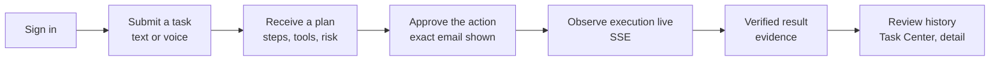

# Milestone 1 — vertical slice

Status: Milestone 1 (in progress). The checklist below is the sign-off list; the integration lead ticks
items only with evidence (test name, command output or screenshot).

## Definition

One complete, real path through the product, on web and iOS:

Reference scenario (English; equivalent German and Arabic requests must work):

> "Summarize https://example.org/article and email it to me"

| Step      | What happens                                                                                         | Evidence                                                                                         |
| --------- | ---------------------------------------------------------------------------------------------------- | ------------------------------------------------------------------------------------------------ |
| Plan      | 3 steps: `web.fetch` (LOW) → `text.summarize` (LOW) → `email.send` to the owner (MEDIUM, approval)   | `plan.ready`, steps with policy reasons                                                          |
| Fetch     | Public page fetched through the SSRF guard                                                           | `http_response`: `GET <final URL> → 200 (text/html, N bytes)`; `content_hash`: `sha256:<64 hex>` |
| Summarize | Model summary (model mode) or extractive summary (offline, labelled)                                 | `model_output` (model, tokens) or `note`                                                         |
| Approve   | Approval sheet: from, to, subject, full body, risk `MEDIUM`, reasons `RISK_MEDIUM`, `RECIPIENT_SELF` | Approval with `actionHash`; audit `approval.approved`                                            |
| Send      | SMTP via the owner's connection, Message-ID derived from the step's idempotency key                  | `smtp_receipt`: `250 …`, accepted count, Message-ID                                              |
| Verify    | Every step's post-condition checked                                                                  | `verification.passed` with checks                                                                |
| Result    | `COMPLETED`, one-line result summary, evidence list, cost                                            | Task detail                                                                                      |

Tools in this build: `web.fetch`, `text.summarize`, `email.send`, `memory.save`, `assistant.answer`.
Connections: Web access, SMTP email.

## Acceptance checklist

### Sign in

- [ ] Web: sign in with the owner created by `cli create-owner`; session cookie is `httpOnly`,
      `SameSite=Lax` (and `Secure` in production).
- [ ] iOS: sign in returns a bearer token stored in the Keychain; the app works after restart without
      signing in again.
- [ ] Wrong password shows a neutral error; the 11th login request per minute from one IP is rate limited.
- [ ] Sessions screen lists web and iOS sessions; revoking the iOS session signs the app out on its
      next request.

### Submit by text or voice

- [ ] Command bar submits a request; the task appears immediately as `QUEUED` with a placeholder title.
- [ ] Voice (web, supporting browsers): dictation in en/de/ar fills the command bar; the user submits;
      task `source` is `voice`; a voice session (metadata only) is recorded; the UI states which engine
      processes audio.
- [ ] Voice (iOS): on-device recognition where supported; same behaviour.
- [ ] Repeating a submit with the same `Idempotency-Key` creates no second task.

### Plan

- [ ] Task detail shows title, objective, numbered steps (tool, risk, policy decision and reasons).
- [ ] The planner mode is visible: "AI model (Anthropic, <model>)" or "Offline rules planner" with the
      reason (no key / disabled by you / budget used up).
- [ ] Offline: "Summarize <link> and email it to me" in en, de and ar produces the 3-step plan;
      an unsupported request fails with `PLANNER_UNSUPPORTED` and lists the supported commands.
- [ ] Model mode (scripted adapter in tests; live key when available): plans pass validation; recipients
      outside the request are rejected.

### Approve

- [ ] The approval sheet shows the sender, every recipient, subject and the complete body, risk and
      reasons, and the expiry time.
- [ ] Approve runs the step; Reject cancels the task with "declined" wording and sends nothing.
- [ ] A decision with a stale action hash is refused (`APPROVAL_MISMATCH`) and the sheet reloads.
- [ ] An expired approval cannot be approved; the task becomes `EXPIRED` and can be retried.
- [ ] With "Send emails to myself without asking" enabled, an email only to the owner runs without an
      approval; with a flagged page in the chain it still asks (`UNTRUSTED_CONTENT`).

### Observe live

- [ ] Status chips, step progress and the Presence indicator update from SSE without reload.
- [ ] Network loss and reconnect: no persisted event lost (`Last-Event-ID` replay); no duplicates.
- [ ] Streaming answers (`assistant.answer`) render incrementally in model mode.

### Verified result

- [ ] `COMPLETED` only after `verification.passed`; the result summary is in the request language.
- [ ] Evidence shows HTTP status, final URL, size, SHA-256; SMTP reply and Message-ID.
- [ ] The email arrives exactly once in the dev mailbox / test sink (`GET http://127.0.0.1:2580/messages`).
- [ ] A page with an embedded prompt injection is flagged; the plan and recipients do not change; the
      approval shows the flag.

### Review history

- [ ] Task Center filters: active, needs approval, completed, failed (includes cancelled and expired),
      all; pagination works.
- [ ] Task detail timeline lists every event in order with timestamps; cost (estimated vs. actual).
- [ ] Cancel available only when `canCancel`; Retry only when `canRetry`; retry after
      `OUTCOME_UNKNOWN` asks for explicit confirmation.

### Cross-cutting

- [ ] Every screen in light and dark, en/de/ar (RTL), 390 px and 1440 px reviewed with the
      [12-step checklist](../design/review-process.md); axe-core reports 0 serious/critical issues.
- [ ] Settings: language, theme, time zone, voice, autonomy, external models, notifications, budget,
      memory toggle all persist and take effect.
- [ ] Connections: enable Web access; connect the dev mailbox (`127.0.0.1:2525`, security "none",
      dev only); test; disconnect erases credentials.
- [ ] Memory: "Remember that I prefer window seats" saves a preference; search, edit, delete, delete all.
- [ ] Export downloads a JSON file without secrets; account deletion removes all user data.
- [ ] Admin overview shows real health, queue depth, tool reliability; no content anywhere.
- [ ] `pnpm typecheck`, `pnpm lint`, `pnpm test`, `pnpm test:integration`, `pnpm e2e` pass;
      `pnpm --filter @jarvis/api openapi --check` reports no drift.

### Automated coverage (API, already written)

| Behaviour                                                                                                                | Test                                                         |
| ------------------------------------------------------------------------------------------------------------------------ | ------------------------------------------------------------ |
| Plan → approval with exact email → completion with evidence                                                              | `apps/api/test/integration/agent/vertical-slice.int.test.ts` |
| Crash after send → `OUTCOME_UNKNOWN`, never re-sent automatically; acknowledged retry                                    | same file                                                    |
| Wrong action hash rejected; reject → `CANCELLED`, nothing sent                                                           | same file                                                    |
| Injection page cannot change recipients or plan                                                                          | same file                                                    |
| Retry after SMTP outage sends exactly once                                                                               | same file                                                    |
| Model-mode planning with a scripted adapter                                                                              | `apps/api/test/integration/agent/model-mode.int.test.ts`     |
| Lifecycle, cancel, expiry                                                                                                | `apps/api/test/integration/agent/lifecycle.int.test.ts`      |
| RLS isolation                                                                                                            | `apps/api/test/integration/rls.int.test.ts`                  |
| HTTP routes (tasks, approvals, stream, connections, memory, account, admin, home, notifications/voice)                   | `apps/api/test/integration/http/*.int.test.ts`               |
| Policy, plan validation, templates, offline planner, SSRF, HTML extraction, injection, pricing/router, Anthropic adapter | `apps/api/test/unit/agent/*.test.ts`                         |
| Token contrast (WCAG AA)                                                                                                 | `packages/tokens/test/contrast.test.ts`                      |
| Task state machine                                                                                                       | `packages/contracts/test/task-state.test.ts`                 |
