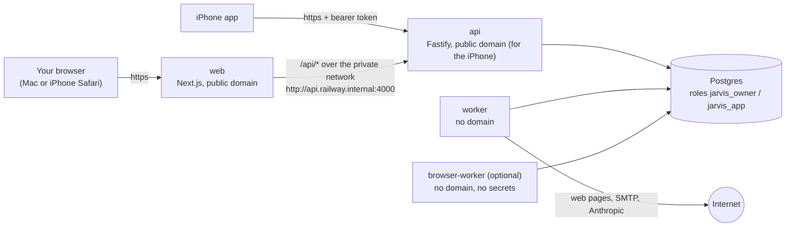

# نشر JARVIS على Railway (نشر تجريبي)

النسخة الإنجليزية: [deploy-railway.md](deploy-railway.md). مرجع المتغيرات:
[deploy/railway/variables.md](../../deploy/railway/variables.md) (بالإنجليزية). تطبيق iPhone:
[ios-testing.ar.md](ios-testing.ar.md).

يأخذك هذا الدليل من حساب Railway فارغ حتى تسجيل الدخول إلى JARVIS في المتصفح وعلى هاتف iPhone،
ثم تشغيل «الشريحة العمودية» للمرحلة الأولى: «لخّص هذه الصفحة وأرسلها إليّ بالبريد». إنه **نشر
تجريبي لمالك واحد** وليس إعدادًا للإنتاج؛ اقرأ أولًا [القيود المعروفة](../known-limitations.md)
(بالإنجليزية). خصّص نحو ساعتين للمرة الأولى.

> **ملاحظة صراحة.** لم يكن الوصول إلى توثيق Railway وواجهتها البرمجية ممكنًا من البيئة التي كُتبت
> فيها هذه الحزمة، ولم يكن تشغيل Docker ممكنًا فيها أيضًا. كُتبت ملفات إعداد Railway وفق مخطط
> «الإعداد كشيفرة» (config-as-code) الموثّق لدى Railway اعتمادًا على المعرفة المسبقة، وقد تختلف أسماء
> عناصر لوحة التحكم وأوامر سطر الأوامر قليلًا. ما جرى التحقق منه وما لم يجرِ مذكور في
> [القسم 18](#18-ما-جرى-التحقق-منه-وما-يجب-مراجعته). حيث يقول الدليل **(تحقّق)** فراجع توثيق Railway
> الحالي أو لوحة التحكم.

## المحتويات

1. [ما الذي ستبنيه](#1-ما-الذي-ستبنيه)
2. [قبل أن تبدأ](#2-قبل-أن-تبدأ)
3. [إنشاء المشروع في منطقة أوروبية](#3-إنشاء-المشروع-في-منطقة-أوروبية)
4. [إضافة PostgreSQL](#4-إضافة-postgresql)
5. [إنشاء الخدمات](#5-إنشاء-الخدمات)
6. [تجهيز قاعدة البيانات](#6-تجهيز-قاعدة-البيانات)
7. [توليد النطاقات](#7-توليد-النطاقات)
8. [ضبط المتغيرات](#8-ضبط-المتغيرات)
9. [النشر بالترتيب](#9-النشر-بالترتيب)
10. [إنشاء حساب المالك](#10-إنشاء-حساب-المالك)
11. [التأكد من أن كل شيء يعمل](#11-التأكد-من-أن-كل-شيء-يعمل)
12. [تشغيل الشريحة العمودية](#12-تشغيل-الشريحة-العمودية)
13. [الإعداد الكامل (اختياري)](#13-الإعداد-الكامل-اختياري)
14. [التحديث والتراجع](#14-التحديث-والتراجع)
15. [التكاليف](#15-التكاليف)
16. [النسخ الاحتياطية](#16-النسخ-الاحتياطية)
17. [استكشاف الأخطاء وإصلاحها](#17-استكشاف-الأخطاء-وإصلاحها)
18. [ما جرى التحقق منه، وما يجب مراجعته](#18-ما-جرى-التحقق-منه-وما-يجب-مراجعته)
19. [قائمة التحقق الأمنية](#19-قائمة-التحقق-الأمنية)
20. [إزالة كل شيء](#20-إزالة-كل-شيء)

## 1. ما الذي ستبنيه



| خدمة Railway     | تُبنى من                                                         | ملف الإعداد (Settings → Config-as-code) | تبدأ بالأمر                                                  | نطاق عام                                   |
| ---------------- | ---------------------------------------------------------------- | --------------------------------------- | ------------------------------------------------------------ | ------------------------------------------ |
| `Postgres`       | قالب PostgreSQL من Railway                                       | —                                       | —                                                            | لا (وكيل TCP للإعداد فقط)                  |
| `api`            | [apps/api/Dockerfile](../../apps/api/Dockerfile)                 | `/deploy/railway/api.json`              | `node dist/server.js` بعد `node dist/migrate.js` (قبل النشر) | نعم، المنفذ 4000 — لتطبيق iPhone (وTwilio) |
| `worker`         | ملف Dockerfile نفسه                                              | `/deploy/railway/worker.json`           | `node dist/worker.js`                                        | لا                                         |
| `web`            | [apps/web/Dockerfile](../../apps/web/Dockerfile)                 | `/deploy/railway/web.json`              | `node apps/web/server.js`                                    | نعم، المنفذ 3000                           |
| `browser-worker` | [apps/api/Dockerfile.browser](../../apps/api/Dockerfile.browser) | `/deploy/railway/browser-worker.json`   | أمر الصورة `tini -- node dist/browser-worker.js`             | لا                                         |

**لماذا يستخدم تطبيق الويب الشبكةَ الخاصة ويستخدم iPhone نطاقَ الواجهة البرمجية نفسه؟** يتحدث تطبيق
الويب إلى الواجهة البرمجية (API) عبر وكيله الخاص `/api`، فتبقى ملفات تعريف الارتباط (cookie) الخاصة
بالجلسة تابعة لنطاق الويب وحده ولا تنتقل إلى موقع آخر ([ADR-0012](../adr/0012-web-nextjs.md)). ويصل
هذا الوكيل إلى الواجهة البرمجية عبر الشبكة الخاصة في Railway، وهي غير مرئية من الإنترنت. أمّا تطبيق
iPhone فلا يستخدم ملفات تعريف الارتباط: إنه يسجّل الدخول برمز حامل (bearer token) ويتصل بالواجهة
البرمجية مباشرة، لذا تحتاج الواجهة البرمجية إلى نطاق عام بـ `https`. وتحتاجه كذلك خطافات Twilio
(اختيارية، للمكالمات الهاتفية). إن كنت ستختبر في المتصفح فقط، فيمكنك الاستغناء عن النطاق العام
للواجهة البرمجية.

## 2. قبل أن تبدأ

- **GitHub**: المستودع `mgrd281/NEXORA-AI` وفيه على الفرع `main` الشيفرة التي تريد اختبارها.
- **حساب Railway**: أنشئه في railway.com عبر GitHub وفعّل التحقق بخطوتين. تكفي الفترة التجريبية أو
  أرخص خطة مدفوعة للإعداد الأدنى؛ اطّلع على [القسم 15](#15-التكاليف) وعلى ملاحظة البريد في
  [القسم 12](#12-تشغيل-الشريحة-العمودية) قبل الاختيار.
- **على جهاز Mac** (عبر Homebrew):

  ```bash
  brew install railway libpq                 # Railway CLI (verify) and psql
  echo "export PATH=\"$(brew --prefix libpq)/bin:\$PATH\"" >> ~/.zshrc && source ~/.zshrc
  psql --version                              # 14 or newer
  git clone https://github.com/mgrd281/NEXORA-AI.git && cd NEXORA-AI
  ```

  إن لم تتوفر الصيغة `railway` في Homebrew، فثبّت أداة سطر الأوامر كما تشرح صفحة CLI لدى Railway
  (مثلًا `npm install -g @railway/cli`).

- **مدير كلمات مرور** لحفظ الأسرار التي ستولّدها.
- لاختبار البريد: صندوق بريد يتيح SMTP، مثل حساب Gmail مفعّل فيه التحقق بخطوتين (لإنشاء «كلمة مرور
  للتطبيقات»).

## 3. إنشاء المشروع في منطقة أوروبية

1. لوحة Railway ← **New Project** ← **Empty Project**. أعد تسميته (مثلًا `jarvis`).
2. لكل خدمة منطقتها (الخدمة ← **Settings** ← **Deploy** ← **Region**، تحقّق). اختر المنطقة
   **الأوروبية** نفسها لكل خدمة ستنشئها أدناه، مثل _EU West (Amsterdam)_. وجود قاعدة البيانات والخدمات
   في منطقة واحدة يقلّل زمن الاستجابة ويُبقي البيانات داخل الاتحاد الأوروبي.
3. اترك **PR environments** معطّلة (إعدادات المشروع ← Environments): فهي تنشر طلبات الدمج (pull
   requests) مع نسخ من متغيراتك.

## 4. إضافة PostgreSQL

1. داخل المشروع: **+ Create** (أو **+ New**) ← **Database** ← **PostgreSQL**. أبقِ الاسم `Postgres`
   (فيصبح النطاق الخاص `postgres.railway.internal`).
2. خدمة Postgres ← **Settings** ← اختر المنطقة الأوروبية.
3. لاحظ إصدار PostgreSQL المعروض على الخدمة. جرى اختبار JARVIS على الإصدار 16، والمطلوب 14 أو أحدث.
4. تعرض Postgres ← **Variables** المتغيرين `DATABASE_URL` (خاص) و`DATABASE_PUBLIC_URL` (وكيل TCP
   عام). كلاهما للمستخدم الفائق (superuser). ستستخدم العام مرة واحدة في القسم 6، ولا تعطِ أيًّا منهما
   لأي خدمة من خدمات JARVIS أبدًا.

## 5. إنشاء الخدمات

أنشئ `api` و`worker` و`web` بالطريقة نفسها (و`browser-worker` لاحقًا فقط إن أردته — القسم 13.3):

1. **+ Create** ← **Empty Service**. أعد تسميتها (`api` أو `worker` أو `web`).
2. الخدمة ← **Settings**:
   - **Source** ← **Connect Repo** ← `mgrd281/NEXORA-AI`، الفرع `main`. إن لم يظهر المستودع فاستخدم
     _Configure GitHub App_ وامنح Railway صلاحية الوصول إليه.
   - **Root Directory**: اتركه **فارغًا** (جذر المستودع)، لأن ملفات Dockerfile تنسخ الحزم المشتركة من
     الجذر.
   - **Config-as-code** ← **Railway config file** (تحقّق من الاسم): المسار المطلق من جدول القسم 1،
     مثل `/deploy/railway/api.json`. يحدّد هذا الملف أداة البناء (Dockerfile) ومسار ملف Dockerfile
     ومسارات المراقبة وأمرَي البدء وما قبل النشر وفحص الصحة وسياسة إعادة التشغيل.
   - **Region**: المنطقة الأوروبية نفسها.
   - Serverless / إيقاف التطبيق عند الخمول: **معطّل**.
3. قد يبدأ Railway أول عملية نشر فور ربط المستودع. ستفشل أو لن تفيد بدون المتغيرات — وهذا متوقع؛
   ستنشر عن قصد في القسم 9.

بعد حفظ مسار ملف الإعداد، افتح إعدادات الخدمة مجددًا وتأكد أنها تعرض _Dockerfile_ أداةً للبناء وأمر
البدء الموجود في الملف. إن حاول Railway بدلًا من ذلك اكتشاف تطبيق Node.js تلقائيًا، فمسار ملف
الإعداد خاطئ.

## 6. تجهيز قاعدة البيانات

يحتاج JARVIS إلى دورين في قاعدة البيانات (كما في التطوير المحلي، [scripts/db-setup.sh](../../scripts/db-setup.sh)):
`jarvis_owner` يملك الجداول ويشغّل الترحيلات (migrations)؛ و`jarvis_app` تستخدمه الخدمات العاملة ولا
يستطيع أبدًا تجاوز أمان مستوى الصف (Row-Level Security) الذي يعزل بيانات كل مستأجر. أنشئهما بالسكربت
[scripts/railway/bootstrap-db.sh](../../scripts/railway/bootstrap-db.sh) من النسخة المستنسخة على جهاز
Mac:

```bash
railway login
railway link                       # choose the project and the "production" environment
railway run --service Postgres bash scripts/railway/bootstrap-db.sh
```

يمرّر `railway run` إلى السكربت متغيراتِ خدمة Postgres، فيتصل عبر `DATABASE_PUBLIC_URL` باتصال مشفّر
(TLS). (بدون أداة سطر الأوامر: `bash scripts/railway/bootstrap-db.sh` ثم الصق `DATABASE_PUBLIC_URL`
عند الطلب المخفي.) يطبع السكربت سطرين:

```
DATABASE_OWNER_URL=postgresql://jarvis_owner:<generated>@postgres.railway.internal:5432/railway
DATABASE_URL=postgresql://jarvis_app:<generated>@postgres.railway.internal:5432/railway
```

- انسخ السطرين إلى مدير كلمات المرور الآن؛ ستلصقهما في القسم 8. يستخدمان العنوان **الخاص** لقاعدة
  البيانات، ولا تصل إليه إلا خدمات Railway.
- يمكن تشغيله مرة أخرى بأمان: تحتفظ الأدوار الموجودة بكلمات مرورها (ويظهر عندها في السطرين
  `<unchanged …>`). يضبط `JARVIS_DB_ROTATE=1` كلمات مرور جديدة؛ وبعدها حدّث المتغيرين وأعد نشر `api`
  و`worker` (و`browser-worker`).
- يستخدم السكربت قاعدة بيانات Railway المسماة `railway`. لوضع JARVIS في قاعدة بيانات مستقلة:
  `JARVIS_DB_NAME=jarvis railway run --service Postgres bash scripts/railway/bootstrap-db.sh` (وتنتهي
  العناوين حينها بـ `/jarvis`).
- لا يطبع أبدًا كلمة مرور المستخدم الفائق، ولا يضع أي كلمة مرور في سطر الأوامر. لا تلتقط صورة لمخرجاته
  ولا تشاركها.
- يعرض `bash scripts/railway/bootstrap-db.sh --help` جميع الخيارات.

لا تحتاج إلى وكيل TCP العام لخدمة Postgres (Postgres ← Settings ← Networking) إلا لهذا السكربت، وللنسخ
الاحتياطي بـ `pg_dump` من جهازك (القسم 16)، وللطريقة البديلة في القسم 10. يمكنك إزالته حين لا تحتاج
إليه وإضافته لاحقًا.

## 7. توليد النطاقات

1. `web` ← **Settings** ← **Networking** ← **Public Networking** ← **Generate Domain**، والمنفذ
   الهدف **3000**. ستحصل على شيء مثل `https://web-production-xxxx.up.railway.app`. هذا **نطاق
   الويب**؛ دوّنه كما هو تمامًا.
2. `api` ← **Generate Domain**، والمنفذ الهدف **4000** ← **نطاق الواجهة البرمجية**، مثل
   `https://api-production-xxxx.up.railway.app`. يحتاجه تطبيق iPhone (وTwilio).
3. `api` ← Settings ← Networking ← **Private Networking** يعرض نطاقها الخاص، وهو عادةً
   `api.railway.internal`. يستخدمه تطبيق الويب.
4. `worker` (و`browser-worker`): **بلا** نطاق.

## 8. ضبط المتغيرات

افتح [deploy/railway/variables.md](../../deploy/railway/variables.md) بجانب هذا الدليل: فيه كل متغير
لكل خدمة، وكتل جاهزة للنسخ واللصق في **Raw Editor** (الخدمة ← **Variables** ← **Raw Editor**). للإعداد
الأدنى:

1. ولّد مفتاح التشفير على جهاز Mac واحفظه في مدير كلمات المرور: `openssl rand -base64 32`.
2. **`api`**: `NODE_ENV=production` و`PORT=4000` و`HOST=::` و`DATABASE_URL` و`DATABASE_OWNER_URL`
   من القسم 6، و`WEB_ORIGIN=https://<نطاق الويب>` و`SECRET_ENCRYPTION_KEY`
   و`SECRET_ENCRYPTION_KEY_ID=k1` و`STORAGE_DRIVER=none`.
3. **`worker`**: `NODE_ENV=production`، والقيم نفسها في `api` لكلٍّ من `DATABASE_URL` و`WEB_ORIGIN`
   و`SECRET_ENCRYPTION_KEY` و`SECRET_ENCRYPTION_KEY_ID`، ثم `STORAGE_DRIVER=none`
   و`WORKER_CONCURRENCY=2`.
4. **`web`**: `API_ORIGIN=http://api.railway.internal:4000` (النطاق الخاص من القسم 7 ومنفذ `PORT`
   للواجهة البرمجية)، و`PORT=3000` و`HOSTNAME=0.0.0.0`.
5. اختم الأسرار: قائمة **⋮** لكل متغير ← **Seal** (لـ `DATABASE_URL` و`DATABASE_OWNER_URL`
   و`SECRET_ENCRYPTION_KEY`). تبقى القيم المختومة متاحة لعمليات البناء والنشر، لكن لا يمكن قراءتها بعد
   ذلك في لوحة التحكم (تحقّق).

قواعد مهمة:

- `WEB_ORIGIN` هو نطاق الويب **كما يظهر تمامًا** في شريط عنوان المتصفح: يبدأ بـ `https://`، بلا مسار،
  وبلا شرطة مائلة في آخره. أي اختلاف يجعل كل تعديل تقوم به في تطبيق الويب يُرفض برسالة «Cross-site
  request blocked».
- يجب أن يكون `SECRET_ENCRYPTION_KEY` **متطابقًا** في `api` و`worker`، ويجب **ألّا** يوجد أبدًا في `web`
  أو `browser-worker`.
- تُثبَّت قيمة `API_ORIGIN` داخل بناء تطبيق الويب. بعد تغييرها يجب **إعادة بناء** تطبيق الويب، لا مجرد
  إعادة تشغيله (انظر القسم 9). يطبع سجلّ بناء الويب القيمة التي استخدمها.
- لا تستخدم أبدًا `DATABASE_URL` الخاص بخدمة Postgres نفسها (المستخدم الفائق) لـ JARVIS، حتى لو اقترحته
  لوحة التحكم.
- لا تضف أي متغير خاص بالتطوير (`FETCH_ALLOW_PRIVATE_HOSTS` و`SMTP_ALLOW_INSECURE_LOCALHOST`
  و`*_BASE_URL_OVERRIDE` …). ترفض الخدمات البدء إذا وُجدت.

## 9. النشر بالترتيب

يعرض Railway الخدمات المعدّلة على أنها _staged_، ويطبّقها زر **Deploy**. انشر خدمة واحدة في كل مرة في
المرة الأولى:

1. **`api`**. افتح سجلات عملية النشر الجديدة:
   - البناء (Build): بناء Docker لملف `apps/api/Dockerfile` (بضع دقائق في المرة الأولى).
   - **ما قبل النشر (Pre-deploy)**: يطبع `node dist/migrate.js` الأسطر `applied 0001_init.sql` … ثم
     `8 migration(s) applied` في المرة الأولى، و`database is up to date` بعد ذلك. إن فشل، توقفت عملية
     النشر هنا ولا يُستبدل شيء من النسخة القديمة (القسم 17).
   - النشر (Deploy): `Server listening at http://…:4000` (سطر لكل عنوان)، ثم ينجح فحص الصحة
     `GET /readyz`.
2. **`worker`**: يُظهر السجل `"msg":"worker started"` مع `"planner":"offline"`. (إن كان قد بدأ قبل
   الترحيلات فقد تعطّل وسيُعاد تشغيله تلقائيًا؛ أو اضغط **Redeploy**.)
3. **`web`**: يُظهر سجل البناء
   `next.config rewrites /api/* to API_ORIGIN=http://api.railway.internal:4000` — تحقق من هذه القيمة.
   فحص الصحة هو `GET /sign-in`.

لإعادة بناء خدمة من آخر إيداع (commit) — وهو ضروري بعد تغيير `API_ORIGIN`: من **Deployments** في
الخدمة ← **⋮** ← إعادة النشر، أو لوحة الأوامر (⌘K) ← _Deploy latest commit_ (تحقّق أيّهما يعيد بناء
الصورة؛ أما الإيداع الجديد فيعيد البناء دائمًا).

## 10. إنشاء حساب المالك

لا توجد صفحة تسجيل. أنشئ الحساب بأداة سطر أوامر المشغّل **داخل حاوية `api` العاملة**، لتستخدم
المتغيرات نفسها والشبكة الخاصة. تُقرأ كلمة المرور من متغير البيئة `JARVIS_OWNER_PASSWORD`، ولا تُمرَّر
أبدًا وسيطًا في سطر الأوامر.

```bash
railway ssh --service api            # or the dashboard: api → ⋮ → Copy SSH command (verify)
```

داخل صدفة (shell) الحاوية:

```bash
bash                                                     # read -s needs bash
read -rs JARVIS_OWNER_PASSWORD && export JARVIS_OWNER_PASSWORD   # type it (≥ 12 characters), Enter
node dist/cli.js create-owner --email you@example.com --name "Your Name" --admin --locale ar --time-zone Europe/Berlin
unset JARVIS_OWNER_PASSWORD
exit
```

لن يظهر شيء أثناء كتابة كلمة المرور؛ اضغط Enter في النهاية. يجيب الأمر بـ
`Created owner + platform admin you@example.com (user …, tenant …)`. قيمة `--locale` هي `en` أو `de`
أو `ar` (لغة رسائل JARVIS نفسها)، ويمنحك `--admin` أيضًا شاشة الإدارة.

**طريقة بديلة بدون `railway ssh`** (من النسخة المستنسخة على جهاز Mac؛ تحتاج Node 22 وpnpm ووكيل TCP
العام لـ Postgres): `pnpm install --frozen-lockfile && pnpm --filter @jarvis/api build`، ثم

```bash
read -rs DATABASE_URL && export DATABASE_URL     # paste the jarvis_app URL, but with the PUBLIC host:port of Postgres
read -rs JARVIS_OWNER_PASSWORD && export JARVIS_OWNER_PASSWORD
NODE_ENV=production WEB_ORIGIN=https://<web domain> SECRET_ENCRYPTION_KEY="$(openssl rand -base64 32)" \
  node apps/api/dist/cli.js create-owner --email you@example.com --name "Your Name" --admin
unset DATABASE_URL JARVIS_OWNER_PASSWORD
```

(لا يستخدم `create-owner` مفتاح التشفير، لذا يكفي هنا مفتاح مؤقت. وإن رُفض الاتصال لغياب TLS، فأضف
`?sslmode=no-verify` إلى نهاية العنوان.)

## 11. التأكد من أن كل شيء يعمل

```bash
curl -s https://<api domain>/readyz        # {"ok":true,"database":true}
curl -s https://<web domain>/api/readyz    # the same answer, through the web's private proxy
```

يثبت السطر الثاني أن `API_ORIGIN` والشبكة الخاصة يعملان. افتح بعد ذلك `https://<نطاق الويب>` وسجّل
الدخول. ويمكنك اختياريًا تشغيل اختبار الدخان (smoke test) من جهاز Mac (يحتاج Node وcurl؛ يطلب كلمة
المرور ويُلغي جلسته في النهاية):

```bash
SMOKE_EMAIL=you@example.com SMOKE_ORIGIN=https://<web domain> scripts/smoke.sh https://<web domain>/api
```

يتحقق من أن الخدمة حيّة وجاهزة، ومن تسجيل الدخول، وملفك الشخصي، وأن **العامل (worker) سليم**، ثم
تسجيل الخروج.

## 12. تشغيل الشريحة العمودية

1. **الاتصالات (Connections) ← الوصول إلى الويب (Web access) ← تفعيل الوصول إلى الويب (Enable web
   access).** يستطيع JARVIS الآن قراءة صفحات الويب العامة (ولا يصل أبدًا إلى الشبكات الخاصة).
2. **الاتصالات ← البريد الإلكتروني (Email) ← إعدادات SMTP.** في Gmail: أنشئ كلمة مرور للتطبيقات من
   myaccount.google.com ← الأمان ← التحقق بخطوتين ← _كلمات مرور التطبيقات_، ثم:

   | الحقل                       | القيمة                                      |
   | --------------------------- | ------------------------------------------- |
   | خادم SMTP (SMTP server)     | `smtp.gmail.com`                            |
   | الأمان (Security)           | TLS (المنفذ 465) — أو STARTTLS (المنفذ 587) |
   | اسم المستخدم (Username)     | عنوان Gmail الكامل                          |
   | كلمة المرور (Password)      | كلمة مرور التطبيقات المكوّنة من 16 حرفًا    |
   | عنوان المرسل (From address) | عنوان Gmail نفسه                            |

   يسجّل JARVIS الدخول إلى الخادم قبل أن يحفظ أي شيء، وتُخزَّن كلمة المرور مشفّرة.

   > **Railway وSMTP (تحقّق).** وثّق Railway أن اتصالات SMTP الصادرة متاحة فقط في خطة Pro، ومحجوبة في
   > الخطط Free وTrial وHobby. إن فشل الحفظ برسالة «Could not reach the mail server» رغم صحة الإعدادات،
   > فهذا هو السبب المرجّح. الخيارات: خطة Pro؛ أو ربط حساب Google أو Microsoft (القسم 13.4) — فيرسل
   > JARVIS حينها عبر Gmail API أو Microsoft Graph بـ HTTPS بدلًا من SMTP.

3. **الرئيسية (Home)**: اطلب مثلًا: _«لخّص https://en.wikipedia.org/wiki/Rail_transport وأرسله إليّ
   بالبريد»_ (أو بالإنجليزية: _"Summarize https://en.wikipedia.org/wiki/Rail_transport and email it to
   me"_). بدون مفتاح Anthropic يتولى المخطِّط غير المتصل (offline planner) هذا النمط من الطلبات
   بالعربية والإنجليزية والألمانية (وتذكر الواجهة أنه يعمل دون اتصال).
4. يعرض JARVIS الخطة. إرسال البريد فعلٌ يغيّر شيئًا في العالم، لذا يستأذنك أولًا: راجع طلب الموافقة
   (المستلم، الموضوع، النص) ثم اضغط **الموافقة والإرسال** (Approve and send).
5. تنتهي المهمة بالملخص وأدلّته (الصفحة التي جُلبت) والرسالة المرسلة، ويصل البريد إلى صندوقك.
6. **على هاتف iPhone**: افتح `https://<نطاق الويب>` في Safari وسجّل الدخول — تطبيق الويب يعمل على
   الهاتف. أما التطبيق الأصلي فاتبع [ios-testing.ar.md](ios-testing.ar.md).

## 13. الإعداد الكامل (اختياري)

لكل إضافة: اضبط المتغيرات المذكورة في [variables.md](../../deploy/railway/variables.md) على الخدمات
المسمّاة هناك، ثم أعد نشر تلك الخدمات.

### 13.1 ذكاء اصطناعي حقيقي (Anthropic)

`ANTHROPIC_API_KEY` على `api` **و** `worker`. ستتوقف الواجهة عن ذكر وضع «غير متصل». اضبط حدًّا
للإنفاق في لوحة Anthropic ([التكاليف](../costs.md)).

### 13.2 تخزين الملفات (المرفقات والأدلة)

`STORAGE_DRIVER=s3` مع متغيرات `S3_*` و`AWS_ACCESS_KEY_ID` / `AWS_SECRET_ACCESS_KEY`، متطابقة على
`api` و`worker` (و`browser-worker`). يجب أن تكون الحاوية (bucket) خاصة. كُتب المشغّل لـ **AWS S3**
(مثلًا `eu-central-1`). أما **Cloudflare R2** وغيرها من الخدمات المتوافقة مع S3 فلم يُتحقق منها: يرسل
JARVIS مع كل رفع ترويسة تشفير من جهة الخادم ومجموع تحقق SHA-256، وقد ترفض بعض الخدمات ذلك — جرّب رفعًا
واحدًا واقرأ سجل الواجهة البرمجية.

### 13.3 عامل المتصفح — اقرأ هذا قبل إضافته

- **لا يضيف اليوم شيئًا في الإنتاج.** لا يفتح وكيل المتصفح إلا المواقع التي لها «وصفة» (recipe) جرت
  مراجعتها. الوصفات في هذا الإصدار هي متجر الاختبار المحلي وموقع الحجز المحلي، وهما مرفوضان في الإنتاج،
  والقارئ العام لا يغطي إلا مواقع الوصفات المفعّلة الأخرى
  ([apps/api/src/modules/browser/sites](../../apps/api/src/modules/browser/sites/index.ts)). لذا لا
  يوجد على Railway أي موقع يُسمح لعامل المتصفح بفتحه. تجاوزه في هذا الاختبار.
- **قد لا يسمح Railway بصندوق الحماية (sandbox) الخاص بـ Chromium (غير متحقَّق منه).** في الإنتاج يعمل
  Chromium دائمًا داخل صندوق الحماية، وهذا يتطلب نطاقات مستخدمين (user namespaces) غير مميّزة داخل
  الحاوية. إن منعتها المنصة، فشل كل تشغيل (في السجلات: `No usable sandbox` أو `Failed to move to new
namespace`) وانتهت مهام المتصفح بـ `BROWSER_CRASHED`. لا تحاول تعطيل صندوق الحماية؛ شغّل عامل المتصفح
  بدلًا من ذلك على مضيف يسمح به.
- يحتاج إلى تخزين الملفات (القسم 13.2) وإلى نحو **1 غيغابايت من الذاكرة** (كل جلسة Chromium تستهلك
  مئات الميغابايتات؛ وفي وضع الخمول استهلك نحو 140 ميغابايت في اختبارنا).
- إن أردت إضافته رغم ذلك: أنشئ الخدمة `browser-worker` (القسم 5) بملف الإعداد
  `/deploy/railway/browser-worker.json`؛ والمتغيرات `NODE_ENV=production` و`DATABASE_URL`
  (jarvis_app) ومتغيرات التخزين و`BROWSER_WORKER_CONCURRENCY=1`. **بلا** أسرار — فهو يرفض البدء إن وُجد
  أيٌّ من `SECRET_ENCRYPTION_KEY` أو `ANTHROPIC_API_KEY` أو `GOOGLE_CLIENT_SECRET` أو
  `MICROSOFT_CLIENT_SECRET` أو `DATABASE_OWNER_URL` أو `METRICS_TOKEN` أو `TWILIO_AUTH_TOKEN`، لذا لا
  تشاركه أبدًا المتغيرات المشتركة على مستوى المشروع. يجب أن يُظهر سجله `"browser worker started"` مع
  `"executable":"configured"`.

### 13.4 Google وMicrosoft (OAuth)

1. Google Cloud Console ← APIs & Services: فعّل Gmail API وGoogle Calendar API؛ واجعل شاشة الموافقة
   (OAuth consent screen) في وضع _Testing_ مع إضافة حسابك مستخدمًا تجريبيًا؛ ثم **Credentials** ←
   OAuth client ID ← **Web application** ← وفي Authorized redirect URI أدخل **حرفيًّا**
   `https://<نطاق الويب>/connections/callback`.
2. Microsoft Entra admin center ← App registrations ← New registration ← عنوان إعادة توجيه من نوع
   **Web**: `https://<نطاق الويب>/connections/callback`؛ ثم Certificates & secrets ← سرّ عميل جديد.
3. `GOOGLE_CLIENT_ID` / `GOOGLE_CLIENT_SECRET` و/أو `MICROSOFT_CLIENT_ID` / `MICROSOFT_CLIENT_SECRET`
   (`MICROSOFT_TENANT=common`) على `api` **و** `worker`.
4. الويب ← الاتصالات ← Google / Microsoft ← اربط الحساب. يعمل الاتصال بعدها في تطبيق iPhone أيضًا
   (أما الربط _من_ iPhone فيحتاج إلى إعداد إضافي؛ انظر [ios-testing.ar.md](ios-testing.ar.md)).

### 13.5 المكالمات الهاتفية (Twilio)

`TWILIO_ACCOUNT_SID` و`TWILIO_AUTH_TOKEN` و`TWILIO_FROM_NUMBER` و
`PUBLIC_WEBHOOK_BASE_URL=https://<نطاق الواجهة البرمجية>` على `api` و`worker`. اقرأ أولًا
[الاتصالات الهاتفية](../security/telephony.md)، وضيّق `CALL_ALLOWED_COUNTRIES`.

### 13.6 الأخطاء والتتبّع والمقاييس

`SENTRY_DSN` و`OTEL_EXPORTER_OTLP_ENDPOINT` (مع الترويسات) و`METRICS_TOKEN` كما يشرح
[دليل المراقبة](observability.md). سيكون `/metrics` على `api` قابلًا للوصول عبر نطاقها العام (مع
الرمز)؛ اترك `METRICS_TOKEN` غير مضبوط ما لم تكن تجمع المقاييس فعلًا.

### 13.7 نطاقك الخاص

أضفه إلى `web` (Settings ← Networking ← Custom Domain، ثم سجل DNS الذي يعرضه Railway). بعد ذلك وبهذا
الترتيب: أضف `https://<النطاق الجديد>/connections/callback` لدى Google/Microsoft (إن كنت تستخدمهما)؛
واضبط `WEB_ORIGIN=https://<النطاق الجديد>` على `api` **و** `worker` وأعد نشرهما؛ ثم سجّل الدخول عبر
النطاق الجديد (لا تنتقل ملفات تعريف الارتباط من النطاق القديم). ولنطاق خاص للواجهة البرمجية حدّث أيضًا
`PUBLIC_WEBHOOK_BASE_URL` و`JARVIS_API_BASE_URL` في تطبيق iPhone.

## 14. التحديث والتراجع

- عند الدفع (push) إلى `main` يعيد Railway بناء الخدمات التي تطابق **مسارات المراقبة** فيها التغيير
  (انظر كل ملف في `deploy/railway/*.json`؛ مثلًا تغيير تحت `apps/web/` يعيد نشر `web` وحده). تشغّل
  `api` الترحيلات في خطوة ما قبل النشر قبل أن تبدأ النسخة الجديدة؛ وإن فشلت تبقى النسخة السابقة عاملة.
- تُكتب الترحيلات بحيث تبقى متوافقة مع النسخة السابقة (توسيع ← نشر ← تقليص)، لذا لا ضرر في أن يُعاد
  تشغيل العامل بعد الواجهة البرمجية بقليل.
- التراجع: **Deployments** في الخدمة ← عملية نشر ناجحة سابقة ← **Redeploy** (تحقّق). لا تتراجع أبدًا
  عبر ترحيلٍ حذف بيانات ([دليل التشغيل](operations.md#deploy)).

## 15. التكاليف

يحاسب Railway حسب الاستخدام (الذاكرة والمعالج وتخزين وحدات التخزين وحركة البيانات الصادرة، بالدقيقة)
إضافةً إلى رسوم الخطة؛ والفترة التجريبية رصيدها محدود. **راجع railway.com/pricing** — الأسعار تتغير ولا
نذكرها هنا. للتقدير:

| الخدمة                     | الذاكرة (في الخمول)                                                                            |
| -------------------------- | ---------------------------------------------------------------------------------------------- |
| `api`                      | نحو 140 ميغابايت (قيس محليًا في وضع الإنتاج أثناء الخمول)                                      |
| `worker`                   | نحو 125 ميغابايت (قيس أثناء الخمول؛ أكثر أثناء التخطيط أو التلخيص)                             |
| `web`                      | لم يُقَس؛ تحتاج خوادم Next.js عادةً 100–250 ميغابايت                                           |
| `Postgres`                 | لم يُقَس؛ إضافةً إلى وحدة التخزين (بضع مئات من الميغابايتات للاختبار)                          |
| `browser-worker` (اختياري) | نحو 140 ميغابايت في الخمول (قيس) **ومئات الميغابايتات لكل جلسة Chromium — خطّط لـ 1 غيغابايت** |

أي إن الإعداد الأدنى يستهلك في الخمول نحو نصف غيغابايت من الذاكرة إجمالًا. بعد يوم، اقرأ صفحة **Usage**
في المشروع واضبط حدًّا أو تنبيهًا للاستخدام في إعدادات الفوترة. تكاليف النماذج (Anthropic) والمكالمات
(Twilio) يحاسب عليها مزوّدوها ([التكاليف](../costs.md)).

## 16. النسخ الاحتياطية

- **Postgres في Railway** يخزّن البيانات على وحدة تخزين (volume). يقدّم Railway نسخًا احتياطية لوحدات
  تخزين قواعد البيانات (خدمة Postgres ← **Backups**: يدوية ومجدولة؛ وتوفرها يعتمد على خطتك — تحقّق).
  فعّل جدولًا يوميًا. هذه **ليست** استعادة إلى نقطة زمنية (PITR).
- **نسختك الخاصة** (من جهاز Mac عبر وكيل TCP؛ يطلب عنوان المستخدم الفائق):

  ```bash
  read -rs DATABASE_PUBLIC_URL && export DATABASE_PUBLIC_URL
  pg_dump --format=custom --no-owner --no-privileges "$DATABASE_PUBLIC_URL" > "jarvis-$(date +%F).dump"
  unset DATABASE_PUBLIC_URL
  ```

  يحتوي ملف النسخة على بيانات الجميع: احفظه مشفّرًا. أسرار الاتصالات داخله مختومة بـ
  `SECRET_ENCRYPTION_KEY` الذي تحفظه **منفصلًا** (في مدير كلمات المرور).

- **للإنتاج الحقيقي** استخدم PostgreSQL مُدارًا يدعم الاستعادة إلى نقطة زمنية (مثل Neon أو Supabase أو
  AWS RDS) داخل الاتحاد الأوروبي، واتبع [دليل التشغيل ← النسخ الاحتياطية](operations.md#backups-and-restore).
  يفترض `bootstrap-db.sh` وجود مستخدم فائق، وأدوار الإدارة لدى المزوّدين المُدارين ليست كذلك عادةً، لذا
  يجب تكييف إعداد الأدوار هناك (لم يُختبر).

## 17. استكشاف الأخطاء وإصلاحها

| العَرَض                                                                                        | السبب والحل                                                                                                                                                                                                |
| ---------------------------------------------------------------------------------------------- | ---------------------------------------------------------------------------------------------------------------------------------------------------------------------------------------------------------- |
| يحاول Railway اكتشاف تطبيق Node / «no start command» / يستخدم Railpack أو Nixpacks             | مسار ملف الإعداد مفقود أو خاطئ (يبدأ بـ `/deploy/railway/`)، أو Root Directory ليس فارغًا                                                                                                                  |
| خطأ بناء `Cache mount ID is not prefixed with cache key`                                       | أُضيف `RUN --mount=type=cache` إلى ملف Dockerfile. يتطلب Railway الصيغة `id=s/<service id>-<path>`؛ ولا تستخدم ملفات JARVIS أيًّا منها عن قصد — احذفه                                                      |
| ما قبل النشر: `DATABASE_OWNER_URL is required`                                                 | أضف `DATABASE_OWNER_URL` إلى `api`                                                                                                                                                                         |
| ما قبل النشر: `password authentication failed for user "jarvis_owner"`                         | العنوان خاطئ أو قديم. أعد تشغيل `bootstrap-db.sh` مع `JARVIS_DB_ROTATE=1` والصق العناوين الجديدة                                                                                                           |
| ما قبل النشر: `permission denied to create extension` أو `permission denied for schema public` | لم يُشغَّل `bootstrap-db.sh` على قاعدة البيانات هذه (مثلًا `JARVIS_DB_NAME` يختلف عن القاعدة في العنوان). شغّله مجددًا لتلك القاعدة                                                                        |
| `getaddrinfo ENOTFOUND postgres.railway.internal`                                              | لخدمة Postgres نطاق خاص آخر (اسم آخر). استخدم النطاق الظاهر في Postgres ← Settings ← Networking في العنوانين (يطبعهما لك `JARVIS_DB_PRIVATE_HOST=… bootstrap-db.sh`)                                       |
| `Migration … was modified after being applied`                                                 | عدّل أحدهم ترحيلًا طُبّق سابقًا. أعده كما كان؛ التغييرات توضع في ملف جديد                                                                                                                                  |
| `api` تتوقف: `Invalid environment configuration:` تليها أسماء                                  | هذه المتغيرات مفقودة أو بصيغة خاطئة. `SECRET_ENCRYPTION_KEY: must be 32 bytes, base64-encoded` ← ولّده بـ `openssl rand -base64 32` والصقه بلا علامات تنصيص أو مسافات                                      |
| `WEB_ORIGIN must be https in production` (في api **أو worker**)                                | اضبط `WEB_ORIGIN=https://<نطاق الويب>` على الاثنتين                                                                                                                                                        |
| `listen EAFNOSUPPORT … :::4000`                                                                | لا يوجد IPv6 في الحاوية: اضبط `HOST=0.0.0.0` على `api` (وحينها تحتاج الشبكة الخاصة إلى دعم IPv4 في بيئة Railway لديك)                                                                                      |
| يفشل فحص صحة `api` (`/readyz` يعيد 503)                                                        | لا تصل الواجهة البرمجية إلى قاعدة البيانات: تحقق من `DATABASE_URL` (المضيف وكلمة المرور)                                                                                                                   |
| الويب: تسجيل الدخول يُظهر خطأ خادم، و`curl https://<web domain>/api/readyz` يعيد 500/502/504   | `API_ORIGIN` خاطئ (النطاق الخاص أو المنفذ) أو لم يُعَد بناء الويب بعد تغييره (راجع السطر في سجل البناء)، أو لا يمكن الوصول إلى الواجهة البرمجية عبر الشبكة الخاصة (`HOST=::`)                              |
| **403 «Cross-site request blocked»** بعد تسجيل الدخول                                          | `WEB_ORIGIN` لا يطابق العنوان في المتصفح (https، المضيف نفسه تمامًا، بلا شرطة مائلة أخيرة؛ وبعد إضافة نطاق خاص يجب أن يكون النطاق الجديد). صحّحه على `api` و`worker` وأعد نشر `api`                        |
| يبدو أن تسجيل الدخول «نجح» لكنك تعود إلى صفحة الدخول؛ لا يوجد ملف `jarvis_session`             | لست على `https`: ملف الجلسة في الإنتاج من نوع `Secure`. استخدم نطاق الويب بـ `https://` (لا نطاق الواجهة البرمجية، ولا `http://`)، واسمح بملفات تعريف الارتباط للموقع                                      |
| **429 «Too many requests»**                                                                    | يسمح تسجيل الدخول بعشر محاولات في الدقيقة لكل عنوان عميل (والمسارات الأخرى 300 في الدقيقة لكل مستخدم). خلف وكيل Railway قد يتشارك كل العملاء عنوانًا واحدًا. انتظر دقيقة                                   |
| تبقى المهام في الانتظار / «worker not healthy»                                                 | `worker` لا يعمل أو لا يصل إلى قاعدة البيانات: اقرأ سجلاته وتحقق من `DATABASE_URL` فيه                                                                                                                     |
| البريد: «Could not reach the mail server. Check host and port.»                                | SMTP محجوب في خطة Railway لديك (ملاحظة القسم 12)، أو المنفذ أو نوع الأمان خاطئ. «rejected the username or password» ← استخدم كلمة مرور للتطبيقات. «Unencrypted SMTP is not allowed» ← اختر TLS أو STARTTLS |
| يفشل إرسال البريد بعد إعادة نشر؛ لا يمكن فتح أسرار الاتصالات                                   | `SECRET_ENCRYPTION_KEY` مختلف بين `api` و`worker` أو تغيّر. اجعله متطابقًا وأعد ربط البريد ([تدوير المفتاح](operations.md#rotate-secret_encryption_key))                                                   |
| «Refusing to connect to a private or reserved address»                                         | الصفحة أو خادم البريد يُحلّ إلى عنوان خاص. الرفض مقصود (حماية من SSRF)                                                                                                                                     |
| `browser-worker` يتوقف: `must not be given …`                                                  | احذف المتغير المذكور من تلك الخدمة (وتحقق من المتغيرات المشتركة)                                                                                                                                           |
| تنتهي مهام المتصفح بـ `BROWSER_CRASHED`                                                        | لا يوجد تخزين ملفات على `browser-worker`، أو صندوق حماية Chromium غير مسموح (القسم 13.3)                                                                                                                   |
| تتوقف التحديثات الحية بعد مدة                                                                  | تُنهي الوكلاء تدفقات الأحداث الطويلة؛ يعيد عملاء الويب وiPhone الاتصال ويستأنفون تلقائيًا                                                                                                                  |

السجلات: الخدمة ← **Deployments** ← عملية نشر ← **Build / Deploy logs**، أو
`railway logs --service api`.

## 18. ما جرى التحقق منه، وما يجب مراجعته

جرى التحقق بتاريخ 2026-11-04 في حاوية التطوير (Linux وNode 22 وPostgreSQL 16)، وليس على Railway:

- ينتج `pnpm --filter @jarvis/api build` الملفات `dist/server.js` و`worker.js` و`browser-worker.js`
  و`cli.js` و`migrate.js` والمجلد `dist/migrations/` — وكل أمر بدء وما قبل نشر في `deploy/railway/*.json`
  يشير إلى ملف موجود في بنية الصورة (`/app/dist/…` و`/app/apps/web/server.js`). وتُقرأ ملفات JSON الأربعة
  دون أخطاء.
- شُغّل `bootstrap-db.sh` على خادم PostgreSQL 16 مؤقت تملك فيه قاعدةَ `railway` المستخدمُ الفائق، باتصال
  TCP بكلمة مرور: التشغيل الأول، وإعادة التشغيل، والتدوير، وكلمات مرور مختارة، وكلمة مرور خاطئة للمستخدم
  الفائق، وعنوان خاص، وغياب العنوان بدون طرفية، وقاعدة بيانات مستقلة (`JARVIS_DB_NAME`). لم تظهر كلمة مرور
  المستخدم الفائق في مخرجاته قط. ونجح `bash -n`. (يأتي macOS مع bash 3.2؛ يتجنب السكربت ميزات bash
  الأحدث، لكنه لم يُشغَّل إلا مع bash 5.)
- طبّق `node dist/migrate.js` بالدور `jarvis_owner` الترحيلات الثمانية كلها (منشئًا الامتدادات)، وأفاد في
  المرة الثانية بأن القاعدة محدّثة.
- مع `NODE_ENV=production`: بدأت `dist/server.js` (مع `HOST=0.0.0.0`؛ تعذّر اختبار `HOST=::` لأن ذلك
  الجهاز بلا IPv6) و`dist/worker.js` و`dist/browser-worker.js`، وأجاب `/healthz` و`/readyz` بـ 200، ونجح
  `create-owner`، ونجح `scripts/smoke.sh` (العامل سليم)، وحصل `Origin` خاطئ على 403 «Cross-site request
  blocked»، وأنشأت جلسة رمز حامل بأسلوب iPhone مهمة أكملها العامل، وبدأت الخدمة مع `STORAGE_DRIVER=s3`
  وقيم وهمية دون الاتصال بـ S3، ورُفض كل متغير محظور، وأوقف `SIGTERM` العاملين بشكل نظيف.
- منطق مسار Chromium في `Dockerfile.browser` تحت `dash` (‏`/bin/sh` في Debian) مع بنية playwright-core
  1.63.0 (‏`chromium-1243/chrome-linux64/chrome`).
- يحوّل المخطِّط غير المتصل طلبَي المثال في القسم 12 (العربي والإنجليزي) إلى خطة تلخيص وإرسال بالبريد.

لم يُتحقق منه:

- **لم تُبنَ أي صورة Docker** (لا يوجد خادم Docker هناك). تبني مهمة _images_ في CI صور الواجهة البرمجية
  والويب — ومعها صورة browser-worker التي أُضيفت مع هذه الحزمة — عند الدفع التالي، وتتحقق من أنها تعمل
  بمستخدم غير root، وتشغّلها؛ راجع نتيجتها قبل النشر.
- **Railway نفسه**: مفاتيح الإعداد كشيفرة، وأسماء عناصر لوحة التحكم، و`railway ssh`، وصيغة متغيرات
  الإحالة، وتمرير وسائط البناء، وسلوك ما قبل النشر، والشبكة الخاصة عبر IPv6 (`HOST=::`)، وسياسة SMTP،
  والنسخ الاحتياطية، وأسماء المناطق.
- صندوق حماية Chromium على Railway؛ والخدمات المتوافقة مع S3 غير AWS.

راجع قبل أول نشر: افتح كل ملف `deploy/railway/*.json` في محرر يتحقق منه وفق `$schema` (يفعل VS Code ذلك
تلقائيًا ويضع خطًا تحت المفاتيح غير المعروفة)، أو قارنه بإعدادات الخدمة بعد حفظ مسار الإعداد. المفاتيح
المستخدمة: `build.builder` (‏`DOCKERFILE`) و`build.dockerfilePath` و`build.watchPatterns` (بأسلوب
gitignore؛ الشرطة المائلة في البداية تعني جذر المستودع) و`deploy.startCommand`
و`deploy.preDeployCommand` (مكتوب مصفوفةً من أمر واحد) و`deploy.healthcheckPath`
و`deploy.healthcheckTimeout` (بالثواني) و`deploy.restartPolicyType` (‏`ON_FAILURE`)
و`deploy.restartPolicyMaxRetries` و`deploy.numReplicas`.

## 19. قائمة التحقق الأمنية

- [ ] `NODE_ENV=production` على كل خدمة؛ ولا يوجد أيٌّ من متغيرات التطوير المذكورة في
      [variables.md ← Never set these](../../deploy/railway/variables.md#never-set-these-on-railway)
      (والخدمات ترفضها على أي حال).
- [ ] `DATABASE_URL` هو عنوان `jarvis_app` على كل خدمة؛ و`DATABASE_OWNER_URL` على `api` وحدها؛ وعنوان
      المستخدم الفائق لـ Postgres على لا شيء.
- [ ] الأسرار مختومة؛ و`SECRET_ENCRYPTION_KEY` متطابق على `api` و`worker`، ومحفوظ في مدير كلمات المرور،
      وغائب عن `web` و`browser-worker`.
- [ ] `web` بلا أسرار؛ و`browser-worker` (إن وُجد) بلا أيٍّ من المتغيرات المحظورة وبلا متغيرات مشتركة.
- [ ] النطاقات العامة على `web` فقط، وعلى `api` (لأجل iPhone/Twilio). ووكيل TCP لـ Postgres مُزال حين لا
      تحتاج إليه.
- [ ] التحقق بخطوتين على حسابات Railway وGitHub وGoogle وAnthropic وTwilio. من يستطيع الدفع إلى `main`
      يستطيع النشر.
- [ ] كلمة مرور المالك 12 حرفًا على الأقل، فريدة، وأُدخلت عبر `JARVIS_OWNER_PASSWORD`.
- [ ] مخرجات `bootstrap-db.sh` غير محفوظة في ملفات أو محادثات أو صور شاشة؛ وإن حُفظت فدوّر كلمات المرور
      (`JARVIS_DB_ROTATE=1`).
- [ ] `METRICS_TOKEN` غير مضبوط ما لم تكن تجمع `/metrics`.
- [ ] حدود إنفاق لدى Anthropic (وTwilio)؛ و`CALL_ALLOWED_COUNTRIES` ضيّق.
- [ ] هذا نشر تجريبي: لا بيانات لأشخاص آخرين حتى تسمح بذلك [قائمة الإصدار](../release-checklist.md).

## 20. إزالة كل شيء

المشروع ← **Settings** ← احذف المشروع (يحذف الخدمات وقاعدة البيانات ووحدة التخزين — خذ نسخة `pg_dump`
أولًا إن أردت الاحتفاظ بشيء). ثم ألغِ ما أنشأته لأجله: كلمة مرور تطبيقات Gmail، وأسرار عملاء OAuth،
ومفتاح Anthropic، وبيانات اعتماد Twilio.
