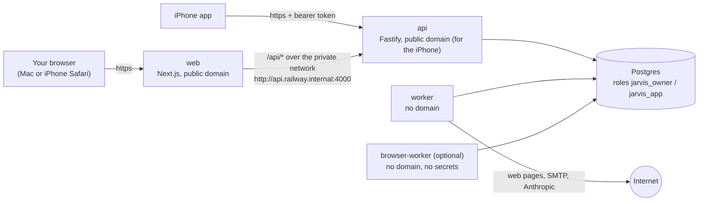

# Deploy JARVIS to Railway (test deployment)

Arabic version: [deploy-railway.ar.md](deploy-railway.ar.md). Variables reference:
[deploy/railway/variables.md](../../deploy/railway/variables.md). iPhone app:
[ios-testing.md](ios-testing.md).

This guide takes you from an empty Railway account to signing in to JARVIS in your browser and on
your iPhone, and running the Milestone 1 vertical slice ("summarize this page and email it to me").
It is a **test deployment for one owner**, not a production setup: read
[known limitations](../known-limitations.md) first. Plan about two hours the first time.

> **Honesty note.** Railway's documentation and API could not be reached from the environment this
> kit was written in, and Docker could not run there. The Railway configuration files follow
> Railway's documented config-as-code schema from memory; dashboard labels and CLI commands may
> differ slightly. What was and was not verified is listed in
> [§18](#18-what-was-verified-and-what-to-double-check). Where this guide says **(verify)**, check
> the current Railway docs or dashboard.

## Contents

1. [What you will build](#1-what-you-will-build)
2. [Before you start](#2-before-you-start)
3. [Create the project in an EU region](#3-create-the-project-in-an-eu-region)
4. [Add PostgreSQL](#4-add-postgresql)
5. [Create the services](#5-create-the-services)
6. [Prepare the database](#6-prepare-the-database)
7. [Generate the domains](#7-generate-the-domains)
8. [Set the variables](#8-set-the-variables)
9. [Deploy, in order](#9-deploy-in-order)
10. [Create your owner account](#10-create-your-owner-account)
11. [Check that it works](#11-check-that-it-works)
12. [Run the vertical slice](#12-run-the-vertical-slice)
13. [Full setup (optional)](#13-full-setup-optional)
14. [Updating and rolling back](#14-updating-and-rolling-back)
15. [Costs](#15-costs)
16. [Backups](#16-backups)
17. [Troubleshooting](#17-troubleshooting)
18. [What was verified, and what to double-check](#18-what-was-verified-and-what-to-double-check)
19. [Security checklist](#19-security-checklist)
20. [Tear it down](#20-tear-it-down)

## 1. What you will build



| Railway service  | Built from                                                       | Config file (Settings → Config-as-code) | Started with                                                     | Public domain                                    |
| ---------------- | ---------------------------------------------------------------- | --------------------------------------- | ---------------------------------------------------------------- | ------------------------------------------------ |
| `Postgres`       | Railway's PostgreSQL template                                    | —                                       | —                                                                | no (TCP proxy only for setup)                    |
| `api`            | [apps/api/Dockerfile](../../apps/api/Dockerfile)                 | `/deploy/railway/api.json`              | `node dist/server.js`, after `node dist/migrate.js` (pre-deploy) | yes, port 4000 — for the iPhone app (and Twilio) |
| `worker`         | the same Dockerfile                                              | `/deploy/railway/worker.json`           | `node dist/worker.js`                                            | no                                               |
| `web`            | [apps/web/Dockerfile](../../apps/web/Dockerfile)                 | `/deploy/railway/web.json`              | `node apps/web/server.js`                                        | yes, port 3000                                   |
| `browser-worker` | [apps/api/Dockerfile.browser](../../apps/api/Dockerfile.browser) | `/deploy/railway/browser-worker.json`   | the image's `tini -- node dist/browser-worker.js`                | no                                               |

**Why the web uses the private network and the iPhone the API's own domain.** The web app talks
to the API through its own `/api` proxy, so the session cookie belongs to the web domain only and
never travels to another site ([ADR-0012](../adr/0012-web-nextjs.md)). That proxy reaches the API
over Railway's private network, which the internet cannot see. The iPhone app does not use
cookies: it signs in with a bearer token and calls the API directly, so the API needs a public
`https` domain. Twilio webhooks (optional, phone calls) need it too. If you only test in a
browser, you can skip the API's public domain.

## 2. Before you start

- **GitHub**: the repository `mgrd281/NEXORA-AI` with the code you want to test on `main`.
- **Railway account**: sign up at railway.com with GitHub and turn on two-factor authentication.
  A trial or the cheapest paid plan is enough for the minimal setup; see [§15](#15-costs) and the
  email note in [§12](#12-run-the-vertical-slice) before choosing.
- **On your Mac** (Homebrew):

  ```bash
  brew install railway libpq                 # Railway CLI (verify) and psql
  echo "export PATH=\"$(brew --prefix libpq)/bin:\$PATH\"" >> ~/.zshrc && source ~/.zshrc
  psql --version                              # 14 or newer
  git clone https://github.com/mgrd281/NEXORA-AI.git && cd NEXORA-AI
  ```

  If the `railway` formula is not available, install the CLI as described on Railway's CLI page
  (e.g. `npm install -g @railway/cli`).

- A **password manager** for the secrets you will generate.
- For the email test: a mailbox that offers SMTP, e.g. a Gmail account with 2-Step Verification
  (for an app password).

## 3. Create the project in an EU region

1. Railway dashboard → **New Project** → **Empty Project**. Rename it (e.g. `jarvis`).
2. Every service has its own region (service → **Settings** → **Deploy** → **Region**, verify).
   Choose the same **EU** region for every service you create below, e.g. _EU West (Amsterdam)_.
   Keeping the database and the services in one region keeps latency low and data in the EU.
3. Leave **PR environments** off (project settings → Environments): they would deploy pull
   requests with copies of your variables.

## 4. Add PostgreSQL

1. In the project: **+ Create** (or **+ New**) → **Database** → **PostgreSQL**. Keep the name
   `Postgres` (the private domain becomes `postgres.railway.internal`).
2. Postgres service → **Settings** → set the EU region.
3. Note the PostgreSQL version shown on the service. JARVIS is tested on 16; 14 or newer is
   required.
4. Postgres → **Variables** shows `DATABASE_URL` (private) and `DATABASE_PUBLIC_URL` (public TCP
   proxy). Both are the **superuser**. You use the public one once, in §6, and never give either
   to a JARVIS service.

## 5. Create the services

Create `api`, `worker` and `web` the same way (and `browser-worker` later, only if you want it —
§13.3):

1. **+ Create** → **Empty Service**. Rename it (`api`, `worker`, `web`).
2. Service → **Settings**:
   - **Source** → **Connect Repo** → `mgrd281/NEXORA-AI`, branch `main`. If the repository is not
     listed, use _Configure GitHub App_ and give Railway access to it.
   - **Root Directory**: leave **empty** (the repository root). The Dockerfiles copy shared
     packages from the root.
   - **Config-as-code** → **Railway config file** (verify the label): the absolute path from the
     table in §1, e.g. `/deploy/railway/api.json`. This sets the builder (Dockerfile), the
     Dockerfile path, watch paths, start and pre-deploy commands, healthcheck and restart policy.
   - **Region**: the same EU region.
   - Serverless / app sleeping: **off**.
3. Railway may start a first deployment as soon as the repository is connected. It will fail or
   be useless without variables — that is expected; you deploy deliberately in §9.

After saving the config file path, open the service's settings again and check that they show
_Dockerfile_ as the builder and the start command from the file. If Railway instead tries to
detect a Node.js app, the config file path is wrong.

## 6. Prepare the database

JARVIS needs two database roles (as in local development, [scripts/db-setup.sh](../../scripts/db-setup.sh)):
`jarvis_owner` owns the tables and runs migrations; `jarvis_app` is what the running services use
and can never bypass Row-Level Security (tenant isolation). Create them with
[scripts/railway/bootstrap-db.sh](../../scripts/railway/bootstrap-db.sh), from the clone on your
Mac:

```bash
railway login
railway link                       # choose the project and the "production" environment
railway run --service Postgres bash scripts/railway/bootstrap-db.sh
```

`railway run` gives the script the Postgres service's variables; it connects with
`DATABASE_PUBLIC_URL` over TLS. (Without the CLI: `bash scripts/railway/bootstrap-db.sh` and paste
`DATABASE_PUBLIC_URL` at the hidden prompt.) It prints two lines:

```
DATABASE_OWNER_URL=postgresql://jarvis_owner:<generated>@postgres.railway.internal:5432/railway
DATABASE_URL=postgresql://jarvis_app:<generated>@postgres.railway.internal:5432/railway
```

- Copy both into your password manager now; you paste them in §8. They use the database's
  **private** address, which only Railway services can reach.
- It is safe to run again: existing roles keep their passwords (the lines then say
  `<unchanged …>`). `JARVIS_DB_ROTATE=1` sets new passwords; afterwards update both variables and
  redeploy `api`, `worker` (and `browser-worker`).
- It uses Railway's database `railway`. To keep JARVIS in a database of its own:
  `JARVIS_DB_NAME=jarvis railway run --service Postgres bash scripts/railway/bootstrap-db.sh` (the
  URLs then end in `/jarvis`).
- It never prints the superuser password and never puts a password on a command line. Do not
  screenshot or share its output.
- `bash scripts/railway/bootstrap-db.sh --help` lists every option.

The public TCP proxy of Postgres (Postgres → Settings → Networking) is only needed for this script,
for `pg_dump` backups from your Mac (§16) and for the fallback in §10. You may remove it when you
do not need it and add it again later.

## 7. Generate the domains

1. `web` → **Settings** → **Networking** → **Public Networking** → **Generate Domain**, target
   port **3000**. You get something like `https://web-production-xxxx.up.railway.app`. This is
   your **web domain**; write it down exactly.
2. `api` → **Generate Domain**, target port **4000** → your **API domain**, e.g.
   `https://api-production-xxxx.up.railway.app`. Needed for the iPhone app (and Twilio).
3. `api` → Settings → Networking → **Private Networking** shows its private domain, normally
   `api.railway.internal`. The web uses it.
4. `worker` (and `browser-worker`): **no** domain.

## 8. Set the variables

Open [deploy/railway/variables.md](../../deploy/railway/variables.md) next to this guide: it lists
every variable per service, and has copy-paste blocks for the **Raw Editor** (service →
**Variables** → **Raw Editor**). For the minimal setup:

1. Generate the encryption key on your Mac and store it in your password manager:
   `openssl rand -base64 32`.
2. **`api`**: `NODE_ENV=production`, `PORT=4000`, `HOST=::`, `DATABASE_URL` and
   `DATABASE_OWNER_URL` from §6, `WEB_ORIGIN=https://<web domain>`, `SECRET_ENCRYPTION_KEY`,
   `SECRET_ENCRYPTION_KEY_ID=k1`, `STORAGE_DRIVER=none`.
3. **`worker`**: `NODE_ENV=production`, the same `DATABASE_URL`, `WEB_ORIGIN`,
   `SECRET_ENCRYPTION_KEY` and `SECRET_ENCRYPTION_KEY_ID` as `api`, `STORAGE_DRIVER=none`,
   `WORKER_CONCURRENCY=2`.
4. **`web`**: `API_ORIGIN=http://api.railway.internal:4000` (the private domain from §7 and the
   API's `PORT`), `PORT=3000`, `HOSTNAME=0.0.0.0`.
5. Seal the secrets: each variable's **⋮** menu → **Seal** (`DATABASE_URL`, `DATABASE_OWNER_URL`,
   `SECRET_ENCRYPTION_KEY`). Sealed values are still given to builds and deployments but can no
   longer be read in the dashboard (verify).

Rules that matter:

- `WEB_ORIGIN` is the web domain **exactly** as the browser shows it: `https://`, no path, no
  trailing slash. Anything else and every change you make in the web app is refused with
  "Cross-site request blocked".
- `SECRET_ENCRYPTION_KEY` must be **identical** on `api` and `worker`, and must **never** be on
  `web` or `browser-worker`.
- `API_ORIGIN` is baked into the web build. After changing it, the web must be **rebuilt**, not
  only restarted (see §9). The web build log prints the value it used.
- Never use the Postgres service's own `DATABASE_URL` (the superuser) for JARVIS, even if the
  dashboard suggests it.
- Do not add any development variable (`FETCH_ALLOW_PRIVATE_HOSTS`,
  `SMTP_ALLOW_INSECURE_LOCALHOST`, `*_BASE_URL_OVERRIDE`, …). The services refuse to start with
  them.

## 9. Deploy, in order

Railway shows changed services as _staged_; **Deploy** applies them. Deploy one service at a time
the first time:

1. **`api`**. Open the new deployment's logs:
   - Build: Docker build of `apps/api/Dockerfile` (a few minutes the first time).
   - **Pre-deploy**: `node dist/migrate.js` prints `applied 0001_init.sql` … and
     `8 migration(s) applied` the first time, `database is up to date` afterwards. If it fails,
     the deployment stops here and nothing old is replaced (§17).
   - Deploy: `Server listening at http://…:4000` (one line per address), then the healthcheck
     `GET /readyz` passes.
2. **`worker`**: the log shows `"msg":"worker started"` with `"planner":"offline"`. (Had it started
   before the migrations, it crashed and is restarted automatically; or click **Redeploy**.)
3. **`web`**: the build log shows
   `next.config rewrites /api/* to API_ORIGIN=http://api.railway.internal:4000` — check this value.
   The healthcheck is `GET /sign-in`.

To rebuild a service from the latest commit (needed after changing `API_ORIGIN`): the service's
**Deployments** → **⋮** → redeploy, or the command palette (⌘K) → _Deploy latest commit_
(verify which one rebuilds the image; a fresh commit always does).

## 10. Create your owner account

There is no sign-up page. Create the account with the operator CLI **inside the running `api`
container**, so it uses the same variables and the private network. The password is read from the
environment variable `JARVIS_OWNER_PASSWORD`, never from a command-line argument.

```bash
railway ssh --service api            # or the dashboard: api → ⋮ → Copy SSH command (verify)
```

In the container's shell:

```bash
bash                                                     # read -s needs bash
read -rs JARVIS_OWNER_PASSWORD && export JARVIS_OWNER_PASSWORD   # type it (≥ 12 characters), Enter
node dist/cli.js create-owner --email you@example.com --name "Your Name" --admin --locale ar --time-zone Europe/Berlin
unset JARVIS_OWNER_PASSWORD
exit
```

It answers `Created owner + platform admin you@example.com (user …, tenant …)`. `--locale` is
`en`, `de` or `ar` (the language of JARVIS's own messages); `--admin` also gives you the Admin
screen.

**Fallback without `railway ssh`** (from the clone on your Mac; needs Node 22 and pnpm, and the
Postgres public TCP proxy): `pnpm install --frozen-lockfile && pnpm --filter @jarvis/api build`,
then

```bash
read -rs DATABASE_URL && export DATABASE_URL     # paste the jarvis_app URL, but with the PUBLIC host:port of Postgres
read -rs JARVIS_OWNER_PASSWORD && export JARVIS_OWNER_PASSWORD
NODE_ENV=production WEB_ORIGIN=https://<web domain> SECRET_ENCRYPTION_KEY="$(openssl rand -base64 32)" \
  node apps/api/dist/cli.js create-owner --email you@example.com --name "Your Name" --admin
unset DATABASE_URL JARVIS_OWNER_PASSWORD
```

(`create-owner` does not use the encryption key, so a throwaway one is fine here. If the
connection is refused for lack of TLS, append `?sslmode=no-verify` to the URL.)

## 11. Check that it works

```bash
curl -s https://<api domain>/readyz        # {"ok":true,"database":true}
curl -s https://<web domain>/api/readyz    # the same answer, through the web's private proxy
```

The second line proves `API_ORIGIN` and the private network work. Then open
`https://<web domain>` and sign in. Optionally run the smoke test from your Mac (needs Node and
curl; it prompts for the password and revokes its session at the end):

```bash
SMOKE_EMAIL=you@example.com SMOKE_ORIGIN=https://<web domain> scripts/smoke.sh https://<web domain>/api
```

It checks liveness, readiness, sign-in, your profile, that a **worker is healthy** and sign-out.

## 12. Run the vertical slice

1. **Connections → Web access → Enable web access.** JARVIS can now read public web pages (never
   private networks).
2. **Connections → Email → SMTP settings.** For Gmail: create an app password at
   myaccount.google.com → Security → 2-Step Verification → _App passwords_; then

   | Field        | Value                                   |
   | ------------ | --------------------------------------- |
   | SMTP server  | `smtp.gmail.com`                        |
   | Security     | TLS (port 465) — or STARTTLS (port 587) |
   | Username     | your full Gmail address                 |
   | Password     | the 16-character app password           |
   | From address | the same Gmail address                  |

   JARVIS signs in to the server before it saves anything; the password is stored encrypted.

   > **Railway and SMTP (verify).** Railway has documented that outbound SMTP is available only on
   > its Pro plan, and blocked on Free/Trial/Hobby. If saving fails with "Could not reach the mail
   > server" while the settings are right, that is the likely cause. Options: the Pro plan; or
   > connect your Google or Microsoft account (§13.4) — JARVIS then sends through the Gmail API /
   > Microsoft Graph over HTTPS instead of SMTP.

3. **Home**: ask, for example, _"Summarize https://en.wikipedia.org/wiki/Rail_transport and email
   it to me"_ (in Arabic: «لخّص https://en.wikipedia.org/wiki/Rail_transport وأرسله إليّ بالبريد»).
   Without an Anthropic key the offline planner handles this pattern in English, German and Arabic
   (the UI says it runs offline).
4. JARVIS shows the plan. Sending email changes the world, so it asks first: review the approval
   (recipient, subject, text) and tap **Approve and send**.
5. The task finishes with the summary, its evidence (the fetched page) and the sent message; the
   email arrives in your inbox.
6. **On your iPhone**: open `https://<web domain>` in Safari and sign in — the web app works on the
   phone. For the native app, follow [ios-testing.md](ios-testing.md).

## 13. Full setup (optional)

Each addition: set the variables from [variables.md](../../deploy/railway/variables.md) on the
services named there, then redeploy those services.

### 13.1 Real AI (Anthropic)

`ANTHROPIC_API_KEY` on `api` **and** `worker`. The UI stops saying "offline". Set a spending limit
in the Anthropic console ([costs](../costs.md)).

### 13.2 File storage (attachments and evidence)

`STORAGE_DRIVER=s3` plus `S3_*` and `AWS_ACCESS_KEY_ID` / `AWS_SECRET_ACCESS_KEY`, identical on
`api`, `worker` (and `browser-worker`). The bucket must be private. **AWS S3** (e.g.
`eu-central-1`) is what the driver is written for. **Cloudflare R2** and other S3-compatible
services are not verified: JARVIS sends a server-side-encryption header and a SHA-256 checksum
with every upload, which some services reject — test one upload and read the API log.

### 13.3 Browser worker — read this before adding it

- **Today it adds nothing in production.** The browser agent only opens sites that have a
  reviewed recipe. The recipes in this build are the local fixture shop and booking site, which
  are refused in production, and the generic reader covers only the sites of other enabled
  recipes ([apps/api/src/modules/browser/sites](../../apps/api/src/modules/browser/sites/index.ts)).
  So on Railway the browser worker has no site it may open. Skip it for this test.
- **Chromium's sandbox may not be allowed on Railway (unverified).** In production Chromium always
  runs sandboxed, which needs unprivileged user namespaces in the container. If the platform
  forbids them, every launch fails (logs: `No usable sandbox` / `Failed to move to new namespace`)
  and browser jobs end as `BROWSER_CRASHED`. Do not try to switch the sandbox off; run the browser
  worker on a host that allows it instead.
- Needs file storage (§13.2) and about **1 GB of RAM** (each Chromium session uses several hundred
  MB; idle it used ~140 MB in our test).
- If you still add it: create the service `browser-worker` (§5) with config file
  `/deploy/railway/browser-worker.json`; variables `NODE_ENV=production`, `DATABASE_URL` (jarvis_app),
  the storage variables, `BROWSER_WORKER_CONCURRENCY=1`. **No** secrets — it refuses to start with
  `SECRET_ENCRYPTION_KEY`, `ANTHROPIC_API_KEY`, `GOOGLE_CLIENT_SECRET`, `MICROSOFT_CLIENT_SECRET`,
  `DATABASE_OWNER_URL`, `METRICS_TOKEN` or `TWILIO_AUTH_TOKEN`, so never share project-wide
  variables with it. Its log should show `"browser worker started"` with `"executable":"configured"`.

### 13.4 Google and Microsoft (OAuth)

1. Google Cloud Console → APIs & Services: enable the Gmail API and Google Calendar API; OAuth
   consent screen in _Testing_ with your account as a test user; **Credentials** → OAuth client ID
   → **Web application** → Authorized redirect URI **exactly**
   `https://<web domain>/connections/callback`.
2. Microsoft Entra admin center → App registrations → New registration → **Web** redirect URI
   `https://<web domain>/connections/callback`; Certificates & secrets → new client secret.
3. `GOOGLE_CLIENT_ID` / `GOOGLE_CLIENT_SECRET` and/or `MICROSOFT_CLIENT_ID` /
   `MICROSOFT_CLIENT_SECRET` (`MICROSOFT_TENANT=common`) on `api` **and** `worker`.
4. Web → Connections → Google / Microsoft → connect. The connection then works in the iPhone app
   too (connecting _from_ the iPhone needs more set-up; see [ios-testing.md](ios-testing.md)).

### 13.5 Phone calls (Twilio)

`TWILIO_ACCOUNT_SID`, `TWILIO_AUTH_TOKEN`, `TWILIO_FROM_NUMBER` and
`PUBLIC_WEBHOOK_BASE_URL=https://<api domain>` on `api` and `worker`. Read
[telephony](../security/telephony.md) first; limit `CALL_ALLOWED_COUNTRIES`.

### 13.6 Errors, traces and metrics

`SENTRY_DSN`, `OTEL_EXPORTER_OTLP_ENDPOINT` (+ headers) and `METRICS_TOKEN` as described in
[observability](observability.md). `/metrics` on `api` would be reachable on its public domain
(with the token); leave `METRICS_TOKEN` unset unless you scrape it.

### 13.7 Your own domain

Add it to `web` (Settings → Networking → Custom Domain, then the DNS record Railway shows). Then,
in this order: add `https://<new domain>/connections/callback` at Google/Microsoft (if used); set
`WEB_ORIGIN=https://<new domain>` on `api` **and** `worker` and redeploy both; sign in on the new
domain (cookies of the old domain do not carry over). For a custom API domain, also update
`PUBLIC_WEBHOOK_BASE_URL` and the iPhone app's `JARVIS_API_BASE_URL`.

## 14. Updating and rolling back

- Push to `main`: Railway rebuilds the services whose **watch paths** match the change (see each
  `deploy/railway/*.json`; e.g. a change under `apps/web/` redeploys only `web`). `api` runs the
  migrations in its pre-deploy step before the new version starts; if they fail, the previous
  version keeps running.
- Migrations are written to be backward compatible (expand → deploy → contract), so a worker that
  restarts a little after the API is fine.
- Roll back: the service's **Deployments** → an earlier successful one → **Redeploy** (verify).
  Never roll back across a migration that dropped data ([operations](operations.md#deploy)).

## 15. Costs

Railway bills by usage (memory, CPU, volume storage and network egress, per minute) on top of a
plan fee; the trial has limited credits. **Check railway.com/pricing** — prices change and are
not quoted here. To estimate:

| Service                     | Memory (idle)                                                                        |
| --------------------------- | ------------------------------------------------------------------------------------ |
| `api`                       | ~140 MB (measured locally in production mode, idle)                                  |
| `worker`                    | ~125 MB (measured, idle; more while planning or summarising)                         |
| `web`                       | not measured; Next.js servers typically need 100–250 MB                              |
| `Postgres`                  | not measured; plus the volume (a few hundred MB for a test)                          |
| `browser-worker` (optional) | ~140 MB idle (measured) **plus several hundred MB per Chromium session — plan 1 GB** |

So the minimal setup idles around half a gigabyte of RAM in total. After a day, read the
project's **Usage** page and set a usage limit / alert in the workspace's billing settings. Model
costs (Anthropic) and calls (Twilio) are billed by those providers ([costs](../costs.md)).

## 16. Backups

- **Railway Postgres** stores data on a volume. Railway offers volume backups for databases
  (Postgres service → **Backups**: manual and scheduled; availability depends on your plan —
  verify). Turn on a daily schedule. This is **not** point-in-time recovery.
- **Your own copy** (from the Mac, through the TCP proxy; prompts for the superuser URL):

  ```bash
  read -rs DATABASE_PUBLIC_URL && export DATABASE_PUBLIC_URL
  pg_dump --format=custom --no-owner --no-privileges "$DATABASE_PUBLIC_URL" > "jarvis-$(date +%F).dump"
  unset DATABASE_PUBLIC_URL
  ```

  The dump contains everyone's data: keep it encrypted. Connection secrets inside it are sealed
  with `SECRET_ENCRYPTION_KEY`, which you keep **separately** (password manager).

- **For real production** use a managed PostgreSQL with point-in-time recovery (e.g. Neon,
  Supabase, AWS RDS) in the EU, and follow [operations → Backups](operations.md#backups-and-restore).
  `bootstrap-db.sh` expects a superuser; managed providers' admin roles usually are not, so the
  role set-up must be adapted there (not tested).

## 17. Troubleshooting

| Symptom                                                                                     | Cause and fix                                                                                                                                                                                 |
| ------------------------------------------------------------------------------------------- | --------------------------------------------------------------------------------------------------------------------------------------------------------------------------------------------- |
| Railway tries to detect a Node app / "no start command" / uses Railpack or Nixpacks         | The config file path is missing or wrong (it starts with `/deploy/railway/`), or Root Directory is not empty                                                                                  |
| Build error `Cache mount ID is not prefixed with cache key`                                 | A `RUN --mount=type=cache` was added to a Dockerfile. Railway needs `id=s/<service id>-<path>`; the JARVIS Dockerfiles deliberately use none — remove it                                      |
| Pre-deploy: `DATABASE_OWNER_URL is required`                                                | Add `DATABASE_OWNER_URL` to `api`                                                                                                                                                             |
| Pre-deploy: `password authentication failed for user "jarvis_owner"`                        | Wrong or outdated URL. Re-run `bootstrap-db.sh` with `JARVIS_DB_ROTATE=1` and paste the new URLs                                                                                              |
| Pre-deploy: `permission denied to create extension` / `permission denied for schema public` | `bootstrap-db.sh` was not run against this database (e.g. `JARVIS_DB_NAME` differs from the database in the URL). Run it again for that database                                              |
| `getaddrinfo ENOTFOUND postgres.railway.internal`                                           | The Postgres service has another private domain (another name). Use the one in Postgres → Settings → Networking in both URLs (`JARVIS_DB_PRIVATE_HOST=… bootstrap-db.sh` prints them for you) |
| `Migration … was modified after being applied`                                              | Someone edited an applied migration. Restore it; changes go into a new file                                                                                                                   |
| `api` exits: `Invalid environment configuration:` followed by names                         | Those variables are missing or malformed. `SECRET_ENCRYPTION_KEY: must be 32 bytes, base64-encoded` → generate it with `openssl rand -base64 32`, paste without quotes or spaces              |
| `WEB_ORIGIN must be https in production` (api **or worker**)                                | Set `WEB_ORIGIN=https://<web domain>` on both                                                                                                                                                 |
| `listen EAFNOSUPPORT … :::4000`                                                             | The container has no IPv6: set `HOST=0.0.0.0` on `api` (the private network then needs IPv4 support in your Railway environment)                                                              |
| `api` healthcheck fails (`/readyz` 503)                                                     | The API cannot reach the database: check `DATABASE_URL` (host, password)                                                                                                                      |
| Web: sign-in shows a server error, `curl https://<web domain>/api/readyz` gives 500/502/504 | `API_ORIGIN` wrong (private domain or port) or the web was not rebuilt after changing it (check the build log line), or the API is not reachable on the private network (`HOST=::`)           |
| **403 "Cross-site request blocked"** after signing in                                       | `WEB_ORIGIN` does not equal the address in the browser (https, exact host, no trailing slash; after adding a custom domain it must be the new one). Fix on `api` and `worker`, redeploy `api` |
| Sign-in "works" but you land on the sign-in page again; no `jarvis_session` cookie          | Not on `https`: in production the session cookie is `Secure`. Use the `https://` web domain (not the API domain, not `http://`); allow cookies for the site                                   |
| **429 "Too many requests"**                                                                 | Sign-in allows 10 attempts per minute per client address (other routes 300 per minute per user). Behind Railway's proxy, all clients may share one address. Wait a minute                     |
| Tasks stay queued / "worker not healthy"                                                    | `worker` is not running or cannot reach the database: read its logs, check its `DATABASE_URL`                                                                                                 |
| Email: "Could not reach the mail server. Check host and port."                              | SMTP blocked by your Railway plan (§12 note), or wrong port/security. "rejected the username or password" → use an app password. "Unencrypted SMTP is not allowed" → choose TLS or STARTTLS   |
| Emails fail after a redeploy; connection secrets cannot be opened                           | `SECRET_ENCRYPTION_KEY` differs between `api` and `worker` or was changed. Make them identical; reconnect email ([key rotation](operations.md#rotate-secret_encryption_key))                  |
| "Refusing to connect to a private or reserved address"                                      | The page or mail server resolves to a private address. Refused by design (SSRF protection)                                                                                                    |
| `browser-worker` exits: `must not be given …`                                               | Remove the named variable from that service (check shared variables)                                                                                                                          |
| Browser tasks end as `BROWSER_CRASHED`                                                      | No file storage on `browser-worker`, or Chromium's sandbox is not allowed (§13.3)                                                                                                             |
| Live updates stop after a while                                                             | Proxies end long-lived event streams; the web and iPhone clients reconnect and resume automatically                                                                                           |

Logs: service → **Deployments** → a deployment → **Build / Deploy logs**, or `railway logs --service api`.

## 18. What was verified, and what to double-check

Verified on 2026-11-04 in the development container (Linux, Node 22, PostgreSQL 16), not on
Railway:

- `pnpm --filter @jarvis/api build` produces `dist/server.js`, `worker.js`, `browser-worker.js`,
  `cli.js`, `migrate.js` and `dist/migrations/` — every start and pre-deploy command in
  `deploy/railway/*.json` points at a file that exists in the image layout (`/app/dist/…`,
  `/app/apps/web/server.js`). All four JSON files parse.
- `bootstrap-db.sh` against a scratch PostgreSQL 16 server whose database `railway` is owned by
  the superuser, connecting with a password over TCP: first run, re-run, rotation, chosen
  passwords, a wrong superuser password, a private URL, a missing URL without a terminal, and a
  dedicated database (`JARVIS_DB_NAME`). The superuser password never appeared in its output.
  `bash -n` passes. (macOS ships bash 3.2; the script avoids newer bash features, but was only run
  with bash 5.)
- `node dist/migrate.js` as `jarvis_owner` applied all 8 migrations (creating the extensions) and
  reported "up to date" on the second run.
- With `NODE_ENV=production`: `dist/server.js` (`HOST=0.0.0.0`; `HOST=::` could not be tested —
  that machine has no IPv6), `dist/worker.js` and `dist/browser-worker.js` started, `/healthz` and
  `/readyz` answered 200, `create-owner` worked, `scripts/smoke.sh` passed (worker healthy), a
  wrong `Origin` got 403 "Cross-site request blocked", an iPhone-style bearer session created a
  task that the worker completed, `STORAGE_DRIVER=s3` with dummy values booted without contacting
  S3, every forbidden variable was refused, and `SIGTERM` stopped both workers cleanly.
- The Chromium path logic of `Dockerfile.browser` under `dash` (Debian's `/bin/sh`) with
  playwright-core 1.63.0's layout (`chromium-1243/chrome-linux64/chrome`).
- The offline planner turns both example requests of §12 (English and Arabic) into a
  summarize-and-email plan.

Not verified:

- **No Docker image was built** (no Docker daemon there). CI's _images_ job builds the API, web
  and — added with this kit — browser-worker images on the next push, checks they run as non-root,
  and starts them; look at it before deploying.
- **Railway itself**: the config-as-code keys, dashboard labels, `railway ssh`, reference-variable
  syntax, build-argument passing, pre-deploy behaviour, private networking over IPv6 (`HOST=::`),
  the SMTP policy, backups, region names.
- Chromium's sandbox on Railway; S3-compatible services other than AWS.

Double-check before the first deploy: open each `deploy/railway/*.json` in an editor that
validates against its `$schema` (VS Code does so automatically; unknown keys are underlined) or
compare with the service's settings after saving the config path. Keys used: `build.builder`
(`DOCKERFILE`), `build.dockerfilePath`, `build.watchPatterns` (gitignore-style; a leading `/`
means the repository root), `deploy.startCommand`, `deploy.preDeployCommand` (written as an array
of one command), `deploy.healthcheckPath`, `deploy.healthcheckTimeout` (seconds),
`deploy.restartPolicyType` (`ON_FAILURE`), `deploy.restartPolicyMaxRetries`, `deploy.numReplicas`.

## 19. Security checklist

- [ ] `NODE_ENV=production` on every service; none of the development variables in
      [variables.md → Never set these](../../deploy/railway/variables.md#never-set-these-on-railway)
      (the services refuse them anyway).
- [ ] `DATABASE_URL` is the `jarvis_app` URL on every service; `DATABASE_OWNER_URL` only on `api`;
      the Postgres superuser URL on none.
- [ ] Secrets sealed; `SECRET_ENCRYPTION_KEY` identical on `api` and `worker`, stored in your
      password manager, absent from `web` and `browser-worker`.
- [ ] `web` holds no secrets; `browser-worker` (if any) has none of the forbidden variables and no
      shared variables.
- [ ] Public domains only on `web` and (for the iPhone/Twilio) `api`. The Postgres TCP proxy is
      removed when you do not need it.
- [ ] Two-factor authentication on Railway, GitHub, Google, Anthropic and Twilio accounts.
      Whoever can push to `main` can deploy.
- [ ] Owner password at least 12 characters, unique, entered through `JARVIS_OWNER_PASSWORD`.
- [ ] The output of `bootstrap-db.sh` is not stored in files, chats or screenshots; if it was,
      rotate (`JARVIS_DB_ROTATE=1`).
- [ ] `METRICS_TOKEN` unset unless you scrape `/metrics`.
- [ ] Spending limits at Anthropic (and Twilio); `CALL_ALLOWED_COUNTRIES` narrow.
- [ ] This is a test deployment: no other people's data until the
      [release checklist](../release-checklist.md) says so.

## 20. Tear it down

Project → **Settings** → delete the project (removes services, database and volume — make a
`pg_dump` first if you want to keep anything). Then revoke what you created for it: the Gmail app
password, the OAuth clients' secrets, the Anthropic key, Twilio credentials.
