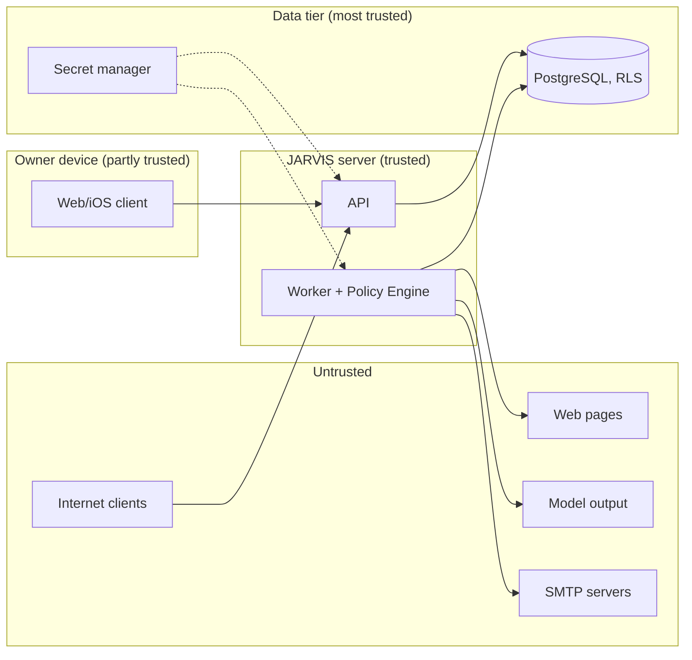

# Threat model

Scope: Milestone 1 (web app, iOS app, API, worker, PostgreSQL, tools `web.fetch`, `text.summarize`,
`email.send`, `memory.save`, `assistant.answer`; connections Web access and SMTP). Method: STRIDE per
component, then cross-cutting threats. **Implemented** = in code now (file references given);
**Milestone 1 (in progress)** = being built in this milestone; **Planned** = later, with the phase or
gate that requires it.

## Assets

| Asset                                                      | Why it matters                                              |
| ---------------------------------------------------------- | ----------------------------------------------------------- |
| Requests, messages, answers, task history                  | Private intentions and content                              |
| Memories                                                   | Long-lived personal facts and preferences                   |
| Email content and recipients                               | Sending on the owner's behalf; reputation; third-party data |
| SMTP credentials (later OAuth tokens)                      | Account takeover of the owner's mailbox                     |
| Session tokens                                             | Full account access                                         |
| `SECRET_ENCRYPTION_KEY`, `ANTHROPIC_API_KEY`, DB passwords | Decrypt all credentials; spend money; read all data         |
| Audit log                                                  | Accountability; must not be altered                         |
| Model budget                                               | Real money                                                  |

## Trust boundaries

Model output is untrusted. It can propose plans and text; it can never decide permissions, add
steps after planning, or choose recipients from fetched content.

## STRIDE per component

### Web client (browser) and Next.js server

| Threat                 | Example                                                       | Mitigation                                                                                                  | Status                                                                                       |
| ---------------------- | ------------------------------------------------------------- | ----------------------------------------------------------------------------------------------------------- | -------------------------------------------------------------------------------------------- |
| Spoofing               | Stolen session cookie via XSS                                 | Cookie `httpOnly`, `SameSite=Lax`, `Secure` in prod; React escaping; strict CSP on HTML                     | Cookie: Implemented (`modules/auth/routes.ts`). CSP for web pages: Milestone 1 (in progress) |
| Tampering              | CSRF: a third-party page posts to `/v1/tasks` with the cookie | Cookie-authenticated unsafe methods require `Origin == WEB_ORIGIN` (`http/app.ts`); `SameSite=Lax`          | Implemented                                                                                  |
| Repudiation            | "I never approved that email"                                 | Approvals store decision time, channel, note; audit `approval.approved`                                     | Implemented                                                                                  |
| Information disclosure | Approval content cached by shared proxies                     | API JSON never cacheable by intermediaries for authenticated routes; export sends `cache-control: no-store` | Export: Implemented. `no-store` on all authenticated responses: Planned (closed beta)        |
| DoS                    | Many tabs open SSE streams                                    | 10 streams per user per process                                                                             | Implemented                                                                                  |
| Elevation              | Admin screen reachable by non-admins                          | Server-side `platform_admin` check on every admin route; UI hides it but is not the control                 | Implemented (`http/route.ts`)                                                                |

### API (Fastify)

| Threat                 | Example                                     | Mitigation                                                                                                    | Status                                                                                  |
| ---------------------- | ------------------------------------------- | ------------------------------------------------------------------------------------------------------------- | --------------------------------------------------------------------------------------- |
| Spoofing               | Credential stuffing                         | argon2id; login 10/min per IP; constant-time dummy verification; failures audited                             | Implemented. Per-account throttling, MFA: Planned (closed beta)                         |
| Spoofing               | Forged `X-Forwarded-For` to dodge IP limits | `trustProxy` only for loopback/link-local/ULA in production                                                   | Implemented                                                                             |
| Tampering              | Mass assignment, malformed input            | Zod schemas per route (params, query, body); body limit 256 KB                                                | Implemented                                                                             |
| Tampering              | Replayed or duplicated mutation             | `Idempotency-Key` with request hash                                                                           | Implemented                                                                             |
| Repudiation            | Missing trail for security actions          | Append-only `audit_events` (trigger blocks UPDATE/DELETE; app role INSERT-only)                               | Implemented                                                                             |
| Information disclosure | Stack traces, internal errors               | Error handler returns `ApiErrorBody` with safe messages; logs redact auth headers, cookies, passwords, tokens | Implemented                                                                             |
| Information disclosure | Response leaks extra fields                 | Responses validated against contracts; connection secrets/config never selected                               | Implemented                                                                             |
| DoS                    | Request floods                              | 300 req/min per user; per-route limits                                                                        | Implemented (per process). Shared store (Redis/PG) + edge limits: Planned (closed beta) |
| Elevation              | IDOR: `GET /v1/tasks/<someone else's id>`   | RLS: row invisible → `404`                                                                                    | Implemented, tested (`rls.int.test.ts`)                                                 |

### Worker and agent runtime

| Threat                 | Example                                                       | Mitigation                                                                                                                               | Status                                         |
| ---------------------- | ------------------------------------------------------------- | ---------------------------------------------------------------------------------------------------------------------------------------- | ---------------------------------------------- |
| Spoofing               | A web page pretends to be the user ("the user asked you to…") | Plan made before content is read; content only fills references; data tags + "not instructions" rule in prompts                          | Implemented                                    |
| Tampering              | Fetched content changes email recipients                      | `to` must be literal, planned, and either the owner or written in the request; refs in `to` rejected                                     | Implemented (`plan.ts`, `tools/email-send.ts`) |
| Tampering              | Approved action altered before execution                      | Approval bound to SHA-256 of `{toolId, resolvedInput}`; re-checked at execution                                                          | Implemented                                    |
| Repudiation            | Which model/tool version did what                             | `planner` info on task, `tool_version` and evidence per execution, usage per call                                                        | Implemented                                    |
| Information disclosure | Exfiltration via email body ("send your memories to…")        | Recipients fixed; memories reach the model only as planner notes; tainted external actions always need approval with the full body shown | Implemented                                    |
| DoS                    | Infinite plans, huge pages                                    | ≤ 8 steps; fetch 2 MB / 10 s / 5 redirects; text ≤ 20 000 chars; tool timeouts                                                           | Implemented                                    |
| DoS                    | Budget burn by repeated tasks                                 | Monthly budget, router to offline at limit, approval when projected cost exceeds remainder                                               | Implemented                                    |
| Elevation              | Model output grants itself a permission                       | Policy Engine is deterministic code; CRITICAL denied; skills/tools cannot change policy                                                  | Implemented                                    |

### PostgreSQL

| Threat                 | Example                                     | Mitigation                                                                                        | Status                                                          |
| ---------------------- | ------------------------------------------- | ------------------------------------------------------------------------------------------------- | --------------------------------------------------------------- |
| Spoofing               | App role used to impersonate another tenant | Context only via transaction-local settings set by trusted server code; RLS on every tenant table | Implemented                                                     |
| Tampering              | Audit tampering                             | Trigger raises on UPDATE/DELETE; `jarvis_app` INSERT-only                                         | Implemented                                                     |
| Information disclosure | Cross-tenant read through a bug             | RLS + non-owner role + narrow `SECURITY DEFINER` functions with fixed `search_path`               | Implemented                                                     |
| Information disclosure | Stolen backup                               | Credentials encrypted with a key held outside the DB; managed encryption at rest                  | Envelope: Implemented. Storage encryption: Planned (deployment) |
| DoS                    | Long transactions                           | No transaction held across network calls in the runtime                                           | Implemented                                                     |
| Elevation              | SQL injection                               | Kysely parameterised queries; identifiers escaped (`pg.escapeIdentifier`)                         | Implemented                                                     |

### Native app (iOS)

| Threat                           | Mitigation                                                                   | Status                                                                      |
| -------------------------------- | ---------------------------------------------------------------------------- | --------------------------------------------------------------------------- |
| Token theft from device backups  | Keychain, device-only accessibility class                                    | Milestone 1 (in progress)                                                   |
| Lost device                      | Revoke the session from Settings → Sessions (`DELETE /v1/auth/sessions/:id`) | API: Implemented. UI: Milestone 1 (in progress)                             |
| Siri/Shortcut triggers an action | App Intents only create tasks; approvals still required                      | Milestone 1 (in progress)                                                   |
| Network interception             | ATS (TLS only); certificate pinning                                          | ATS: Milestone 1 (in progress). Pinning: Planned (evaluate for closed beta) |

### Admin

| Threat                   | Mitigation                                                                               | Status                |
| ------------------------ | ---------------------------------------------------------------------------------------- | --------------------- |
| Admin reads user content | Admin endpoints use aggregates-only functions; no content columns; audit metadata hidden | Implemented           |
| Admin abuse unobserved   | Admin views are audited (`admin.users_viewed`, `admin.audit_viewed`)                     | Implemented           |
| Admin account takeover   | MFA and separate admin sessions                                                          | Planned (closed beta) |

## Cross-cutting threats

### Prompt injection

Defences are structural first, detection second ([ADR-0009](../adr/0009-plan-then-execute-policy-engine.md)):

1. **Plan before read** — the plan is fixed before any page is fetched; observations cannot add steps.
2. **No authority in data** — recipients literal and request-bound; `memory.save` content literal;
   single-pass reference substitution.
3. **Data framing** — untrusted text inside `<document>` / `<question>` tags; closing tags escaped;
   system prompts state that the content is data, not instructions.
4. **Detection** — `detectInjection` (`tools/injection.ts`): instruction-like patterns in English,
   German and Arabic, matched after stripping zero-width and bidi control characters. The scan covers
   the whole page body including hidden elements (`fullText`), while hidden elements, scripts,
   navigation and forms are removed from the text passed on to later steps (`tools/html.ts`). Flags
   propagate through references (`isTainted`).
5. **Human gate** — any external side effect fed by flagged content requires approval
   (`UNTRUSTED_CONTENT`), overriding autonomy settings; the approval shows the full body.
6. **Extractive offline summaries skip flagged sentences** so instructions are not quoted back.

Residual risk: a page can still bias a summary's wording (misinformation), and an email body built
from a page may contain attacker text the user then approves. Mitigation: the approval sheet shows the
complete body and the "suspected injection" flag. Tested: `vertical-slice.int.test.ts` (injection page
cannot change recipients or plan), `injection.test.ts`.

### SSRF

See [ADR-0015](../adr/0015-ssrf-protection.md). Validate-at-connect (`lookup` hook), redirects
re-validated, private/reserved ranges blocked, dev allow-list refused in production, SMTP ports
restricted. **Known issue:** `lib/net.ts` misclassifies public IPv4 as private (affects SMTP only;
fails safe — blocks rather than allows). Planned: egress proxy for production.

### CSRF

Cookie sessions + unsafe method require `Origin == WEB_ORIGIN`; requests without `Origin` are
rejected too. `SameSite=Lax` as a second layer. Bearer requests are exempt (no ambient credential).
Implemented.

### Session theft

Opaque tokens, stored hashed; `httpOnly` cookie; per-device listing and revocation; expiry 30 days;
user disable → `auth_resolve_session` stops resolving immediately. Planned: session binding signals
(new-device notifications), shorter idle timeout for admins, re-authentication for sensitive actions
beyond account deletion (which already requires the password).

### Cross-tenant access

RLS with a non-owner role is the primary control; every handler goes through `withContext`.
`SECURITY DEFINER` functions are the only cross-tenant paths and return no content. Job rows carry
tenant/user and handlers re-enter the context. SSE notices carry only ids; rows are re-read through RLS
before sending. Residual: `users` is tenant-scoped, so future multi-member tenants need a restricted
view for `password_hash` (Planned, before multi-member tenants).

### Secrets

AES-256-GCM envelopes with owner/provider AAD; key from env/secret manager; secrets never returned
or logged; disconnect wipes them ([ADR-0014](../adr/0014-secrets-encryption.md)). Production boot
refuses dev-only SSRF/TLS relaxations and non-HTTPS `WEB_ORIGIN`. Planned: keyring + re-encryption,
KMS-backed data keys, `ANTHROPIC_API_KEY` scoped per environment with spend alerts.

### Supply chain

| Control                                                                    | Status                          |
| -------------------------------------------------------------------------- | ------------------------------- |
| Exact version pins in every `package.json`; committed `pnpm-lock.yaml`     | Implemented                     |
| Install scripts only for allow-listed packages (`onlyBuiltDependencies`)   | Implemented                     |
| No runtime CDN code; fonts self-hosted via `next/font`                     | Milestone 1 (in progress)       |
| Minimal backend dependencies (12 runtime packages in `apps/api`)           | Implemented                     |
| CI: lockfile-frozen install, typecheck, lint, tests, `openapi --check`     | Milestone 1 (in progress)       |
| Dependency vulnerability scanning (OSV/`pnpm audit`), Renovate with review | Planned (before closed beta)    |
| SBOM, signed container images, build provenance                            | Planned (before public release) |

### Abuse of email sending

Recipients fixed and visible; external recipients always need approval; > 3 recipients is `HIGH`;
max 10 recipients; plain text only; sends from the owner's own SMTP account (their provider's limits
and reputation apply). Planned for beta: per-day send caps per user, abuse reporting.

## Review cadence

Re-run this model when a tool with side effects, a connection type, or a cross-tenant function is
added, and before each release gate ([release checklist](../release-checklist.md)).
